# Graph Theory for Networks and Dependencies

**Math used:** directed graphs, adjacency lists and matrices, topological sort, cycle detection, shortest paths, reachability · **Level needed:** 501 (graph theory unit; 101 to start) · **Time:** 2 hours
**Run it:** `go run ./code/deploy-order`

## The Real Problem

A platform has nine services. The load balancer needs the web tier. The web tier needs the API. The API needs auth, a cache, a queue and the database. A background worker needs the queue and the database. A cold start of the whole stack (a new region, a disaster recovery drill, a fresh cluster) needs an order that never starts a service before the things it needs. A shutdown needs the reverse order.

Then the questions get sharper. Someone adds a database init hook that calls a web health check, and startup hangs forever. Traffic between regions needs the lowest-latency route, not the route with the fewest hops. During an incident the first question is: if the database goes down, who breaks?

Each of these is a graph question with an old, well-tested algorithm behind it. Ansible role dependencies, the Terraform resource graph, and systemd `After=` and `Requires=` run the same math you build here in Go. You already operate these tools. This workshop shows what they do under the hood.

## The Math You Need

* [501 Linear Algebra, Probability and Discrete Math](../../course/501/README.md): the graph theory unit covers vertices, edges, paths, cycles and trees. This workshop uses directed graphs and weighted graphs from it.
* [Graph Theory Track](../../tracks/graph-theory/README.md): adjacency representations, breadth-first and depth-first search, shortest paths, and connectivity.
* [Discrete Math Track](../../tracks/discrete-math/README.md): sets and relations. A dependency graph without cycles is a partial order (some pairs have a required order, others do not care), and a start order is one way to line them all up.
* [101 Foundations](../../course/101/README.md): to start, you only need counting and addition. Dijkstra adds latencies. Nothing more.

Words used below, in plain terms:

* **Vertex** (plural **vertices**): a dot. Here, a service or a region. Also called a node.
* **Edge**: a line between two dots. A **directed edge** is an arrow: it has a start and an end.
* **Weight**: a number on an edge, such as latency in milliseconds.
* **Path**: a walk along edges from one vertex to another.
* **Cycle**: a path that comes back to where it started.
* **DAG**: directed acyclic graph. Arrows, and no cycles.

## Picture It

<!-- diagram: type=graph-anatomy panels=edge,directed-edge,weighted-edge,degree caption="Parts of a graph" -->
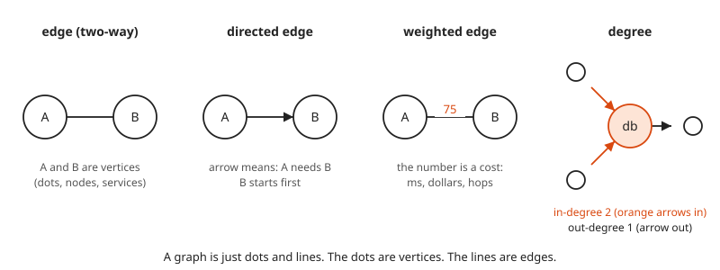

A graph is dots and lines. That is all of it. The arrow adds direction. The number adds cost. The **in-degree** of a vertex counts arrows coming in. The **out-degree** counts arrows going out. Everything else in this workshop is built from these four pictures.

<!-- diagram: type=dag layout=layers nodes=lb,web,api,auth,worker,config,db,cache,queue edges="lb>web,web>api,api>auth,api>cache,api>queue,api>db,auth>db,auth>config,worker>queue,worker>db" caption="Service dependency DAG in layers" -->
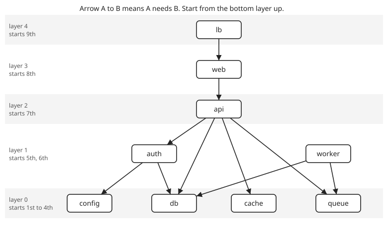

This is the whole platform as a graph. An arrow from A to B means A needs B. The layer of a service is the length of the longest arrow chain below it. Layer 0 services need nothing and start first. Every arrow points down, never up. That one fact is what makes a safe start order possible.

<!-- diagram: type=digraph highlight-cycle=api,auth,db,web dashed-edge=db>web caption="One bad edge creates a cycle" -->
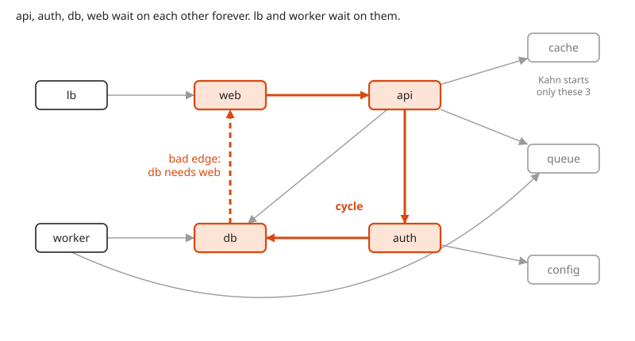

Add one edge, db needs web, and four services wait on each other in a ring. web waits for api, api waits for auth, auth waits for db, and db waits for web. Nobody goes first. lb and worker are not in the ring, but they wait on it. Only cache, queue and config start. It is a very polite deadlock.

<!-- diagram: type=weighted-graph nodes=7 source=us-east target=ap-south path=us-east,eu-west,ap-south caption="Lowest-latency route between regions" -->
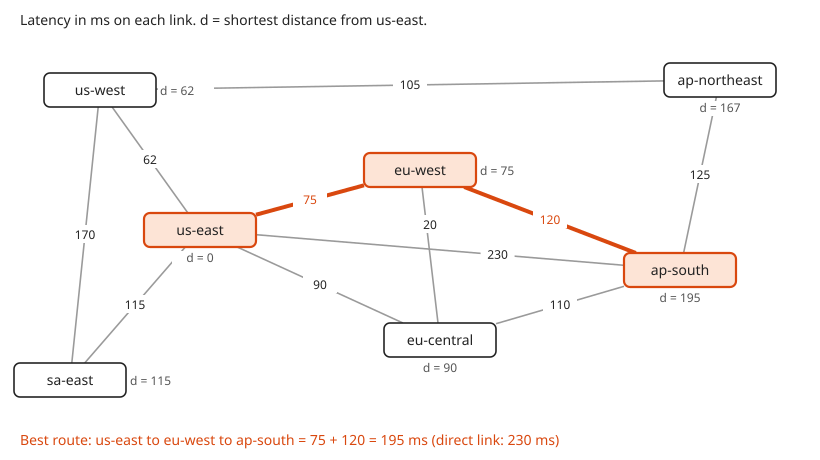

Now the edges carry weights: round-trip latency in milliseconds. The direct link from us-east to ap-south is one hop and 230 ms. The route through eu-west is two hops and 75 + 120 = 195 ms. Fewest hops and lowest latency are different questions with different answers. The `d = ...` label next to each region is its final shortest distance from us-east.

<!-- diagram: type=dag highlight-reverse-reachable-from=db caption="Blast radius of db" -->
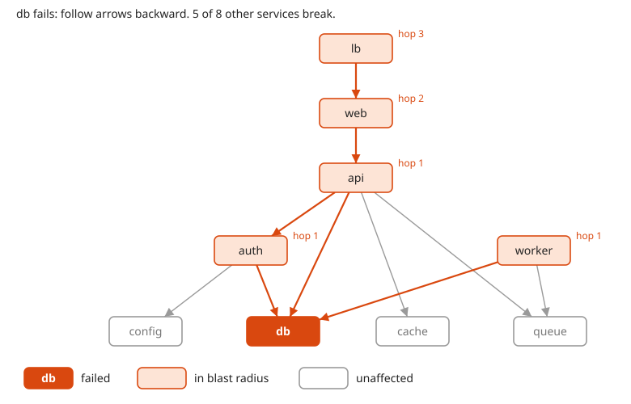

To find who breaks when db fails, follow the arrows backward from db. One hop back gives api, auth and worker. Two hops gives web. Three hops gives lb. Five of the eight other services break. The hop number shows how far the failure travels.

## Guided Build

All three programs live in their own folder under `code/`. Run them from the workshop folder:

```txt
go run ./code/deploy-order
go run ./code/dijkstra
go run ./code/blast-radius
```

### Step 1: Store the Graph Two Ways

A graph is a pair $G = (V, E)$: a set of vertices $V$ and a set of edges $E$. Each directed edge is an ordered pair $(a, b)$, meaning an arrow from $a$ to $b$. Here $|V| = 9$ and $|E| = 10$. The bars $|\cdot|$ mean "how many".

There are two standard ways to store a graph in memory.

* **Adjacency list:** for each vertex, a list of where its arrows go. Memory grows with $|V| + |E|$. In Go this is a `map[string][]string`.
* **Adjacency matrix:** a square grid with one row and one column per vertex. Put a 1 in row $i$, column $j$ when there is an arrow from $i$ to $j$, and 0 otherwise. Memory grows with $|V|^2$. Checking one edge is a single lookup.

$$A_{ij} = \begin{cases} 1 & \text{if there is an edge from } v_i \text{ to } v_j \\ 0 & \text{otherwise} \end{cases}$$

<!-- diagram: type=adjacency-compare nodes=app,db,cache,disk edges="app>db,app>cache,db>disk,cache>disk" caption="One graph, two storage formats" -->
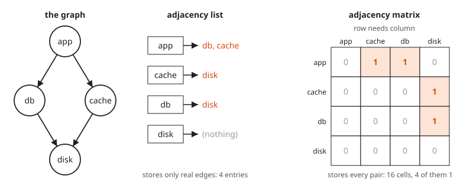

The small graph above has four vertices and four edges. The list stores four entries. The matrix stores sixteen cells, twelve of them zero. The matrix spends most of its memory saying "no edge here".

```go
// Edge A -> B means "A needs B": B must be up before A starts.
type Graph struct {
	nodes []string
	needs map[string][]string // out-edges: what a service depends on
}
```

`go run ./code/deploy-order` prints both forms for the nine-service graph:

```txt
Adjacency list (service -> what it needs):
  api     -> [auth, cache, db, queue]
  auth    -> [config, db]
  cache   -> []
  config  -> []
  db      -> []
  lb      -> [web]
  queue   -> []
  web     -> [api]
  worker  -> [db, queue]

Adjacency matrix (row needs column, 1 = edge):
         api aut cac con db  lb  que web wor 
  api      .   1   1   .   1   .   1   .   . 
  auth     .   .   .   1   1   .   .   .   . 
  cache    .   .   .   .   .   .   .   .   . 
  config   .   .   .   .   .   .   .   .   . 
  db       .   .   .   .   .   .   .   .   . 
  lb       .   .   .   .   .   .   .   1   . 
  queue    .   .   .   .   .   .   .   .   . 
  web      1   .   .   .   .   .   .   .   . 
  worker   .   .   .   .   1   .   1   .   . 
```

The matrix holds 81 cells and only 10 of them are 1. Real dependency graphs look like this: mostly empty. A graph like that is called **sparse**, and the list wins. The row sum of the matrix is the out-degree (how many things a service needs). The column sum is the in-degree (how many services need it).

### Step 2: Topological Sort With the Kahn Algorithm

A **topological order** is a list of every vertex where, for each arrow $A \to B$, $B$ comes before $A$. In plain words: a start order where nothing starts before what it needs. It exists exactly when the graph is a DAG.

The Kahn algorithm (Arthur Kahn, 1962) keeps one number per service: how many of its dependencies are not running yet.

$$\text{remaining}(v) = \text{out-degree of } v$$

1. Put every service with $\text{remaining}(v) = 0$ in a first-in first-out queue.
2. Take the first service from the queue and start it. For every service that needs it, subtract one. Any number that hits zero joins the queue.
3. Repeat until the queue is empty. If every service started, the order is valid.

Each vertex enters the queue once and each edge is subtracted once. The work grows with $|V| + |E|$.

<!-- diagram: type=filmstrip algorithm=kahn graph="app>db,app>cache,db>disk,cache>disk" frames=5 caption="Kahn on four services, one frame per step" -->


Read the frames left to right. Orange means started. The small number next to each service is its remaining count. When disk starts, db and cache both drop to zero and join the queue. app waits until both of them are up.

```go
for len(queue) > 0 {
	n := queue[0]
	queue = queue[1:]
	order = append(order, n)
	var ready []string
	for _, m := range rev[n] { // rev[n] = services that need n
		remaining[m]--
		if remaining[m] == 0 {
			ready = append(ready, m)
		}
	}
	queue = append(queue, ready...)
}
```

The same run on the nine services:

```txt
Kahn algorithm (queue = services with zero unmet dependencies):
  step start    newly ready                        queue after
  0    -        -                                  [cache config db queue]
  1    cache    -                                  [config db queue]
  2    config   -                                  [db queue]
  3    db       auth                               [queue auth]
  4    queue    worker                             [auth worker]
  5    auth     api                                [worker api]
  6    worker   -                                  [api]
  7    api      web                                [web]
  8    web      lb                                 [lb]
  9    lb       -                                  []

Start order: cache -> config -> db -> queue -> auth -> worker -> api -> web -> lb
Stop order:  lb -> web -> api -> worker -> auth -> queue -> db -> config -> cache
Unprocessed: 0
```

Watch step 3. Starting db drops auth from one unmet dependency to zero (config already started at step 2), and auth joins the queue. Step 4 does the same for worker. The api service needs four things and becomes ready only at step 5, when auth, the last of the four, starts.

Services that sit in the queue at the same time have no order between them. They can start in parallel. The tools you already run do exactly this:

* **Ansible:** roles listed under `dependencies` in `meta/main.yml` run before the role that lists them. Ansible flattens that tree into one ordered run.
* **Terraform:** every resource reference (`aws_instance.web` reading `aws_subnet.a.id`) is an edge. `terraform graph` prints the DAG in DOT format. `terraform apply` walks it and creates independent resources in parallel (the queue). `terraform destroy` walks it in reverse.
* **systemd:** `After=db.service` is an ordering edge. `Requires=db.service` is a dependency edge that also pulls db in. systemd builds a graph of jobs and starts every unit whose ordering constraints are met, in parallel.

### Step 3: Detect the Cycle

Add the bad edge db needs web. Kahn runs out of zero-count services early:

```txt
=== Part 2: add bad edge db -> web (db init calls a web health check) ===
Kahn algorithm (queue = services with zero unmet dependencies):
  step start    newly ready                        queue after
  0    -        -                                  [cache config queue]
  1    cache    -                                  [config queue]
  2    config   -                                  [queue]
  3    queue    -                                  []

Kahn placed 3 of 9 services: cache config queue
Stuck: api(2 unmet) auth(1 unmet) db(1 unmet) lb(1 unmet) web(1 unmet) worker(1 unmet)
```

The test is simple: if the order is shorter than the list of services, a cycle exists. Kahn tells you **that** a cycle exists and who is stuck. It does not tell you **which** edges form the loop. lb and worker are stuck only because they sit behind the loop.

To name the loop, use **depth-first search** (DFS): walk as deep as possible along arrows, and back up only when stuck. Paint each vertex one of three colors:

* **WHITE:** not visited yet.
* **GRAY:** on the current walk. Entered, not finished.
* **BLACK:** finished. Everything below it is explored, and no loop runs through it.

An arrow $u \to v$ where $v$ is GRAY is a **back edge**. $v$ is somewhere above $u$ on the current walk. The walk from $v$ down to $u$, plus this arrow back up to $v$, is a cycle. A directed graph has a cycle exactly when DFS finds a back edge.

<!-- diagram: type=dfs-state colors=api:gray,auth:gray,db:gray,web:gray,config:black back-edge=web>api caption="Three-color DFS at the moment of the back edge" -->
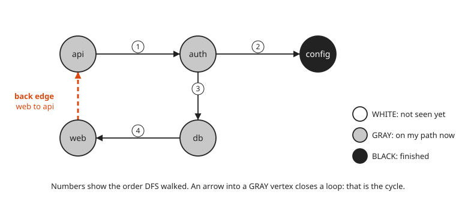

The numbers show the walk. DFS goes api, then auth, then config (a dead end, painted BLACK), then back to auth and on to db, then web. web points at api, and api is still GRAY. Loop found.

```go
color[u] = gray
for _, v := range g.needs[u] {
	if color[v] == gray { // back edge: cycle found
		...
	}
	if color[v] == white {
		parent[v] = u
		if visit(v) {
			return true
		}
	}
}
color[u] = black
```

```txt
Three-color DFS:
  back edge web -> api (api is GRAY)
  cycle: api -> auth -> db -> web -> api
```

This is the message you want from a deploy tool: not "cycle detected" but the exact loop. GNU make prints `Circular ... dependency dropped`. systemd logs `Found ordering cycle` and lists the units in it.

A second loop hides here too: api needs db directly, which gives api, db, web, api. DFS stops at the first back edge it finds. Removing the one bad edge (db needs web) breaks both loops.

### Step 4: Shortest Paths With the Dijkstra Algorithm

Give every edge a weight $w(u, v) \ge 0$. The **distance** $d(v)$ from a source $s$ is the smallest total weight of any path from $s$ to $v$. The Dijkstra algorithm (Edsger Dijkstra, 1956, reportedly designed in about twenty minutes over coffee) grows a set of finished vertices one at a time:

1. Set $d(s) = 0$ and $d(v) = \infty$ (unknown) for every other vertex.
2. Pick the unfinished vertex $u$ with the smallest $d(u)$. Mark it finished.
3. **Relax** each edge out of $u$. Relax means: check whether going through $u$ is a shorter way to reach the neighbor.

$$d(v) \leftarrow \min\bigl(d(v),\ d(u) + w(u, v)\bigr)$$

4. Repeat until every vertex is finished.

```go
// Pick the unfinished region with the smallest distance.
u, best := "", inf
for _, r := range regions {
	if !done[r] && dist[r] < best {
		u, best = r, dist[r]
	}
}
done[u] = true
for _, e := range g[u] {
	if !done[e.to] && dist[u]+e.ms < dist[e.to] {
		dist[e.to] = dist[u] + e.ms
		prev[e.to] = u
	}
}
```

Run `go run ./code/dijkstra`. Each row is the **frontier**: the best-known distance to every unfinished region after one more region is finished.

```txt
=== Dijkstra from us-east ===
Frontier = tentative distances of regions not yet finalized (inf = unknown)
step finalize                us-east       us-west       sa-east       eu-west    eu-central      ap-south  ap-northeast
1    us-east=0                  done            62           115            75            90           230           inf
2    us-west=62                 done          done           115            75            90           230           167
3    eu-west=75                 done          done           115          done            90           195           167
4    eu-central=90              done          done           115          done          done           195           167
5    sa-east=115                done          done          done          done          done           195           167
6    ap-northeast=167           done          done          done          done          done           195          done
7    ap-south=195               done          done          done          done          done          done          done
```

Read the ap-south column. It starts at 230 (the direct link). It drops to 195 at step 3, when eu-west is finished: $75 + 120 = 195 < 230$. It stays there. At step 4 eu-central offers $90 + 110 = 200$, and loses.

<!-- diagram: type=number-line range=0..200 marks=us-east:0,us-west:62,eu-west:75,eu-central:90,sa-east:115,ap-northeast:167,ap-south:195 caption="Dijkstra finishes regions in order of distance" -->
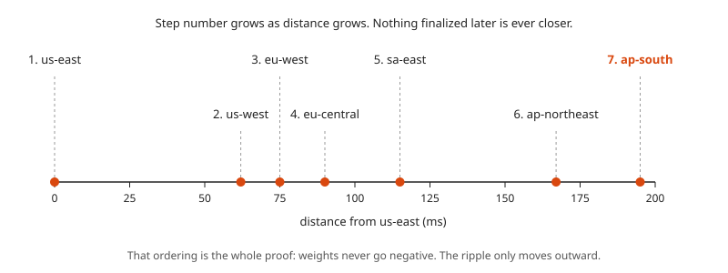

This picture is the reason Dijkstra works. Regions are finished in order of distance, like a ripple spreading from a stone dropped at us-east. When the ripple reaches $u$, every other route to $u$ has to leave the finished area through some vertex at least as far away as $u$. Weights are never negative. A detour can only add, never subtract. No later route can beat $d(u)$.

### Step 5: Breadth-First Search for Hop Count

When every edge counts as 1, **breadth-first search** (BFS) finds shortest paths with a plain queue. BFS visits vertices in rings: everything 0 hops away, then 1 hop, then 2.

$$\text{hops}(v) = \text{hops}(\text{parent of } v) + 1$$

<!-- diagram: type=rings center=us-east ring1=us-west,sa-east,eu-west,eu-central,ap-south ring2=ap-northeast caption="BFS rings by hop count" -->
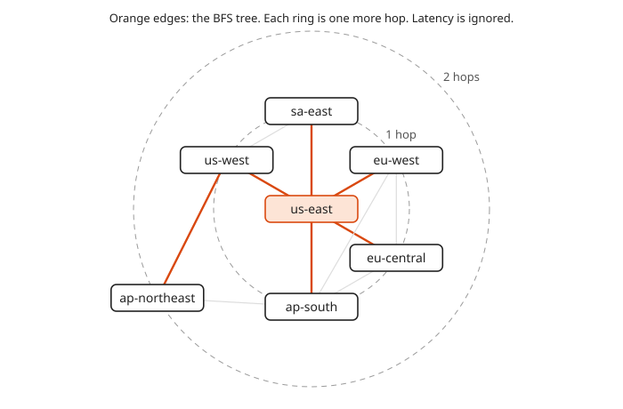

BFS ignores the numbers on the edges. ap-south sits on the first ring, one hop away, even though that hop costs 230 ms.

```go
for len(queue) > 0 {
	u := queue[0]
	queue = queue[1:]
	for _, e := range g[u] {
		if _, seen := hops[e.to]; !seen {
			hops[e.to] = hops[u] + 1
			prev[e.to] = u
			queue = append(queue, e.to)
		}
	}
}
```

```txt
Final latency from us-east:
  us-east          0 ms                           via us-east
  us-west         62 ms  ######                   via us-east > us-west
  sa-east        115 ms  ###########              via us-east > sa-east
  eu-west         75 ms  #######                  via us-east > eu-west
  eu-central      90 ms  #########                via us-east > eu-central
  ap-south       195 ms  ###################      via us-east > eu-west > ap-south
  ap-northeast   167 ms  ################         via us-east > us-west > ap-northeast

=== BFS (hop count) from us-east ===
  us-east       hops = 0
  us-west       hops = 1
  sa-east       hops = 1
  eu-west       hops = 1
  eu-central    hops = 1
  ap-south      hops = 1
  ap-northeast  hops = 2

Route us-east -> ap-south
  fewest hops : us-east > ap-south                   hops = 1, 230 ms
  lowest ms   : us-east > eu-west > ap-south         hops = 2, 195 ms
```

The RIP routing protocol uses hop count, which is BFS thinking. OSPF and IS-IS run Dijkstra on link costs. The last two lines show why the difference matters: the shortest-looking route is 35 ms slower. Fewer hops is not the same as faster, in networks or in airports.

### Step 6: Blast Radius as Reverse Reachability

A vertex $v$ can **reach** $x$ when there is a path of arrows from $v$ to $x$. The **blast radius** of $x$ is every service that can reach $x$:

$$\text{blast}(x) = \{\, v \ne x : \text{there is a path } v \to \cdots \to x \,\}$$

Flip every arrow (build the needed-by list) and run BFS from $x$. Everything BFS reaches is in the blast radius.

```go
for _, v := range sortedCopy(neededBy[u]) {
	if !seen[v] {
		seen[v] = true
		queue = append(queue, v)
		out = append(out, v)
	}
}
```

Run `go run ./code/blast-radius`:

```txt
=== Degree table (in = dependents, out = dependencies) ===
  service  in  out  fan-in bar
  db        3    0  ############
  queue     2    0  ########
  api       1    4  ####
  auth      1    2  ####
  cache     1    0  ####
  config    1    0  ####
  web       1    1  ####
  lb        0    1  
  worker    0    2  

=== Blast radius (reverse reachability by BFS on needed-by edges) ===
  api     2  ########                     [lb web]
  auth    3  ############                 [api lb web]
  cache   3  ############                 [api lb web]
  config  4  ################             [api auth lb web]
  db      5  ####################         [api auth lb web worker]
  lb      0                               []
  queue   4  ################             [api lb web worker]
  web     1  ####                         [lb]
  worker  0                               []

Trace for db:
  pop db      adds [api auth worker]  queue [api auth worker]
  pop api     adds [web]  queue [auth worker web]
  pop auth    adds []  queue [worker web]
  pop worker  adds []  queue [web]
  pop web     adds [lb]  queue [lb]
  pop lb      adds []  queue []
```

The in-degree counts direct dependents. A high in-degree (high **fan-in**) is a quick risk signal. The blast radius is the full answer.

<!-- diagram: type=paired-bars series=in-degree,blast-radius services=db,queue,config,auth,cache,api,web,lb,worker caption="In-degree versus blast radius" -->
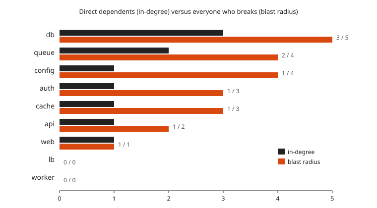

Compare config and cache. Each has in-degree 1. Yet config has a blast radius of four and cache only three: config sits under auth, which sits under api. In-degree sees one level down the chain. Reachability sees the whole chain. Quiet services with one dependent are not always quiet failures.

### Step 7: Single Points of Failure (Optional)

Treat every edge as a two-way link. Ask which single vertex, when removed, splits the graph into separate pieces. Such a vertex is an **articulation point**, also called a cut vertex.

<!-- diagram: type=undirected-graph highlight=web,api,auth caption="Articulation points" -->
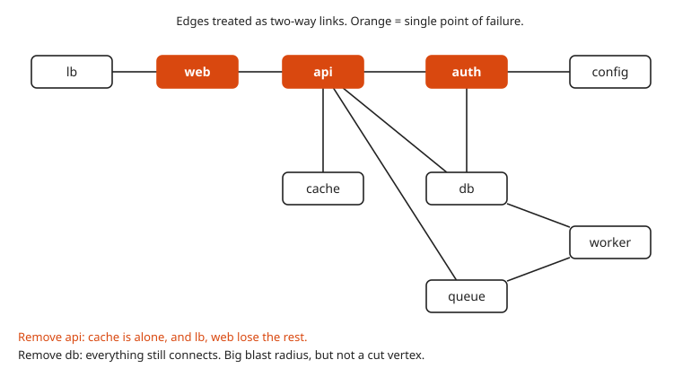

The Tarjan method finds them in one DFS. It records $\text{disc}(u)$, the step at which DFS first reached $u$, and $\text{low}(v)$, the earliest step reachable from the part of the walk below $v$ using at most one shortcut edge back up. A non-root vertex $u$ is a cut vertex when some child $v$ below it has

$$\text{low}(v) \ge \text{disc}(u)$$

In plain words: nothing below $v$ has a way around $u$. The root of the DFS is a cut vertex when it has two or more children.

```txt
=== Single points of failure (articulation points, edges treated as undirected) ===
  articulation points: api auth web
  remove api   -> pieces: auth,config,db,queue,worker | cache | lb,web
  remove auth  -> pieces: api,cache,db,lb,queue,web,worker | config
  remove web   -> pieces: api,auth,cache,config,db,queue,worker | lb
```

db has the biggest blast radius but is not a cut vertex: api, auth and worker still connect to each other by other lines. The two ideas answer different questions. Blast radius asks "who loses a dependency?" Articulation points ask "where does the topology pinch down to one box?"

## Worked Numbers

### Example 1: Kahn by Hand on Four Services

Edges: app needs db, app needs cache, db needs disk, cache needs disk.

```txt
remaining: app=2 db=1 cache=1 disk=0         count out-edges (what each needs)
queue [disk]                                 only disk has 0 unmet
pop disk   -> db 1->0, cache 1->0            db and cache both need disk
queue [db cache]                             both now ready, either order works
pop db     -> app 2->1                       app still needs cache
pop cache  -> app 1->0                       app is ready
queue [app]
pop app                                      queue empty
order: disk, db, cache, app                  4 of 4 placed: no cycle
```

### Example 2: Dijkstra Relaxation for ap-south

```txt
d(ap-south) = 230                            step 1: direct edge from us-east, 0 + 230
finalize eu-west at 75                       step 3: smallest unfinished distance
75 + 120 = 195 < 230 -> d(ap-south) = 195    relax eu-west -> ap-south
finalize eu-central at 90                    step 4
90 + 110 = 200 > 195 -> no change            relaxation loses
finalize ap-northeast at 167                 step 6
167 + 125 = 292 > 195 -> no change           relaxation loses
finalize ap-south at 195                     step 7: answer, path us-east > eu-west > ap-south
```

### Example 3: Blast Radius of queue

```txt
needed-by(queue) = {api, worker}             reverse edges: api and worker need queue
needed-by(api)   = {web}                     web needs api
needed-by(worker)= {}                        nothing needs worker
needed-by(web)   = {lb}                      lb needs web
needed-by(lb)    = {}                        lb is the top
blast(queue) = {api, worker, web, lb}        4 services, matches the program
```

### Example 4: Matrix vs List Memory at Scale

```txt
V = 2,000 services, E = 6,000 edges          a large microservice estate
matrix cells = V^2 = 4,000,000               one cell per ordered pair
list entries = V + E = 8,000                 one slot per vertex plus one per edge
ratio = 4,000,000 / 8,000 = 500              the list is 500 times smaller
```

## Common Mistakes

* Mixing up edge direction: "A depends on B" and "A sends traffic to B" point opposite ways for startup. Pick one meaning, write it in a comment above the type, and keep it.
* Trusting a Kahn result without checking its length: a short order silently drops the services in and behind a cycle. Always compare the order length with the number of services.
* Using two colors in DFS: with only visited and unvisited, a vertex reached twice through two branches (a diamond, like api to db and api to auth to db) looks like a loop. The GRAY state separates "on my current walk" from "already finished".
* Running Dijkstra with negative weights: the greedy finish step assumes a detour never makes a path shorter. Latency, cost and hop count are safe. Credits or refunds as weights need the Bellman-Ford algorithm.
* Using BFS for weighted routes: BFS minimizes hops, not latency. The us-east to ap-south direct link is one hop and 35 ms slower.
* Treating fan-in as the whole risk picture: config has in-degree 1 and a blast radius of four. Compute reachability.

## Try It

1. How many cells does the adjacency matrix of the nine-service graph have, and how many hold a 1?
2. Add a service `search` that needs db and cache, and make api need search too. Which layer does search land in, and does api change layer?
3. List the blast radius of auth by hand, then check it against the program output.
4. Services x, y, z, w have edges x needs y, y needs z, z needs x, w needs x. How many services does Kahn place, and what cycle does three-color DFS report if it starts at x?
5. The eu-west to ap-south link degrades from 120 ms to 140 ms. What is the new lowest-latency route from us-east to ap-south, and its total?
6. What is the hop count from us-east to ap-northeast, and what is the lowest latency?
7. What is the sum of the in column of the degree table, and why does it equal the sum of the out column?
8. Add a direct edge lb needs api (two-way for this question). Which articulation points remain?
9. Roughly how many steps does the Kahn algorithm take on a graph with 2,000 vertices and 6,000 edges?
10. In a valid start order, can db start before config? Can auth start before config?

<details><summary>Answers</summary>

1. 81 cells, 10 of them are 1: one per edge.
2. search lands in layer 1 (its dependencies db and cache are layer 0). api stays in layer 2: the longest chain below it is still api, auth, db.
3. api, web, lb: auth is needed by api, api by web, web by lb.
4. Zero services: every one has an unmet dependency. DFS from x reports x -> y -> z -> x, and w is stuck behind the cycle.
5. us-east > eu-central > ap-south at 90 + 110 = 200 ms: through eu-west it is now 75 + 140 = 215 ms.
6. 2 hops (through us-west or ap-south) and 167 ms through us-west (62 + 105).
7. 10 for both: each edge adds one to the out-degree of its tail and one to the in-degree of its head.
8. api and auth: web is now on the triangle lb, web, api. Removing it leaves lb connected through api.
9. About $|V| + |E| = 8,000$ steps: each vertex enters the queue once and each edge is subtracted once.
10. Yes: db and config have no edge between them, and either order works. No: auth needs config.

</details>

## Where This Shows Up at Work

* **Deploy and startup ordering:** Terraform plans, Ansible role dependencies, systemd unit ordering, Helm and Argo CD sync waves, and `docker compose` `depends_on` all compute a topological order and run the queue in parallel.
* **Build systems:** Bazel, Make and `go build` treat packages as a DAG. Go rejects import cycles at compile time for the same reason Kahn stalls.
* **Network routing:** OSPF and IS-IS run Dijkstra (they call it shortest path first) on link costs. RIP uses hop count. Global load balancers pick regions by latency-weighted shortest paths.
* **Incident response:** blast radius from a service catalog or tracing data (reverse reachability) tells you who to page and what to fail over.
* **Architecture review:** high fan-in services and articulation points are where redundancy, caching and circuit breakers pay off most.
* **Package managers:** apt, pip and npm resolve install order with topological sort and report dependency cycles.

## Go Deeper

* [Topological Sort on Wolfram MathWorld](https://mathworld.wolfram.com/TopologicalSort.html): the formal definition and its link to partial orders.
* [Dijkstra Algorithm on Wolfram MathWorld](https://mathworld.wolfram.com/DijkstrasAlgorithm.html): a short statement of the algorithm.
* [Terraform graph command](https://developer.hashicorp.com/terraform/cli/commands/graph): print your own infrastructure as a DOT dependency graph.
* [systemd.unit manual](https://www.freedesktop.org/software/systemd/man/latest/systemd.unit.html): the exact meaning of `After=`, `Before=`, `Requires=` and `Wants=`.
* [Go container/heap package](https://pkg.go.dev/container/heap): the priority queue that makes Dijkstra fast on large graphs, instead of the simple scan used here.
* [Graph Theory Track](../../tracks/graph-theory/README.md) and [501 Course](../../course/501/README.md): the theory behind every step here.
