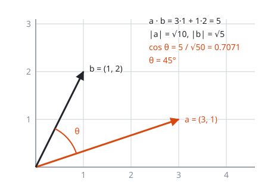
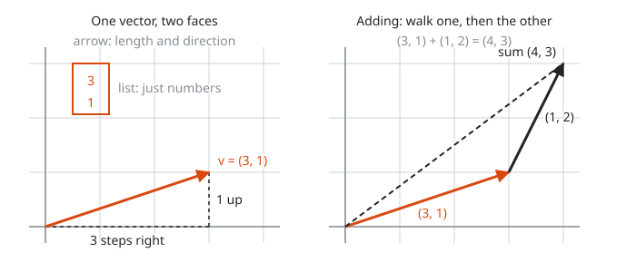
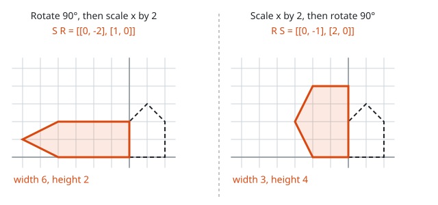
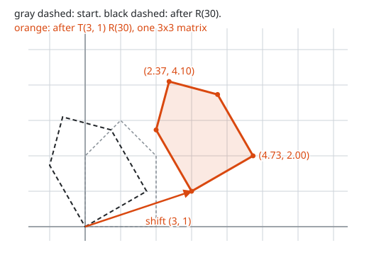
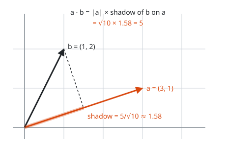
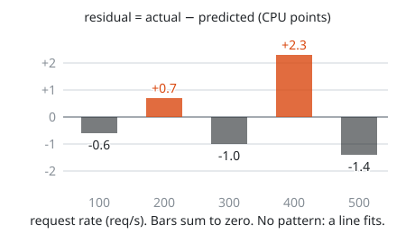

# Linear Algebra for Graphics and ML

**Math used:** vectors, 2x2 and 3x3 matrices, matrix multiplication, dot product, cosine similarity, least squares · **Level needed:** 501 (201 coordinate plane and 301 trig to start) · **Time:** 2 to 3 hours
**Run it:** `go run ./code/transforms` (from this folder)

## The Real Problem

A game draws a house on screen. The player turns the camera 30 degrees and walks three steps right. Every corner of every shape needs new coordinates, sixty times a second. The engine does not run custom trig for each shape. It multiplies each corner by one small grid of numbers that holds the whole move.

A search service stores each document as a list of numbers called an **embedding**. A query becomes the same kind of list. The service returns the documents whose lists point most nearly the same way. That ranking is one multiply-and-add per document.

A capacity planner has five measurements of request rate against CPU. Before a launch, the planner wants a straight line through them, to ask one question: at what rate does CPU hit 80%? Fitting that line is a small matrix equation.

Three jobs, one toolkit: multiply a matrix by a vector, take a dot product, solve a small linear system. This workshop builds all three by hand and in plain Go. Nothing here needs more than a pencil, patience, and `go run`.

## The Math You Need

* [Level 201](../../course/201/README.md): the coordinate plane. A point is a pair (x, y). A line is y = m x + b, with slope m and intercept b.
* [Level 301](../../course/301/README.md) and the [Trigonometry track](../../tracks/trigonometry/README.md): cos and sin. Walk one unit from the origin at angle θ. Your x coordinate is cos θ, your y coordinate is sin θ. That is all the trig this workshop uses.
* [Level 501](../../course/501/README.md): vectors, matrices, matrix multiplication, and the dot product. This workshop puts that material to work.
* [Linear Algebra track](../../tracks/linear-algebra/README.md): the long road from here to eigenvalues, projections, and the SVD. The least-squares fit at the end is a projection in disguise.

## Picture It

Each idea in the Guided Build has its own pictures. Here is the overview: one picture per tool.

<!-- diagram: type=grid-transform matrix=[[1,1],[0,1]] range=-3..3 show=basis,unit-square caption="Unit grid before and after a shear; columns of M are where i-hat and j-hat land" -->
![Two panels. Left: the square unit grid with i-hat (1, 0) in orange and j-hat (0, 1) in black. Right: the same grid after the shear matrix [[1, 1], [0, 1]]; vertical lines lean 45 degrees, i-hat still points to (1, 0), j-hat now points to (1, 1), and the shaded unit square is a parallelogram](img/grid-shear.svg)

A matrix moves the whole plane at once. Watch only the two short arrows. The orange **i-hat** (1, 0) stays put. The black **j-hat** (0, 1) slides to (1, 1). Read the matrix [[1, 1], [0, 1]] column by column: the first column (1, 0) is where i-hat lands, the second column (1, 1) is where j-hat lands. Every other grid line follows those two arrows.

<!-- diagram: type=vector-angle a=(3,1) b=(1,2) caption="Angle between two vectors from the dot product" -->


The dot product turns two arrows into one number. Divide by both lengths and you get the cosine of the angle between them. In ML this is **cosine similarity**: 1 means same direction, 0 means unrelated, -1 means opposite.

<!-- diagram: type=scatter-fit points=(1,20),(2,31),(3,39),(4,52),(5,58) line="y=9.7x+10.9" residuals=dashed caption="Least-squares line through request rate versus CPU" -->


Five dots, one line. The vertical gap from a dot to the line is the **residual**, the part the line fails to explain. Least squares picks the one line with the smallest total of squared gaps.

## Guided Build

### Step 1: Vectors as Arrows and as Lists

A **vector** has two faces. As an arrow, it has a length and a direction. As a list, it is just numbers: (3, 1) means 3 along x and 1 along y. Code works with the list. Your eyes work with the arrow. Same object.

<!-- diagram: type=vector-faces v=(3,1) add=(1,2) caption="A vector as an arrow and as a list; adding tip to tail" -->


$$
\mathbf{v} = \begin{pmatrix} 3 \\ 1 \end{pmatrix} = 3\,\hat{\imath} + 1\,\hat{\jmath}
$$

Here $\hat{\imath}$ (say "i-hat") is the arrow (1, 0) and $\hat{\jmath}$ ("j-hat") is the arrow (0, 1). They are the **basis vectors**: one step east, one step north. Every 2D vector is some amount of each.

Adding vectors adds the lists entry by entry. As arrows, it means walk one, then the other. Scaling multiplies every entry. An embedding is the same idea with more entries: a 4-dimensional word vector is a list of four numbers, and an arrow in a space nobody can draw. That has never stopped anyone from computing with it.

### Step 2: A 2x2 Matrix Is Two Landing Spots

A **matrix** is a grid of numbers. A 2x2 matrix applied to a vector mixes its columns:

$$
\begin{pmatrix} a & b \\ c & d \end{pmatrix}
\begin{pmatrix} x \\ y \end{pmatrix}
= x \begin{pmatrix} a \\ c \end{pmatrix} + y \begin{pmatrix} b \\ d \end{pmatrix}
$$

Put in x = 1, y = 0 and out comes the first column. Put in x = 0, y = 1 and out comes the second column. That is the whole secret: **the columns are where i-hat and j-hat land**. To build any matrix, draw where the two arrows go and copy their coordinates into the columns.

The four standard moves:

$$
\text{scale}(s_x, s_y) = \begin{pmatrix} s_x & 0 \\ 0 & s_y \end{pmatrix}
\quad
R(\theta) = \begin{pmatrix} \cos\theta & -\sin\theta \\ \sin\theta & \cos\theta \end{pmatrix}
\quad
\text{shear} = \begin{pmatrix} 1 & k \\ 0 & 1 \end{pmatrix}
\quad
\text{reflect} = \begin{pmatrix} -1 & 0 \\ 0 & 1 \end{pmatrix}
$$

<!-- diagram: type=transform-gallery shape=house matrices=scale(2,0.5),rotate(90),shear(1),reflect-y show=basis caption="Scale, rotate, shear, reflect applied to the house" -->


Same house, four matrices. In each panel the orange arrow is where i-hat went (column 1) and the black arrow is where j-hat went (column 2). The house just follows its two arrows. The grid picture in Picture It shows the shear on the whole plane instead of one house: two ways of seeing the same thing.

For the rotation: i-hat turned by θ lands on (cos θ, sin θ), the unit-circle point at angle θ. j-hat turned by θ lands on (−sin θ, cos θ). Those two landing spots are the two columns of R(θ). Nothing to memorize beyond that.

The helpers in `code/transforms/main.go` are plain slices of rows:

```go
// matvec applies matrix m to the column vector v.
func matvec(m Matrix, v Vec) Vec {
	out := make(Vec, len(m))
	for i := range m {
		for k := range v {
			out[i] += m[i][k] * v[k]
		}
	}
	return out
}

func rotate(deg float64) Matrix {
	t := deg * math.Pi / 180
	c, s := math.Cos(t), math.Sin(t)
	return Matrix{{c, -s}, {s, c}}
}
```

The line `t := deg * math.Pi / 180` converts degrees to **radians**, the unit Go trig functions expect. A full turn is 360 degrees or 2π radians.

Real output from `go run ./code/transforms`:

```txt
================================================================
1. Columns are where the basis vectors land
================================================================

scale(2, 0.5) =
   [   2.0000   0.0000 ]
   [   0.0000   0.5000 ]
   i-hat (1, 0) -> (2.0000, 0.0000)   = column 1 (2.0000, 0.0000)
   j-hat (0, 1) -> (0.0000, 0.5000)   = column 2 (0.0000, 0.5000)

rotate(90) =
   [   0.0000  -1.0000 ]
   [   1.0000   0.0000 ]
   i-hat (1, 0) -> (0.0000, 1.0000)   = column 1 (0.0000, 1.0000)
   j-hat (0, 1) -> (-1.0000, 0.0000)  = column 2 (-1.0000, 0.0000)

shearX(1) =
   [   1.0000   1.0000 ]
   [   0.0000   1.0000 ]
   i-hat (1, 0) -> (1.0000, 0.0000)   = column 1 (1.0000, 0.0000)
   j-hat (0, 1) -> (1.0000, 1.0000)   = column 2 (1.0000, 1.0000)

reflect over y-axis =
   [  -1.0000   0.0000 ]
   [   0.0000   1.0000 ]
   i-hat (1, 0) -> (-1.0000, 0.0000)  = column 1 (-1.0000, 0.0000)
   j-hat (0, 1) -> (0.0000, 1.0000)   = column 2 (0.0000, 1.0000)
```

Each line checks the same fact: where i-hat lands equals column 1, where j-hat lands equals column 2.

### Step 3: Composing Transforms Is Matrix Multiplication, and Order Matters

Doing transform R and then transform S to a vector is $S(R\mathbf{v})$. Multiply the matrices first and you get one matrix that does both:

$$
S(R\mathbf{v}) = (SR)\mathbf{v}
$$

Read a product right to left: the matrix next to the vector acts first. Like function calls, `S(R(v))`. And like function calls, swapping the order changes the result. In general $SR \neq RS$.

<!-- diagram: type=compose-order shape=house A=rotate(90) B=scale(2,1) panels="S R","R S" caption="Rotate then scale versus scale then rotate give different shapes" -->


Same two moves, opposite order, different houses. On the left the house tips over first, and then the sideways stretch doubles its old height into a width of 6. On the right the house is stretched first, and then the tip turns that doubled width into a height of 4. Getting dressed works the same way: socks then shoes is not shoes then socks.

```go
// matmul returns a times b. Row i of a meets column j of b.
func matmul(a, b Matrix) Matrix {
	rows, inner, cols := len(a), len(b), len(b[0])
	if len(a[0]) != inner {
		panic("inner sizes must match")
	}
	out := make(Matrix, rows)
	for i := 0; i < rows; i++ {
		out[i] = make([]float64, cols)
		for j := 0; j < cols; j++ {
			for k := 0; k < inner; k++ {
				out[i][j] += a[i][k] * b[k][j]
			}
		}
	}
	return out
}

r, s := rotate(90), scale(2, 1)
sr := matmul(s, r) // rotate first, then scale (rightmost acts first)
rs := matmul(r, s) // scale first, then rotate
```

```txt
================================================================
2. Order matters: rotate(90) and scale(2, 1)
================================================================
S R  (rotate first, then scale) =
   [   0.0000  -2.0000 ]
   [   1.0000   0.0000 ]
R S  (scale first, then rotate) =
   [   0.0000  -1.0000 ]
   [   2.0000   0.0000 ]

v = (1.0000, 0.0000)
   rotate then scale: R v = (0.0000, 1.0000)  then S -> (0.0000, 1.0000)
   scale then rotate: S v = (2.0000, 0.0000)  then R -> (0.0000, 2.0000)
   same two moves, different order, different answer
```

The vector (1, 0) ends at (0, 1) one way and at (0, 2) the other way. Rotate first, and the arrow stands vertical, where a horizontal stretch has nothing to stretch. Stretch first, and the rotation stands up an arrow that is already twice as long.

### Step 4: Rotate the House by 30 Degrees

Apply R(30) to each corner. With $\cos 30° = \sqrt{3}/2 \approx 0.8660$ and $\sin 30° = 1/2$:

$$
x' = x\cos 30° - y\sin 30°, \qquad y' = x\sin 30° + y\cos 30°
$$

<!-- diagram: type=polygon-transform shape=house(0,0;2,0;2,2;1,3;0,2) matrix=rotate(30) caption="House rotated 30 degrees about the origin with every new corner labelled" -->


The dashed house is the original. The orange house is the same five corners, each multiplied by R(30). The corner at the origin stays home. Every other corner swings counterclockwise by 30 degrees and keeps its distance from the origin.

One corner, two ways of seeing it:

<!-- diagram: type=rotate-two-ways point=(2,2) angle=30 caption="Rotating (2, 2): as an angle change and as a mix of the matrix columns" -->


Left: the trig view. The corner (2, 2) sits at 45 degrees. Rotation adds 30, giving 75 degrees at the same length. Right: the matrix view. Take 2 of column 1, the rotated i-hat, plus 2 of column 2, the rotated j-hat. Both roads end at (0.73, 2.73).

```go
var house = []Vec{{0, 0}, {2, 0}, {2, 2}, {1, 3}, {0, 2}}

func rotatedHouse(deg float64) []Vec {
	m := rotate(deg)
	out := make([]Vec, len(house))
	for i, p := range house {
		out[i] = matvec(m, p)
	}
	return out
}
```

```txt
================================================================
3. Rotate the house by 30 degrees
================================================================
cos 30 = 0.8660   sin 30 = 0.5000
R(30) =
   [   0.8660  -0.5000 ]
   [   0.5000   0.8660 ]

  point      x' = x cos - y sin      y' = x sin + y cos
  (0, 0)  ->  ( 0.0000,  0.0000)
  (2, 0)  ->  ( 1.7321,  1.0000)
  (2, 2)  ->  ( 0.7321,  2.7321)
  (1, 3)  ->  (-0.6340,  3.0981)
  (0, 2)  ->  (-1.0000,  1.7321)

length of peak before: 3.1623   after: 3.1623
```

These are the labels on the house picture. The last line is a sanity check: a rotation never changes a length, and the roof peak stays $\sqrt{10} \approx 3.1623$ from the origin. Run `go run ./code/transforms -svg /tmp/house.svg` to write the two outlines as an SVG and open it in a browser.

### Step 5: Homogeneous Coordinates for Translation

A 2x2 matrix always sends (0, 0) to (0, 0), since anything times zero is zero. A plain slide, three steps right, is out of reach. The trick: write every point as (x, y, 1) and use 3x3 matrices. The extra 1 picks up the last column, which holds the shift:

$$
T(t_x, t_y) = \begin{pmatrix} 1 & 0 & t_x \\ 0 & 1 & t_y \\ 0 & 0 & 1 \end{pmatrix},
\qquad
T \begin{pmatrix} x \\ y \\ 1 \end{pmatrix} = \begin{pmatrix} x + t_x \\ y + t_y \\ 1 \end{pmatrix}
$$

These are **homogeneous coordinates**: the same point with a 1 tacked on. A rotation goes in the top-left 2x2 block. Now rotation and translation are both matrices, and a whole chain of moves multiplies down to one 3x3 matrix. Every 2D game engine and every CSS `matrix()` transform works this way.

<!-- diagram: type=polygon-transform shape=house steps=rotate(30),translate(3,1) caption="House rotated 30 degrees, then translated by (3, 1)" -->


Gray to black is the rotation. Black to orange is the shift along the arrow (3, 1). One 3x3 matrix does both in a single multiply per corner.

```go
t, r := translateH(3, 1), rotateH(30)
m := matmul(t, r) // rotate first, then translate
```

```txt
================================================================
4. Homogeneous coordinates: rotate 30, then translate (3, 1)
================================================================
T(3, 1) =
   [   1.0000   0.0000   3.0000 ]
   [   0.0000   1.0000   1.0000 ]
   [   0.0000   0.0000   1.0000 ]
R(30) as 3x3 =
   [   0.8660  -0.5000   0.0000 ]
   [   0.5000   0.8660   0.0000 ]
   [   0.0000   0.0000   1.0000 ]
M = T R =
   [   0.8660  -0.5000   3.0000 ]
   [   0.5000   0.8660   1.0000 ]
   [   0.0000   0.0000   1.0000 ]

  (0, 0, 1) -> ( 3.0000,  1.0000, 1)
  (2, 0, 1) -> ( 4.7321,  2.0000, 1)
  (2, 2, 1) -> ( 3.7321,  3.7321, 1)
  (1, 3, 1) -> ( 2.3660,  4.0981, 1)
  (0, 2, 1) -> ( 2.0000,  2.7321, 1)

a 2x2 matrix always sends (0, 0) to (0, 0); the 3x3 trick moves it
```

Each output is the rotated corner from Step 4 plus (3, 1). The combined matrix M holds the rotation in its top-left block and the shift in its right column.

### Step 6: Dot Product, Length, Angle, and Cosine Similarity

The **dot product** multiplies matching entries and adds:

$$
\mathbf{a}\cdot\mathbf{b} = a_1 b_1 + a_2 b_2 + \dots + a_n b_n
$$

Length is the dot product of a vector with itself, square-rooted: $|\mathbf{a}| = \sqrt{\mathbf{a}\cdot\mathbf{a}}$. In 2D that is the Pythagorean theorem. The angle comes from:

$$
\cos\theta = \frac{\mathbf{a}\cdot\mathbf{b}}{|\mathbf{a}|\,|\mathbf{b}|}
$$

Two pictures of the same number. The first is the angle picture from Picture It. The second is the shadow picture:

<!-- diagram: type=dot-projection a=(3,1) b=(1,2) caption="The dot product as length of a times the shadow of b on a" -->


Shine a light straight down onto a. The shadow of b on a has length 1.58. Multiply by the length of a, $\sqrt{10} \approx 3.16$, and you get 5, the dot product. Long shadow: big dot product. Shadow of zero, when b stands at right angles to a: dot product zero.

The ratio $\cos\theta$ is **cosine similarity**. It ignores length and keeps only direction. That matters for text: a long document and a short one on the same topic point the same way, even though one vector is much longer.

```go
func dot(a, b []float64) float64 {
	s := 0.0
	for i := range a {
		s += a[i] * b[i]
	}
	return s
}

func length(a []float64) float64 { return math.Sqrt(dot(a, a)) }

func cosine(a, b []float64) float64 { return dot(a, b) / (length(a) * length(b)) }
```

Real output from `go run ./code/similarity`:

```txt
================================================================
1. Dot product, length, angle
================================================================
a = (3, 1)   b = (1, 2)
a . b   = 3*1 + 1*2 = 5
|a|     = sqrt(3^2 + 1^2) = sqrt(10) = 3.1623
|b|     = sqrt(1^2 + 2^2) = sqrt(5)  = 2.2361
cos(t)  = 5 / (sqrt(10) * sqrt(5)) = 0.7071
t       = acos(0.7071) = 45.00 degrees

================================================================
2. Cosine looks at direction only
================================================================
a = (3, 1)
  cos(a, (6, 2)   same way, twice as long  ) = +1.0000
  cos(a, (1, 2)   45 degrees off           ) = +0.7071
  cos(a, (-1, 3)  perpendicular            ) = +0.0000
  cos(a, (-3, -1) opposite                 ) = -1.0000
```

### Step 7: Embeddings and Nearest-Neighbor Search

An **embedding** gives every item a vector, arranged such that similar items point in similar directions. Real models learn hundreds of dimensions that no person names. To see the mechanics, `code/similarity/main.go` uses a hand-made 4-dimensional embedding with readable axes: royalty, gender (+ male, - female), animal, food.

**Nearest-neighbor search** means: compute the cosine from the query to every stored vector, sort, keep the top few. Vector databases do exactly this, plus an index to skip most of the comparisons.

```go
// nearest ranks every stored word by cosine to vec and keeps the top k.
func nearest(vec []float64, k int, exclude ...string) []scored {
	skip := map[string]bool{}
	for _, e := range exclude {
		skip[e] = true
	}
	var out []scored
	for _, w := range words {
		if !skip[w] {
			out = append(out, scored{cosine(vec, embed[w]), w})
		}
	}
	sort.Slice(out, func(i, j int) bool { return out[i].score > out[j].score })
	return out[:k]
}
```

```txt
================================================================
3. Hand-made 4-d embedding: cosine similarity matrix
================================================================
dims:       royalty gender animal food
  king      [ 0.95  0.50  0.05  0.00]
  queen     [ 0.95 -0.50  0.05  0.00]
  man       [ 0.10  0.60  0.10  0.00]
  woman     [ 0.10 -0.60  0.10  0.00]
  cat       [ 0.05  0.00  0.95  0.10]
  dog       [ 0.05  0.05  0.90  0.15]
  pizza     [ 0.00  0.00  0.05  0.95]
  burger    [ 0.00  0.05  0.10  0.90]

            king   queen     man   woman     cat     dog   pizza  burger
    king    1.00    0.57    0.60   -0.30    0.09    0.12    0.00    0.03
   queen    0.57    1.00   -0.30    0.60    0.09    0.07    0.00   -0.02
     man    0.60   -0.30    1.00   -0.89    0.17    0.22    0.01    0.07
   woman   -0.30    0.60   -0.89    1.00    0.17    0.12    0.01   -0.04
     cat    0.09    0.09    0.17    0.17    1.00    1.00    0.16    0.21
     dog    0.12    0.07    0.22    0.12    1.00    1.00    0.22    0.27
   pizza    0.00    0.00    0.01    0.01    0.16    0.22    1.00    1.00
  burger    0.03   -0.02    0.07   -0.04    0.21    0.27    1.00    1.00

================================================================
4. Nearest neighbors by cosine (top 3, word itself excluded)
================================================================

query: dog
  cat     +0.9967  ####################
  burger  +0.2741  #####
  man     +0.2216  ####

query: pizza
  burger  +0.9968  ####################
  dog     +0.2154  ####
  cat     +0.1566  ###

query: king
  man     +0.6038  ############
  queen   +0.5671  ###########
  dog     +0.1195  ##

query: king - man + woman
  vector = [ 0.95 -0.70  0.05  0.00]
  queen   +0.9887  ####################
  cat     +0.0841  ##
  dog     +0.0532  #
```

The similarity matrix as a picture:

<!-- diagram: type=heatmap rows=king,queen,man,woman,cat,dog,pizza,burger values=cosine caption="Cosine similarity heat map of the hand-made embedding" -->


Dark blocks on the diagonal: royals with royals, animals with animals, food with food. The gray cell between man and woman is the gender axis pulling them in opposite directions.

And the vector arithmetic, flattened onto two of the four axes:

<!-- diagram: type=vector-arithmetic axes=royalty,gender words=king,queen,man,woman result=king-man+woman caption="king minus man plus woman lands next to queen" -->


Take king, remove the male direction, add the female direction. The dashed arrow lands right beside queen, and the search confirms it with a cosine of 0.9887. Real embeddings show this effect only roughly, and they also pick up the biases of the text they learned from. A model is no wiser than its reading list.

### Step 8: Least-Squares Line by the Normal Equations

Five measurements of request rate x (in hundreds of requests per second) against CPU percent y:

```txt
x (100 req/s):  1   2   3   4   5
y (CPU %):     20  31  39  52  58
```

No line passes through all five points. Write the wish "every point is on the line" as a matrix equation, one row per point:

$$
A\mathbf{p} \approx \mathbf{y}, \qquad
A = \begin{pmatrix} 1 & 1 \\ 2 & 1 \\ 3 & 1 \\ 4 & 1 \\ 5 & 1 \end{pmatrix},
\quad \mathbf{p} = \begin{pmatrix} m \\ b \end{pmatrix},
\quad \mathbf{y} = \begin{pmatrix} 20 \\ 31 \\ 39 \\ 52 \\ 58 \end{pmatrix}
$$

Row 1 asks for 1 m + 1 b = 20, and the other rows ask the same for their points. Five wishes, two unknowns: the wishes cannot all come true. The best compromise $\mathbf{p}$, the one with the smallest sum of squared residuals, solves the **normal equations**:

$$
A^{\mathsf T} A\, \mathbf{p} = A^{\mathsf T}\mathbf{y}
\quad\Longleftrightarrow\quad
\begin{pmatrix} \sum x^2 & \sum x \\ \sum x & n \end{pmatrix}
\begin{pmatrix} m \\ b \end{pmatrix}
=
\begin{pmatrix} \sum xy \\ \sum y \end{pmatrix}
$$

Two terms in plain words. The **transpose** $A^{\mathsf T}$ is A with rows turned into columns. The **determinant** of a 2x2 matrix [[a, b], [c, d]] is ad − bc. The determinant rule (Cramer rule) solves a 2x2 system with three determinants: swap the right-hand side into column 1 to get m, into column 2 to get b, and divide each by the determinant of the original.

Why the normal equations work: the residual vector $\mathbf{r} = \mathbf{y} - A\mathbf{p}$ is shortest when it stands at right angles to both columns of $A$. Right angles means dot product zero, $A^{\mathsf T}\mathbf{r} = \mathbf{0}$, and that rearranges to the equation above. The dot product from Step 6 shows up again, doing honest work.

```go
a := make(Matrix, len(xs)) // each row is (x_i, 1)
y := make(Matrix, len(ys))
for i := range xs {
	a[i] = []float64{xs[i], 1}
	y[i] = []float64{ys[i]}
}
ata := matmul(transpose(a), a)
aty := matmul(transpose(a), y)
d := det2(ata)
dm := det2(Matrix{{aty[0][0], ata[0][1]}, {aty[1][0], ata[1][1]}})
db := det2(Matrix{{ata[0][0], aty[0][0]}, {ata[1][0], aty[1][0]}})
m, b := dm/d, db/d
```

Real output from `go run ./code/regression`:

```txt
================================================================
1. The sums
================================================================
  x (100 req/s)   y (CPU %)    x*x     x*y
         1             20        1      20
         2             31        4      62
         3             39        9     117
         4             52       16     208
         5             58       25     290
  sum x = 15   sum y = 200   sum x^2 = 55   sum xy = 697   n = 5

================================================================
2. Normal equations (A^T A) p = A^T y, with p = (m, b)
================================================================
  A = rows (x_i, 1): (1, 1) (2, 1) (3, 1) (4, 1) (5, 1)
  A^T A = [[55, 15], [15, 5]]   = [[sum x^2, sum x], [sum x, n]]
  A^T y = [697, 200]             = [sum xy, sum y]

================================================================
3. Solve with the determinant (Cramer) rule
================================================================
  det(A^T A) = 55*5 - 15*15 = 50
  m = 485 / 50 = 9.7000   CPU points per 100 req/s
  b = 545 / 50 = 10.9000   CPU % at zero traffic
  fitted line: CPU = 9.7 * x + 10.9

================================================================
4. Predictions and residuals (residual = actual - predicted)
================================================================
  x    actual   predicted   residual
  1        20        20.6       -0.6
  2        31        30.3       +0.7
  3        39        40.0       -1.0
  4        52        49.7       +2.3
  5        58        59.4       -1.4
  sum of residuals         = +0.0000  (always 0 with an intercept)
  sum of squared residuals = 9.10
  residuals dot x          = +0.0000  (residuals are orthogonal to the x column)

  residual bars (each # = 0.25 CPU points; left = below the line)
  x=1          ##|            -0.6
  x=2            |###         +0.7
  x=3        ####|            -1.0
  x=4            |#########   +2.3
  x=5      ######|            -1.4

================================================================
5. Capacity: what rate reaches 80% CPU
================================================================
  80 = 9.7 x + 10.9  ->  x = (80 - 10.9) / 9.7 = 7.12
  about 712 requests per second (an extrapolation past the data)
```

The residuals as bars:

<!-- diagram: type=bar values=-0.6,0.7,-1.0,2.3,-1.4 labels=100,200,300,400,500 caption="Residuals of the CPU fit" -->


The two zero lines in the output are the "why" made visible: the residuals sum to zero (at right angles to the column of ones) and have zero dot product with the x column. The bars bounce up and down with no trend, which says a straight line is a fair model. A smile or a frown in the residuals means the line is the wrong shape, and no amount of decimal places fixes that.

## Worked Numbers

### Example 1: Rotate One Corner by Hand

```txt
  corner (2, 2), angle 30°
  cos 30° = 0.8660, sin 30° = 0.5000          unit circle values
  x' = 2(0.8660) - 2(0.5000)                  top row of R(30) dot (2, 2)
     = 1.7321 - 1.0000
     = 0.7321
  y' = 2(0.5000) + 2(0.8660)                  bottom row of R(30) dot (2, 2)
     = 1.0000 + 1.7321
     = 2.7321
  |(2, 2)|           = sqrt(8) = 2.8284         length before
  |(0.7321, 2.7321)| = sqrt(0.5360 + 7.4644)    length after
                     = sqrt(8.0004) ≈ 2.8284    same, up to rounding: rotations keep lengths
```

### Example 2: Multiply S R and R S by Hand

```txt
  S = [[2, 0], [0, 1]]     R = [[0, -1], [1, 0]]     scale x by 2; rotate 90°
  S R, row 1: (2, 0)·(0, 1) = 0,   (2, 0)·(-1, 0) = -2    row of S dot column of R
  S R, row 2: (0, 1)·(0, 1) = 1,   (0, 1)·(-1, 0) = 0
  S R = [[0, -2], [1, 0]]
  R S, row 1: (0, -1)·(2, 0) = 0,  (0, -1)·(0, 1) = -1    row of R dot column of S
  R S, row 2: (1, 0)·(2, 0) = 2,   (1, 0)·(0, 1) = 0
  R S = [[0, -1], [2, 0]]
  S R ≠ R S                                               order matters
  check column 1 of R S = (0, 2)                          i-hat: stretched to (2, 0), then rotated up
```

### Example 3: Cosine of King and Queen

```txt
  king  = (0.95,  0.50, 0.05, 0)
  queen = (0.95, -0.50, 0.05, 0)
  king·queen = 0.9025 - 0.2500 + 0.0025 + 0      multiply matching entries, add
             = 0.6550
  |king|^2   = 0.9025 + 0.2500 + 0.0025 + 0      dot with itself
             = 1.1550,  |king| = 1.0747
  |queen|    = 1.0747                            same entries up to sign
  cos        = 0.6550 / (1.0747 × 1.0747)        cosine formula
             = 0.6550 / 1.1550
             = 0.5671                            matches the program
```

The gender axis pulls king and queen apart. The royalty axis pulls them together. The cosine lands in between.

### Example 4: The Regression Line by Hand

```txt
  n = 5, Σx = 15, Σy = 200, Σx² = 55, Σxy = 697       from the data table
  55m + 15b = 697                                     row 1 of the normal equations
  15m +  5b = 200                                     row 2
  45m + 15b = 600                                     row 2 times 3
  10m       =  97                                     subtract from row 1
       m    = 9.7                                     divide by 10
  15(9.7) + 5b = 200                                  back into row 2
  145.5   + 5b = 200
           5b = 54.5
            b = 10.9
  CPU = 9.7x + 10.9                                   x in hundreds of req/s
  at x = 3.5: 9.7(3.5) + 10.9 = 44.85%                prediction at 350 req/s
```

## Common Mistakes

* Reading a matrix product left to right. In $SR\mathbf{v}$, R acts first. Write the first move on the right, next to the vector.
* Putting the landing spots in rows instead of columns. With column vectors, where i-hat lands is column 1. Some graphics APIs use row vectors and store the transpose. Check the convention before copying a matrix out of a library.
* Forgetting to convert degrees to radians. `math.Cos(30)` is the cosine of 30 radians, about 0.154. Use `math.Cos(30 * math.Pi / 180)`.
* Trying to translate with a 2x2 matrix. It cannot move the origin. Use a 3x3 matrix on (x, y, 1).
* Ranking by raw dot product. Longer vectors win on raw dot product. Divide by both lengths, or scale every vector to length 1 once, and then the dot product is the cosine.
* Treating cosine 0 as "opposite". Zero means at right angles, that is, unrelated. Opposite is -1.
* Trusting the fitted line far past the data. The 712 requests per second estimate extends the line beyond 500. CPU curves often bend upward near saturation. Measure before you bet a launch on it.
* Minimizing the sum of residuals instead of the sum of squared residuals. Positive and negative residuals cancel, and many bad lines have residuals that sum to zero.

## Try It

1. Write the 2x2 matrix that rotates by 90 degrees counterclockwise, using only the fact that the columns are where i-hat and j-hat land.
2. The matrix [[3, 1], [2, 4]] acts on (1, 0) and on (0, 1). Where do they land?
3. Rotate the point (4, 0) by 60 degrees. Give both coordinates to four decimals.
4. Reflect over the y-axis twice. What single matrix is the result?
5. Write the 3x3 homogeneous matrix for translation by (5, -2) and apply it to the point (1, 1).
6. For a = (2, 3) and b = (4, -1), compute the dot product, both lengths, the cosine, and the angle in degrees.
7. Find the cosine similarity of (1, 1, 0, 0) and (2, 2, 0, 0).
8. Show that (2, 5) and (5, -2) are at right angles.
9. Fit y = m x + b to the points (0, 1), (1, 3), (2, 5) with the normal equations. What are the residuals?
10. Use the fitted CPU line to predict CPU at 350 requests per second.

<details>
<summary>Answers</summary>

1. [[0, -1], [1, 0]]: i-hat goes to (0, 1) and j-hat goes to (-1, 0).
2. (1, 0) goes to (3, 2) and (0, 1) goes to (1, 4): the two columns.
3. (2.0000, 3.4641): x' = 4 cos 60° = 2, y' = 4 sin 60° = 3.4641.
4. The identity [[1, 0], [0, 1]]: (-1)(-1) = 1, and flipping twice returns every point.
5. [[1, 0, 5], [0, 1, -2], [0, 0, 1]]; (1, 1, 1) goes to (6, -1, 1).
6. Dot 8 - 3 = 5; lengths √13 ≈ 3.6056 and √17 ≈ 4.1231; cosine 5 / √221 ≈ 0.3363; angle ≈ 70.35°.
7. 1: the second vector is twice the first, the same direction.
8. 2(5) + 5(-2) = 0: dot product zero means right angles.
9. n = 3, Σx = 3, Σx² = 5, Σy = 9, Σxy = 13 give m = (39 - 27) / (15 - 9) = 2 and b = (9 - 6) / 3 = 1; all residuals are 0, since the points lie on y = 2x + 1.
10. 9.7(3.5) + 10.9 = 44.85%: x is in hundreds of requests per second.

</details>

## Where This Shows Up at Work

* Graphics and UI: CSS `transform: matrix(a, b, c, d, e, f)` is the top two rows of a 3x3 homogeneous matrix. SVG `transform`, Canvas `setTransform`, and every game engine scene graph multiply matrices down a tree of parents and children.
* 3D rendering: the same trick one size up. Models use 4x4 matrices on (x, y, z, 1) for model, view, and projection, and the GPU multiplies millions of corners by them per frame.
* Search and retrieval: vector databases (pgvector, FAISS, and similar) store embeddings and answer "top k by cosine". Retrieval-augmented generation uses exactly the nearest-neighbor step from Step 7.
* Recommendations and deduplication: near-duplicate log lines, tickets, or alerts cluster by cosine similarity of their embeddings.
* ML models: a neural network layer is a matrix times a vector plus a bias, then a simple bend. Training adjusts the matrix entries.
* Capacity planning and SRE: least-squares fits of CPU, memory, or latency against load give quick capacity estimates. The residuals show when the straight-line model stops working.
* Finance: linear regression of one return series against another gives beta, the slope m in this workshop.

## Go Deeper

* [Course Level 501](../../course/501/README.md): the vector and matrix lessons behind this workshop.
* [Linear Algebra Track](../../tracks/linear-algebra/README.md): from matrices to eigenvalues, projections, and the SVD.
* [Course Level 301](../../course/301/README.md) and the [Trigonometry Track](../../tracks/trigonometry/README.md): the unit circle values inside every rotation matrix.
* [Course Level 201](../../course/201/README.md): the coordinate plane and lines.
* [Better Explained: An Intuitive Guide to Linear Algebra](https://betterexplained.com/articles/linear-algebra-guide/): matrices as spreadsheets of operations, in plain words.
* [Math Is Fun: Dot Product](https://www.mathsisfun.com/algebra/vectors-dot-product.html): short and visual, with the angle formula.
* [Math Is Fun: Multiplying Matrices](https://www.mathsisfun.com/algebra/matrix-multiplying.html): row-times-column, step by step.
* [Wolfram MathWorld: Rotation Matrix](https://mathworld.wolfram.com/RotationMatrix.html): the reference form, including 3D rotations.
* [Wolfram MathWorld: Least Squares Fitting](https://mathworld.wolfram.com/LeastSquaresFitting.html): the derivation of the normal equations.
* [MIT OpenCourseWare 18.06 Linear Algebra](https://ocw.mit.edu/courses/18-06-linear-algebra-spring-2010/): Gilbert Strang lectures, including projections and least squares.
