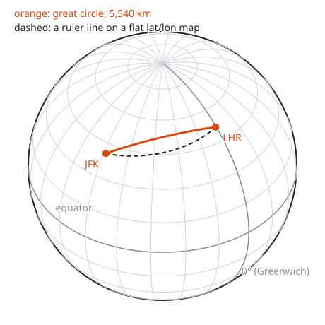
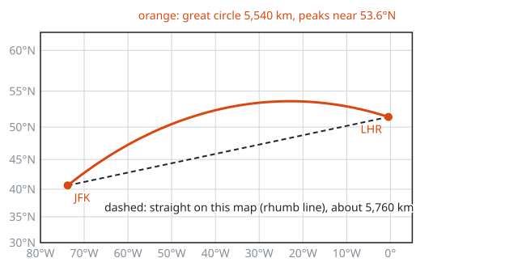

# Maps and Projections

**Math used:** spherical coordinates, unit vectors and the dot product, haversine and the spherical law of cosines, atan2 bearings, natural log and secant in the Mercator projection · **Level needed:** 301 (trigonometry) · **Time:** 90 minutes to 2 hours
**Run it:** `go run ./code/great-circle` (from this folder)

## The Real Problem

A user in Sydney opens your app. A geo-DNS service or an anycast edge has to pick which region answers: Singapore, Tokyo, or Oregon. The first cut at that choice is geometry. The speed of light in fiber sets a floor on round-trip time, and that floor grows with the distance over the curved Earth, not with the distance on a flat map.

The same distance formula sits under flight planning, ride-hailing ETAs, delivery zones, and every "stores near you" query. All of them start from two numbers per place, latitude and longitude, which are angles on a sphere.

Then the answer goes onto a screen. A screen is flat, and a sphere cannot lie flat without stretching. Every map picks what to stretch. The web map in your browser uses the Mercator projection, which is why the shortest flight from New York to London draws as an arc, and why Greenland looks about as large as Africa when Africa is fourteen times bigger.

## The Math You Need

* [Level 301](../../course/301/README.md) and the [Trigonometry track](../../tracks/trigonometry/README.md): sine, cosine, radians, inverse trig, and the unit circle. Every formula here is built from them.
* [Level 301](../../course/301/README.md): the natural logarithm, used in the Mercator y formula.
* [Geometry track](../../tracks/geometry/README.md): circles, arcs, and arc length s = R θ. A great-circle distance is an arc length.
* [Level 401](../../course/401/README.md), optional: the Mercator y formula is the integral of sec φ. Step 7 checks that with a midpoint sum.

## Picture It

<!-- diagram: type=orthographic-globe center=40N,40W graticule=15deg route=great-circle(JFK,LHR) compare=linear-latlon caption="Globe with latitude and longitude lines and the JFK to LHR great circle" -->


Latitude lines run east and west. Longitude lines meet at the poles. The orange arc is the **great circle** from New York JFK to London Heathrow: the slice of the globe cut by a plane through both airports and the center of the Earth. It is the shortest path on the surface, 5,540 km. The dashed path changes latitude and longitude at a steady rate, the straight line a ruler draws on a flat lat/lon map. On the globe it sags south and comes out longer.

<!-- diagram: type=sphere-to-xyz phi=40deg lambda=55deg panels=side,top caption="From latitude and longitude to x, y, z on the unit sphere" -->


Two right triangles turn a latitude and longitude into a 3D point. In the side view, the radius 1 at latitude φ splits into a height z = sin φ and a distance from the axis r = cos φ. In the top view, that distance r splits at longitude λ into x = r cos λ and y = r sin λ. Multiply through and the point is (cos φ cos λ, cos φ sin λ, sin φ).

<!-- diagram: type=projection-compare left=equirectangular right=mercator lat=-75..75 step=15 lon=-90..90 step=30 tissot=lat(0,±30,±60) caption="Equirectangular and Mercator grids with equal-size circles" -->


Every orange shape covers the same patch of ground, a small circle on the globe. These are **Tissot circles**. On the left, the equirectangular map keeps latitude lines evenly spaced, and the circles near the poles get squashed into wide ellipses: east-west is stretched, north-south is not. On the right, Mercator stretches north-south by the same amount as east-west. The circles stay round, which keeps angles and local shapes true, and they grow. At 60 degrees they are twice as wide, and four times the area.

<!-- diagram: type=mercator-route window=80W..5E,30N..62N route=great-circle(JFK,LHR) compare=rhumb caption="JFK to LHR on a Mercator map" -->


This is the same route on a Mercator map. The shortest path now looks like a detour north. The dashed straight line is a **rhumb line**: a course with a fixed compass bearing, about 5,760 km, which is around 220 km longer. Mercator draws rhumb lines straight, which made it the classic sea chart. It does not draw great circles straight.

## Guided Build

### Step 1: Latitude and Longitude Are Spherical Coordinates

**Latitude** φ is the angle north (+) or south (−) of the equator, from −90° to 90°. **Longitude** λ is the angle east (+) or west (−) of the Greenwich meridian, from −180° to 180°. Together with the radius R they place a point on a sphere. The Earth is not a perfect sphere (it bulges about 21 km at the equator), but a sphere with mean radius R = 6,371 km gives distances within about 0.5%.

Code works in radians. Convert first:

$$
\varphi_{\text{rad}} = \varphi_{\text{deg}} \cdot \frac{\pi}{180}
$$

The airports in `code/great-circle/main.go` use the airport reference points rounded to two decimals, with west and south as negative numbers:

```go
var airports = []place{
	{"JFK", "New York", 40.64, -73.78},
	{"LHR", "London", 51.47, -0.46},
	{"SFO", "San Francisco", 37.62, -122.38},
	{"NRT", "Tokyo Narita", 35.77, 140.39},
	{"SIN", "Singapore", 1.36, 103.99},
	{"SYD", "Sydney", -33.95, 151.18},
	{"GRU", "Sao Paulo", -23.44, -46.47},
}
```

### Step 2: Convert to x, y, z on the Unit Sphere

From the two triangles in the sphere picture:

$$
x = \cos\varphi\cos\lambda, \qquad y = \cos\varphi\sin\lambda, \qquad z = \sin\varphi
$$

The x axis points to (0°N, 0°E) in the Gulf of Guinea, y points to (0°N, 90°E) in the Indian Ocean, and z points to the North Pole. Every such point has length 1.

The angle θ between two points, seen from the center of the Earth, is the **central angle**. The dot product gives it directly, $\cos\theta = \mathbf{a}\cdot\mathbf{b}$, and the surface distance is the arc length $d = R\theta$.

```go
func rad(d float64) float64 { return d * math.Pi / 180 }

// toXYZ puts a point on the unit sphere. x toward (0N, 0E), z toward the North Pole.
func toXYZ(lat, lon float64) [3]float64 {
	phi, lam := rad(lat), rad(lon)
	return [3]float64{math.Cos(phi) * math.Cos(lam), math.Cos(phi) * math.Sin(lam), math.Sin(phi)}
}
```

### Step 3: Haversine and the Spherical Law of Cosines

Multiply out the dot product of two such unit vectors and simplify with $\cos A\cos B + \sin A\sin B = \cos(A - B)$. The result is the **spherical law of cosines**:

$$
\cos\theta = \sin\varphi_1\sin\varphi_2 + \cos\varphi_1\cos\varphi_2\cos\Delta\lambda,
\qquad d = R\,\theta
$$

For two points close together, $\cos\theta$ is very close to 1, and `acos` loses precision there. The **haversine** form rewrites the same thing with $\sin^2$ of half-angles, which stays accurate for small distances:

$$
a = \sin^2\!\frac{\Delta\varphi}{2} + \cos\varphi_1\cos\varphi_2\sin^2\!\frac{\Delta\lambda}{2},
\qquad
d = 2R\arcsin\sqrt{a}
$$

The name comes from the old navigator function $\text{hav}(\theta) = \sin^2(\theta/2) = (1 - \cos\theta)/2$. Navigators used printed haversine tables because the values are never negative.

```go
func haversineKm(lat1, lon1, lat2, lon2 float64) float64 {
	p1, p2 := rad(lat1), rad(lat2)
	dphi, dlam := p2-p1, rad(lon2-lon1)
	a := math.Pow(math.Sin(dphi/2), 2) + math.Cos(p1)*math.Cos(p2)*math.Pow(math.Sin(dlam/2), 2)
	return 2 * rEarthKm * math.Asin(math.Sqrt(a))
}
```

Real output from `go run ./code/great-circle`:

```txt
==================================================================
1. JFK to LHR, three ways
==================================================================
JFK  lat  40.64  lon  -73.78
LHR  lat  51.47  lon   -0.46
JFK on unit sphere: (0.2120, -0.7286, 0.6513)
LHR on unit sphere: (0.6229, -0.0050, 0.7823)
dot product = cos(central angle) = 0.645177
central angle = 0.869542 rad = 49.8211 deg
3D dot product   :   5,539.9 km
haversine        :   5,539.9 km
law of cosines   :   5,539.9 km
straight tunnel  :   5,367.0 km  (chord through the Earth)
```

Three formulas, one answer: 5,540 km. The chord line is a fun check. A straight tunnel through the Earth is shorter than any surface route, and the surface arc is always longer than its chord.

### Step 4: Initial Bearing, and Why the Route Looks Curved

The **initial bearing** is the compass heading at departure, measured clockwise from north:

$$
\theta_0 = \operatorname{atan2}\!\big(\sin\Delta\lambda\cos\varphi_2,\;
\cos\varphi_1\sin\varphi_2 - \sin\varphi_1\cos\varphi_2\cos\Delta\lambda\big)
$$

Use `atan2(y, x)`, not `atan(y / x)`, to land in the correct quadrant. On a great circle the bearing changes all the way along. To see the path, walk along it with spherical linear interpolation of the two unit vectors and convert each point back to latitude and longitude.

```go
func initialBearingDeg(lat1, lon1, lat2, lon2 float64) float64 {
	p1, p2 := rad(lat1), rad(lat2)
	dlam := rad(lon2 - lon1)
	y := math.Sin(dlam) * math.Cos(p2)
	x := math.Cos(p1)*math.Sin(p2) - math.Sin(p1)*math.Cos(p2)*math.Cos(dlam)
	return math.Mod(deg(math.Atan2(y, x))+360, 360)
}
```

```txt
==================================================================
2. Initial bearing (degrees clockwise from north)
==================================================================
JFK -> LHR:   51.4 deg
LHR -> JFK:  287.9 deg
SFO -> NRT:  303.1 deg
a straight east line from JFK has bearing 90; the great circle starts
well north of east, then swings round to come into London from the west

==================================================================
3. Waypoints JFK -> LHR along the great circle
==================================================================
  frac    lat     lon    latitude bar (each # = 1 deg above 40N)
   0.0   40.64   -73.78  #
   0.1   43.63   -68.40  ####
   0.2   46.34   -62.49  ######
   0.3   48.72   -56.00  #########
   0.4   50.70   -48.93  ###########
   0.5   52.22   -41.31  ############
   0.6   53.21   -33.24  #############
   0.7   53.64   -24.91  ##############
   0.8   53.48   -16.52  #############
   0.9   52.75    -8.31  #############
   1.0   51.47    -0.46  ###########
the route climbs above 51.47 N (London) before it arrives:
on a flat map that looks like a curve; on the globe it is straight
```

The flight leaves heading northeast at 51.4 degrees, climbs to about 53.6 degrees north over the ocean, and comes down into London. Why north? Near the poles, the longitude lines crowd together, and a degree of longitude covers less ground. The short route spends its east-west travel at high latitude, where east-west is cheap. The return bearing of 287.9 degrees is not 51.4 + 180 = 231.4, because the bearing turns along the way.

### Step 5: A Distance Table and a Nearest-Datacenter Picker

With a distance function, a nearest-region picker is a sort. For a latency floor, use the speed of light in fiber, about 200,000 km/s, that is, 200 km per millisecond. A round trip covers the distance twice:

$$
\text{RTT}_{\min} \approx \frac{2d}{200\ \text{km/ms}} = \frac{d}{100}\ \text{ms}
$$

```go
for _, p := range airports {
	var ranked []cand
	for _, d := range datacenters {
		ranked = append(ranked, cand{haversineKm(p.lat, p.lon, d.lat, d.lon), d.name})
	}
	sort.Slice(ranked, func(i, j int) bool { return ranked[i].km < ranked[j].km })
	best := ranked[0]
	rtt := 2 * best.km / fiberKmPerMs
	// ... print best.name, best.km, rtt
}
```

```txt
==================================================================
4. Great-circle distance table (km, haversine, R = 6,371 km)
==================================================================
           JFK     LHR     SFO     NRT     SIN     SYD     GRU
   JFK       0   5,540   4,152  10,830  15,339  16,013   7,665
   LHR   5,540       0   8,616   9,591  10,882  17,021   9,461
   SFO   4,152   8,616       0   8,226  13,581  11,949  10,428
   NRT  10,830   9,591   8,226       0   5,358   7,833  18,493
   SIN  15,339  10,882  13,581   5,358       0   6,295  15,995
   SYD  16,013  17,021  11,949   7,833   6,295       0  13,366
   GRU   7,665   9,461  10,428  18,493  15,995  13,366       0

==================================================================
5. Nearest datacenter for users at each airport
==================================================================
  RTT floor = 2 x distance / (200 km per ms), light in fiber, no hops
  JFK New York       -> us-east (N. Virginia)        363 km  RTT >=   3.6 ms  #
  LHR London         -> eu-west (Dublin)             445 km  RTT >=   4.5 ms  #
  SFO San Francisco  -> us-west (Oregon)             941 km  RTT >=   9.4 ms  ##
  NRT Tokyo Narita   -> ap-northeast (Tokyo)          64 km  RTT >=   0.6 ms  #
  SIN Singapore      -> ap-southeast (Singapore)      19 km  RTT >=   0.2 ms  #
  SYD Sydney         -> ap-southeast (Singapore)   6,308 km  RTT >=  63.1 ms  #############
  GRU Sao Paulo      -> us-east (N. Virginia)      7,660 km  RTT >=  76.6 ms  ###############
  (each # = 5 ms; real RTT is higher: routes are not great circles)
```

The table is symmetric, and the diagonal is zero, as every distance table requires. The picker sends Sydney to Singapore and São Paulo to Virginia, because this list has no region in Australia or South America. Those two rows are the case for adding one. Real round trips run higher than the floor, often 1.5 to 2 times, because cables follow coastlines and routers add delay. The floor is still useful: no tuning beats it.

### Step 6: The Mercator Projection

Mercator maps longitude straight across and stretches latitude upward:

$$
x = R\,\lambda, \qquad y = R\,\ln\tan\!\left(\frac{\pi}{4} + \frac{\varphi}{2}\right)
$$

At latitude φ, a circle of latitude has true length $2\pi R\cos\varphi$, yet the map draws it the full width $2\pi R$. That is an east-west stretch of $1/\cos\varphi = \sec\varphi$. Mercator chooses y to stretch north-south by the same factor, which keeps small shapes and angles true. The cost:

$$
k = \sec\varphi \quad\text{(length scale)}, \qquad k^2 = \sec^2\varphi \quad\text{(area scale)}
$$

At the pole, $\sec 90°$ is infinite, and y runs off to infinity. Web maps cut off at about 85.05 degrees, where the map turns into a square.

The **equirectangular** projection is the lazy alternative: $x = R\lambda$, $y = R\varphi$. Latitude lines are evenly spaced. It is easy to compute and handy for data plots, but it stretches east-west by sec φ while leaving north-south alone, and shapes squash.

```go
func mercY(lat float64) float64 {
	y := math.Log(math.Tan(math.Pi/4 + rad(lat)/2))
	if math.Abs(y) < 1e-12 { // tan(45 deg) is 0.99999... in floats
		return 0
	}
	return y
}

func equiY(lat float64) float64 { return rad(lat) }
```

Real output from `go run ./code/mercator`:

```txt
================================================================
1. Where each latitude line lands (y in units of R)
================================================================
   lat   equirect y = phi   mercator y = ln tan(45 + lat/2)   gap above
     0       0.0000             0.0000                    0.2648
    15       0.2618             0.2648                    0.2845
    30       0.5236             0.5493                    0.3321
    45       0.7854             0.8814                    0.4356
    60       1.0472             1.3170                    0.7106
    75       1.3090             2.0276
    80       1.3963             2.4362
    85       1.4835             3.1313
   mercator y at 90 = ln(tan 90) = infinity: the poles never fit

================================================================
2. Latitude lines every 10 degrees, same vertical scale
================================================================
   y/R   equirectangular        mercator
   2.50
   2.44                       -------------- 80
   2.38
   2.31
   2.25
   2.19
   2.12
   2.06
   2.00
   1.94
   1.88
   1.81
   1.75                       -------------- 70
   1.69
   1.62
   1.56
   1.50
   1.44
   1.38  -------------- 80
   1.31                       -------------- 60
   1.25  -------------- 70
   1.19
   1.12
   1.06  -------------- 60
   1.00                       -------------- 50
   0.94
   0.88  -------------- 50
   0.81
   0.75                       -------------- 40
   0.69  -------------- 40
   0.62
   0.56                       -------------- 30
   0.50  -------------- 30
   0.44
   0.38  -------------- 20    -------------- 20
   0.31
   0.25
   0.19  -------------- 10    -------------- 10
   0.12
   0.06
   0.00  --------------  0    --------------  0
  equirectangular spaces lines evenly; mercator spreads them apart

================================================================
3. Scale factor k = sec(lat) and area factor k^2
================================================================
   lat     k = sec     k^2     area bar (each # = 1x)
     0     1.0000    1.0000    #
    10     1.0154    1.0311    #
    20     1.0642    1.1325    #
    30     1.1547    1.3333    #
    40     1.3054    1.7041    ##
    50     1.5557    2.4203    ##
    60     2.0000    4.0000    ####
    70     2.9238    8.5486    #########
    72     3.2361   10.4721    ##########
    80     5.7588   33.1634    #################################
```

Near the equator, the two projections agree: the 10 and 20 degree lines sit at almost the same height. Past 40 degrees they split fast. On Mercator the gap from 70 to 80 degrees is bigger than the gap from 0 to 30.

### Step 7: Greenland Versus Africa, and the Integral of Secant

Greenland spans about 60 to 83 degrees north. Take 72 degrees as its middle. Africa straddles the equator, where the area factor is close to 1.

```txt
================================================================
4. Greenland versus Africa
================================================================
   true area   Greenland  2.166 M km^2   Africa  30.37 M km^2
   Africa is 14.0 times bigger on the globe
   Mercator area factor at 72 N: sec^2 = 10.47
   Mercator area factor at  0 N: sec^2 = 1.00
   Greenland as drawn: 2.166 x 10.47 = 22.7 M km^2 of map
   Africa as drawn (equator value): 30.37 M km^2 of map
   drawn ratio Africa : Greenland = 1.34 : 1
   (Africa reaches 35 S to 37 N and is drawn a bit larger than this;
    the eye sees two shapes of similar size, not a 14 : 1 difference)
```

A fourteen-to-one difference shrinks on the map to about four-to-three. The northern edge of Greenland at 83 degrees gets an area factor near 67, which inflates it even further.

Where does $\ln\tan(\pi/4 + \varphi/2)$ come from? Mercator wants $dy/d\varphi = \sec\varphi$ at every latitude, that is, each small step north is stretched by the same factor as east-west. Add up the small steps:

$$
y(\varphi) = \int_0^{\varphi} \sec t\,dt = \ln\tan\!\left(\frac{\pi}{4} + \frac{\varphi}{2}\right)
$$

The script adds 10,000 thin slices of sec and gets the same numbers:

```txt
================================================================
5. Mercator y is the integral of sec from 0 to lat
================================================================
   lat 30: midpoint sum = 0.549306   ln tan(45 + lat/2) = 0.549306
   lat 60: midpoint sum = 1.316958   ln tan(45 + lat/2) = 1.316958
   lat 80: midpoint sum = 2.436246   ln tan(45 + lat/2) = 2.436246
```

Mercator drew his map in 1569, before calculus existed. Mapmakers built the tables by adding up secants, exactly like this loop. About 75 years later, Henry Bond noticed the table matched a log-tangent table. That match is one of the stories behind the integral of sec in [Level 401](../../course/401/README.md).

## Worked Numbers

### Example 1: JFK to LHR by Haversine, by Hand

```txt
  φ1 = 40.64°, λ1 = -73.78°   (JFK)            airport coordinates
  φ2 = 51.47°, λ2 =  -0.46°   (LHR)
  Δφ = 10.83°, Δλ = 73.32°                     subtract
  sin(Δφ/2) = sin 5.415° = 0.09437             half the latitude gap
  sin²(Δφ/2) = 0.008905                        square it
  cos φ1 = 0.75882, cos φ2 = 0.62292           cosines of the latitudes
  cos φ1 cos φ2 = 0.47269                      multiply
  sin(Δλ/2) = sin 36.66° = 0.59707             half the longitude gap
  sin²(Δλ/2) = 0.35649                         square it
  a = 0.008905 + 0.47269 × 0.35649             haversine formula
    = 0.008905 + 0.16851
    = 0.17741
  √a = 0.42120
  θ = 2 arcsin(0.42120) = 0.86954 rad          central angle
  d = 6,371 × 0.86954 = 5,540 km               arc length R θ
```

### Example 2: The Same Pair by the Spherical Law of Cosines

```txt
  sin φ1 = 0.65130, sin φ2 = 0.78228           sines of the latitudes
  sin φ1 sin φ2 = 0.50950                      first term
  cos Δλ = cos 73.32° = 0.28703
  cos φ1 cos φ2 cos Δλ = 0.47269 × 0.28703     second term
                       = 0.13567
  cos θ = 0.50950 + 0.13567 = 0.64518          law of cosines
  θ = arccos(0.64518) = 0.86954 rad            same central angle as Example 1
  d = 6,371 × 0.86954 = 5,540 km               same distance
```

### Example 3: Initial Bearing out of JFK

```txt
  sin Δλ = sin 73.32° = 0.95792
  y = sin Δλ cos φ2 = 0.95792 × 0.62292 = 0.59671           east component
  x = cos φ1 sin φ2 - sin φ1 cos φ2 cos Δλ                  north component
    = 0.75882 × 0.78228 - 0.65130 × 0.62292 × 0.28703
    = 0.59361 - 0.11645
    = 0.47716
  θ0 = atan2(0.59671, 0.47716) = 51.35°                      both positive: northeast quadrant
  highest latitude: cos φmax = |sin θ0 cos φ1|               Clairaut relation on a great circle
                             = 0.78100 × 0.75882 = 0.59264
                    φmax = 53.66°                            matches the 53.64° waypoint
```

### Example 4: Mercator Height and Scale at 60° and at Greenland

```txt
  y(60°) = ln tan(45° + 30°)            Mercator formula with R = 1
         = ln tan 75°
         = ln 3.7321
         = 1.3170                       vs 1.0472 on equirectangular
  k(60°) = sec 60° = 1 / 0.5 = 2        lengths drawn twice as long
  k²(60°) = 4                           areas drawn four times as big
  k(72°) = 1 / cos 72° = 1 / 0.30902    middle of Greenland
         = 3.2361
  k²(72°) = 10.47                       Greenland area inflated about ten times
  Africa / Greenland on the globe = 30.37 / 2.166 = 14.0
  Africa / Greenland on the map  ≈ 30.37 / 22.7  = 1.34
```

## Common Mistakes

* Passing degrees to `math.Sin` and `math.Cos`. Go trig functions take radians. Convert with `d * math.Pi / 180` first, every time.
* Mixing up the order of latitude and longitude. Many formats (GeoJSON, for example) store (longitude, latitude). Most people say "lat, long". Check the format before computing.
* Dropping the minus sign for west and south. JFK is at −73.78, not 73.78. A missing sign puts New York in China.
* Using `acos` on the law of cosines for very short distances. When two points are metres apart, $\cos\theta$ rounds to 1 and the answer loses digits. Use haversine.
* Forgetting to clamp. Rounding can push $\cos\theta$ to 1.0000000002, and `math.Acos` then returns NaN, which quietly poisons every number after it. Clamp to [−1, 1].
* Using `math.Atan` instead of `math.Atan2` for bearings. `math.Atan(y / x)` cannot tell northeast from southwest.
* Treating Mercator distances as real distances. A ruler on a Mercator map overstates lengths by sec φ. At 60 degrees, every kilometre on the map is half a kilometre on the ground.
* Expecting the return bearing to be the outbound bearing plus 180. On a great circle, the bearing changes along the route.
* Treating the RTT floor as a prediction. Fiber paths, router hops, and queueing add delay. The floor tells you what is impossible, not what to expect.

## Try It

1. Convert (0°, 90°E) to x, y, z on the unit sphere.
2. What are x, y, z for the North Pole?
3. How far is it from the equator to the North Pole along a meridian, with R = 6,371 km?
4. How many kilometres is one degree of latitude?
5. How many kilometres is one degree of longitude at 60°N?
6. What is the Mercator length scale and area scale at 60 degrees?
7. At what latitude does Mercator draw areas four times too big?
8. Compute the Mercator y for 45 degrees, with R = 1.
9. What is the round-trip-time floor in fiber between JFK and LHR?
10. Two points on the equator are 90 degrees of longitude apart. Find the distance with the law of cosines.

<details>
<summary>Answers</summary>

1. (0, 1, 0): cos 0 cos 90° = 0, cos 0 sin 90° = 1, sin 0 = 0.
2. (0, 0, 1): cos 90° = 0 kills x and y, and sin 90° = 1.
3. About 10,008 km: a quarter circle, π R / 2 = 10,007.5 km.
4. About 111.2 km: 2π R / 360 = 6,371 × π / 180.
5. About 55.6 km: the circle of latitude has radius R cos 60° = R / 2.
6. Length scale sec 60° = 2, area scale 4.
7. 60 degrees: sec²φ = 4 means cos φ = 1/2.
8. 0.8814: ln tan 67.5° = ln 2.4142.
9. About 55.4 ms: 2 × 5,540 / 200 km per ms.
10. About 10,008 km: cos θ = 0 + 1 × 1 × cos 90° = 0, θ = π/2, d = π R / 2.

</details>

## Where This Shows Up at Work

* Geo-routing and CDNs: geo-DNS and anycast pick the nearest point of presence. Haversine distance is the first-pass score before real latency measurements refine it.
* Region placement: the RTT floor from Step 5 tells you which user populations no region choice can serve under a latency SLO, and where a new region pays off.
* GPS and location services: receivers work in 3D Earth-centered x, y, z coordinates, close to Step 2 but on an ellipsoid (WGS 84), and convert to latitude and longitude for display.
* Databases: PostGIS, Elasticsearch geo queries, Redis `GEOSEARCH`, and S2 or H3 cell indexes all compute great-circle distances or approximate them with cells on the sphere.
* Web maps: Google Maps, OpenStreetMap tiles, and Mapbox use Web Mercator (EPSG:3857), the projection from Step 6, cut off at 85.05 degrees.
* Aviation and shipping: flight plans follow great circles adjusted for winds. Ship autopilots sometimes follow rhumb lines because a fixed heading is simpler.
* Data visualization: plotting global metrics, for example requests per country, on Mercator inflates high-latitude countries. An equal-area projection gives a fairer picture.

## Go Deeper

* [Course Level 301](../../course/301/README.md): trigonometry, radians, and logarithms behind every formula here.
* [Trigonometry Track](../../tracks/trigonometry/README.md): from right triangles to the unit circle and beyond.
* [Geometry Track](../../tracks/geometry/README.md): circles, arcs, and the start of non-Euclidean geometry on the sphere.
* [Course Level 401](../../course/401/README.md): optional, for the integral of sec φ behind the Mercator formula.
* [Movable Type Scripts: Calculate Distance, Bearing and More Between Latitude/Longitude Points](https://www.movable-type.co.uk/scripts/latlong.html): the classic reference for haversine, bearing, and rhumb-line formulas with code.
* [Wolfram MathWorld: Great Circle](https://mathworld.wolfram.com/GreatCircle.html): the great-circle distance derivation.
* [Wolfram MathWorld: Mercator Projection](https://mathworld.wolfram.com/MercatorProjection.html): the forward and inverse formulas.
* [Wolfram MathWorld: Spherical Coordinates](https://mathworld.wolfram.com/SphericalCoordinates.html): the general x, y, z conversion (MathWorld measures the angle from the pole, not from the equator).
* [Wikipedia: Tissot Indicatrix](https://en.wikipedia.org/wiki/Tissot%27s_indicatrix): pictures of Tissot circles on many projections.
