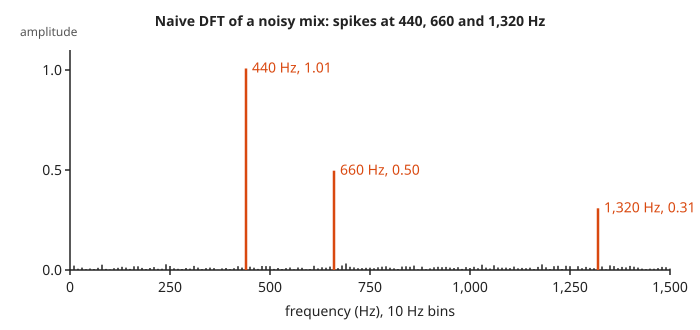
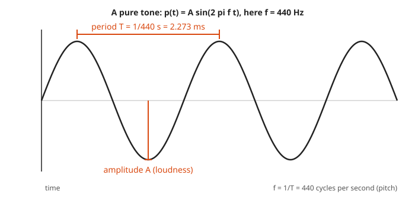
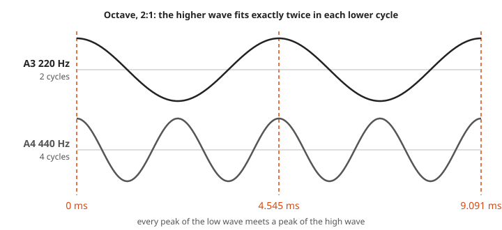
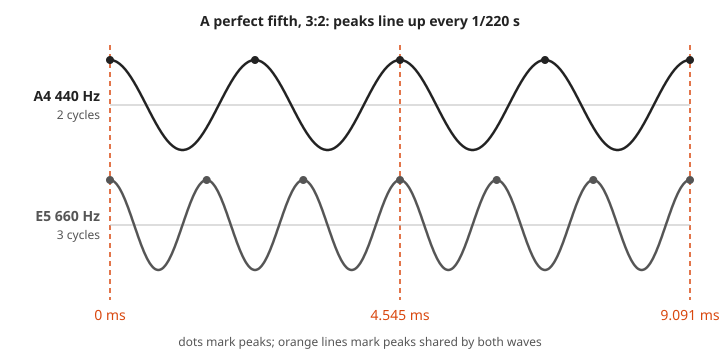
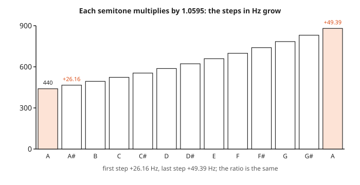
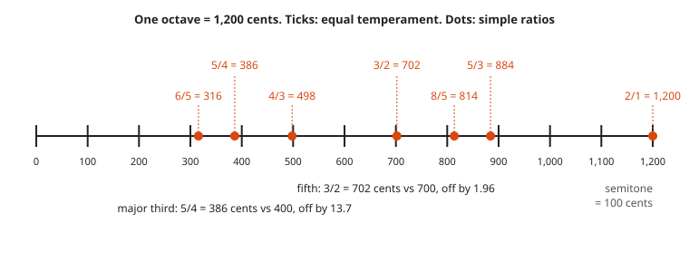
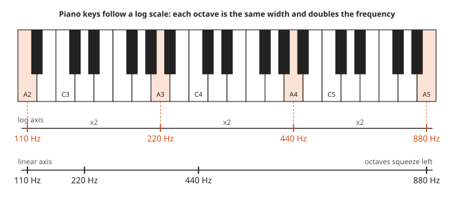
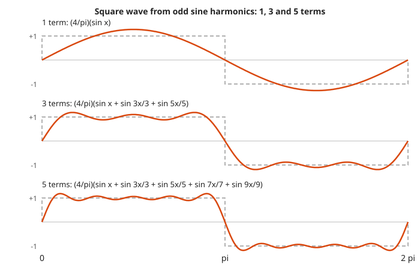
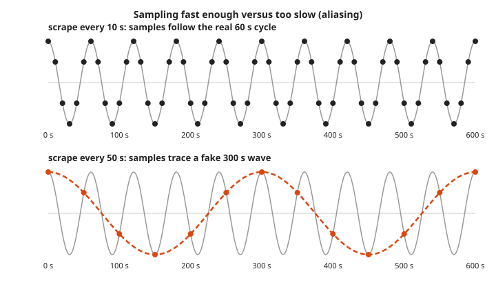
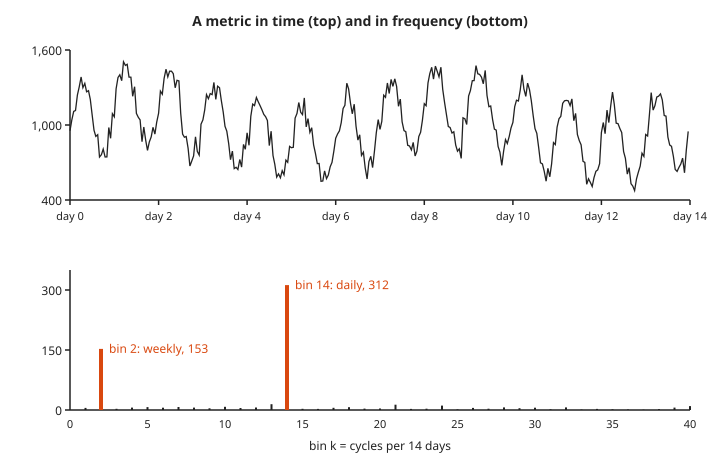

# Music and Frequencies

**Math used:** ratios, exponentials and logarithms, sine waves, Fourier series, the discrete Fourier transform · **Level needed:** 301 (ratios from 101, logs and trig from 301) · **Time:** 90 minutes to 2 hours
**Run it:** `go run ./code/tuning` from this folder, then `./code/fourier` and `./code/makewav`

## The Real Problem

A guitar tuner listens to a string and says "A, three cents flat." A monitoring tool looks at a latency series and reports "strong 24-hour seasonality." A Prometheus graph of a job that runs every minute shows a slow five-minute wave that is not really there. All three are the same math problem: find the frequencies inside a signal, and measure how far apart two frequencies are.

Music is the friendliest place to learn this math, because your ear already does it. Two notes an octave apart sound like the same note, because one vibrates exactly twice as fast as the other. A piano keyboard looks evenly spaced, yet the frequency doubles every 12 keys, which makes the keyboard a log scale. A buzzy square wave from a cheap synthesizer turns out to be a stack of smooth sine waves.

This workshop computes all of it in plain Go: the equal-tempered scale from $2^{1/12}$, the cents a tuner reports, why a fifth sounds smooth, a square wave built from sines, and a hand-written transform that pulls notes out of a noisy signal and a daily cycle out of a metric. An optional flag writes a WAV file to hear A440 and the fifth. No musical talent required. The program does not have any either.

## The Math You Need

* Ratios and fractions: [101 Foundations](../../course/101/README.md). A musical interval is a ratio of two frequencies, such as $3 : 2$.
* Exponentials and logarithms: [301 Algebra II, Trig and Precalculus](../../course/301/README.md). Equal temperament uses $2^{n/12}$. A **logarithm** answers "what power?", and cents use $\log_2$.
* Sine waves, period, frequency, and amplitude: [301 Algebra II, Trig and Precalculus](../../course/301/README.md) and the [Trigonometry track](../../tracks/trigonometry/README.md). A pure tone is $A \sin(2\pi f t)$.
* The complex exponential $e^{i\theta} = \cos\theta + i\sin\theta$: [Complex Analysis track](../../tracks/complex-analysis/README.md). The transform in Step 8 uses it as a short way to write a point spinning around a circle. That picture is all you need.
* Sums of many terms (series): [401 Calculus](../../course/401/README.md). A Fourier series adds up sines, and the more terms you add, the closer you get to the target shape.

## Picture It

Two pictures carry the workshop. Every step below adds its own.

<!-- diagram: type=keyboard range=A2..A5 axis=log2 ticks=110,220,440,880 second-axis=linear caption="Piano keys sit on a log frequency axis" -->


Every octave on the keyboard has the same width, and every octave doubles the frequency. Equal widths for equal ratios is what a **log scale** means. On the plain hertz axis at the bottom, the low octaves crowd together and the top octave takes half the room.

<!-- diagram: type=spectrum x=0..1500Hz bins=10Hz peaks=440,660,1320 caption="Naive DFT spectrum of a noisy mix" -->


A noisy signal looks like a jagged mess when you plot it against time. The transform turns it into a bar chart of how much of each frequency it holds, and the three hidden tones stand up at the right heights.

## Guided Build

All programs live in `code/<name>/main.go`, use only the Go standard library, and run from this folder with `go run ./code/<name>`.

### Step 1: Sound as a Sine Wave

Sound is air pressure going up and down. A pure tone does it as a smooth sine wave:

$$p(t) = A \sin(2\pi f t)$$

* $f$ is the **frequency**: how many full cycles per second, measured in hertz (Hz). It sets the pitch.
* $T = 1/f$ is the **period**: how long one cycle takes.
* $A$ is the **amplitude**: how far the wave swings from the middle. It sets the loudness.

<!-- diagram: type=wave f=440 marks=period,amplitude caption="Period and amplitude of a sine wave" -->


Concert pitch is A4 = 440 Hz, which has a period of $1/440$ s = 2.273 ms. A CD-quality recording stores 44,100 numbers (**samples**) per second, which puts about 100 samples on each A4 cycle.

```go
for i := range out {
	t := float64(i) / rate
	v := 0.0
	for _, f := range freqs {
		v += math.Sin(2 * math.Pi * f * t)
	}
	v /= float64(len(freqs))
```

Output of `go run ./code/makewav` (prints only; add `-wav` to write the file):

```txt
sample rate 44,100 Hz, Nyquist limit 22,050 Hz, 16-bit mono
sample spacing 1 / 44,100 s = 22.68 microseconds
one A4 cycle (2.273 ms) spans 100.23 samples

A4 alone                                 440.00 Hz  44,100 samples
  samples 441..446: [7704 7025 6318 5586 4832 4059]
E5 alone (equal-tempered)                659.26 Hz  44,100 samples
  samples 441..446: [-7199 -8195 -9118 -9961 -10716 -11377]
A4 + E5 just fifth 3:2          440.00 + 660.00 Hz  44,100 samples
  samples 441..446: [0 -821 -1617 -2383 -3114 -3806]
A4 + E5 equal-tempered fifth    440.00 + 659.26 Hz  44,100 samples
  samples 441..446: [252 -585 -1400 -2188 -2942 -3659]

equal-tempered E5 is 0.74 Hz flat of 660 Hz (1.955 cents)
on a real instrument, harmonic 3 of A4 (1,320 Hz) and harmonic 2 of E5 (1,318.51 Hz)
  beat 1.49 times per second; this file uses pure sines, which have no harmonics and hide most of that beat

total 176,400 samples, 4 s, file size 352,844 bytes
no file written (pass -wav to write a440_fifth.wav)
```

Run `go run ./code/makewav -wav` and open `a440_fifth.wav` to hear four one-second segments: A4, E5, the just fifth, and the equal-tempered fifth. The program writes the 44-byte WAV header by hand with `encoding/binary`, which is less scary than it sounds.

### Step 2: Octaves and Simple Ratios

Double the frequency and the note goes up one **octave**. The ear hears $f$ and $2f$ as the same note, only higher. Other simple ratios give the classic intervals:

$$\text{octave } 2:1, \quad \text{fifth } 3:2, \quad \text{fourth } 4:3, \quad \text{major third } 5:4$$

<!-- diagram: type=wave-pair f1=220 f2=440 window=0..9.091ms markers=shared-peaks caption="Octave 2:1, every low peak meets a high peak" -->


<!-- diagram: type=wave-pair f1=440 f2=660 window=0..9.091ms markers=shared-peaks caption="Perfect fifth 3:2, peaks align every 1/220 s" -->


For a ratio $p : q$ in lowest terms, the two waves line up again after $q$ cycles of the lower note and $p$ cycles of the upper note. The pattern then repeats exactly. A short, regular repeat sounds smooth, or **consonant**. Ratios with big numbers repeat slowly or never and sound rough. For 440 Hz and 660 Hz, the shared period is $1 / \gcd(440, 660) = 1/220$ s, where $\gcd$ is the greatest common divisor.

```go
fmt.Printf("  shared peaks every 1 / gcd(440, 660) = 1/%d s = %.3f ms (2 A cycles = 3 E cycles)\n",
	gcd(440, 660), 1000/float64(gcd(440, 660)))
```

Output of `go run ./code/tuning`, section 3:

```txt
==================================================================
3. Why 3:2 sounds smooth: peaks line up
==================================================================
A4 = 440 Hz and E5 = 660 Hz. A peak happens at t = k / f.
  A4 peaks (ms): 0.000, 2.273, 4.545, 6.818, 9.091
  E5 peaks (ms): 0.000, 1.515, 3.030, 4.545, 6.061, 7.576, 9.091
  shared peaks every 1 / gcd(440, 660) = 1/220 s = 4.545 ms (2 A cycles = 3 E cycles)
  ASCII view of 0 to 9.09 ms (^ = peak, one column = 0.152 ms):
  A4 440 |^--------------^--------------^--------------^--------------|
  E5 660 |^---------^---------^---------^---------^---------^---------|
  shared |*                             *                             |
```

### Step 3: Twelve-Tone Equal Temperament

Stack 12 pure fifths and you almost land on an octave, but not quite: $(3/2)^{12} = 129.75$, while seven octaves give $2^7 = 128$. Musicians argued about that gap for centuries. **Equal temperament** settles it by splitting the octave into 12 equal ratio steps. Each step, a **semitone**, multiplies the frequency by the same number:

$$r = 2^{1/12} \approx 1.059463, \qquad f_n = 440 \cdot 2^{n/12}$$

Twelve steps multiply to exactly 2, which keeps every octave pure and every key equally usable.

<!-- diagram: type=bar-chart notes=A4..A5 values=440*2^(n/12) caption="Semitone steps grow in hertz, not in ratio" -->


```go
var semitone = math.Pow(2, 1.0/12)

f := a4 * math.Pow(semitone, float64(n))
```

```txt
==================================================================
1. One octave of 12-tone equal temperament (A4 = 440 Hz)
==================================================================
semitone ratio 2^(1/12) = 1.059463
  n  note    freq Hz  period ms  bar (log spacing)
  0  A4       440.00      2.273  #
  1  A#4      466.16      2.145  #####
  2  B4       493.88      2.025  #########
  3  C5       523.25      1.911  #############
  4  C#5      554.37      1.804  #################
  5  D5       587.33      1.703  #####################
  6  D#5      622.25      1.607  #########################
  7  E5       659.26      1.517  #############################
  8  F5       698.46      1.432  #################################
  9  F#5      739.99      1.351  #####################################
 10  G5       783.99      1.276  #########################################
 11  G#5      830.61      1.204  #############################################
 12  A5       880.00      1.136  #################################################
```

In the text bars, each row grows by the same four characters, because each row multiplies by the same ratio. In hertz the steps grow: 26.16 Hz from A4 to A#4, but 49.39 Hz from G#5 to A5.

### Step 4: Cents, the Ruler for Intervals

A **cent** is one hundredth of an equal-tempered semitone. An octave is 1,200 cents:

$$\text{cents}(f_1 \to f_2) = 1200 \cdot \log_2 \frac{f_2}{f_1}$$

Because cents use a log, intervals add. A fifth (700 cents) plus a fourth (500 cents) makes an octave (1,200 cents), even though the ratios multiply: $\tfrac32 \cdot \tfrac43 = 2$.

<!-- diagram: type=number-line range=0..1200 ticks=100 marks=6/5,5/4,4/3,3/2,8/5,5/3,2/1 caption="Cents ruler: equal temperament versus simple ratios" -->


```go
func cents(f2, f1 float64) float64 { return 1200 * math.Log2(f2/f1) }
```

```txt
==================================================================
2. Equal temperament versus simple ratios
==================================================================
interval         semis  2^(n/12)   just    ratio  ET cents   just c  ET - just
unison               0   1.00000      1  1.00000         0     0.00      +0.00
minor second         1   1.05946  16/15  1.06667       100   111.73     -11.73
major second         2   1.12246    9/8  1.12500       200   203.91      -3.91
minor third          3   1.18921    6/5  1.20000       300   315.64     -15.64
major third          4   1.25992    5/4  1.25000       400   386.31     +13.69
perfect fourth       5   1.33484    4/3  1.33333       500   498.04      +1.96
tritone              6   1.41421  45/32  1.40625       600   590.22      +9.78
perfect fifth        7   1.49831    3/2  1.50000       700   701.96      -1.96
minor sixth          8   1.58740    8/5  1.60000       800   813.69     -13.69
major sixth          9   1.68179    5/3  1.66667       900   884.36     +15.64
minor seventh       10   1.78180    9/5  1.80000      1000  1017.60     -17.60
major seventh       11   1.88775   15/8  1.87500      1100  1088.27     +11.73
octave              12   2.00000      2  2.00000      1200  1200.00      +0.00

fifth:       2^(7/12) = 1.498307   3/2 = 1.5   gap = 1.955 cents
major third: 2^(4/12) = 1.259921   5/4 = 1.25  gap = 13.686 cents
A4 = 440 Hz: just E5 = 660.00 Hz, equal-tempered E5 = 659.26 Hz, difference 0.74 Hz
```

"Just" here means tuned to the simple ratio. The equal-tempered fifth is only 1.955 cents narrow, below what most ears notice. The major third is 13.686 cents wide, which trained ears hear as a slight shimmer. That is the price of being able to play in every key. Everyone pays a little, and nobody pays a lot.

### Step 5: Pitch Is Logarithmic

The piano maps key number to frequency with an exponential:

$$f(\text{key}) = 440 \cdot 2^{(\text{key} - 49)/12}$$

Take $\log_2$ of both sides and key number becomes a straight line in $\log_2 f$. Equal key steps mean equal ratio steps. That is why the keyboard in the first picture lines up with the log axis and not with the plain hertz axis.

<!-- diagram: type=keyboard range=A2..A5 axis=log2 ticks=110,220,440,880 second-axis=linear caption="Piano keys sit on a log frequency axis" -->


**Decibels** use the same trick for loudness. A pressure ratio $p_2/p_1$ is $20 \log_{10}(p_2/p_1)$ dB, which turns a factor of 1,000 into a tidy 60 dB.

```go
func keyFreq(key int) float64 { return a4 * math.Pow(2, float64(key-49)/12) }
```

```txt
==================================================================
4. Piano keys: frequency = 440 * 2^((key - 49) / 12)
==================================================================
 key  note   freq Hz  log2(f / 27.5)  position bar
   1  A0       27.50           0.000
  13  A1       55.00           1.000  ########
  25  A2      110.00           2.000  ################
  37  A3      220.00           3.000  ########################
  40  C4      261.63           3.250  ##########################
  49  A4      440.00           4.000  ################################
  52  C5      523.25           4.250  ##################################
  56  E5      659.26           4.583  #####################################
  61  A5      880.00           5.000  ########################################
  73  A6     1760.00           6.000  ################################################
  85  A7     3520.00           7.000  ########################################################
  88  C8     4186.01           7.250  ##########################################################
Each octave adds 12 keys and doubles the frequency: equal steps in log2(f).
Range: 27.5 Hz to 4,186.0 Hz, a factor of 152, 7.25 octaves
...
==================================================================
6. Decibels: also a log scale
==================================================================
sound pressure level change = 20 * log10(p2 / p1) dB
  pressure x2     ->   6.02 dB
  pressure x10    ->  20.00 dB
  pressure x100   ->  40.00 dB
  pressure x1000  ->  60.00 dB
power ratio change = 10 * log10(P2 / P1) dB
  power x2        ->   3.01 dB
  power x10       ->  10.00 dB
  power x100      ->  20.00 dB
```

### Step 6: Harmonics and Overtones

A plucked string does not vibrate at one frequency. It vibrates at $f$, $2f$, $3f$, $4f$, and more, all at once. These whole-number multiples are the **harmonics** (also called **overtones**). Their mix is why a guitar and a flute sound different while playing the same note.

$$f_h = h \cdot f_1, \qquad h = 1, 2, 3, \dots$$

<!-- diagram: type=standing-waves modes=1..5 f1=110 caption="Harmonics of a string" -->


```go
for h := 1; h <= 10; h++ {
	f := 110 * float64(h)
	key := int(math.Round(49 + 12*math.Log2(f/a4)))
```

```txt
==================================================================
5. Harmonics of A2 = 110 Hz (integer multiples)
==================================================================
harmonic  freq Hz  nearest key    key Hz  cents off
       1      110  A2             110.00      +0.00
       2      220  A3             220.00      +0.00
       3      330  E4             329.63      +1.96
       4      440  A4             440.00      +0.00
       5      550  C#5            554.37     -13.69
       6      660  E5             659.26      +1.96
       7      770  G5             783.99     -31.17
       8      880  A5             880.00      +0.00
       9      990  B5             987.77      +3.91
      10     1100  C#6           1108.73     -13.69
```

The simple ratios hide inside the harmonic series. Harmonics 2 and 3 form a fifth (3:2). Harmonics 4 and 5 form a major third (5:4). Two notes sound consonant when many of their harmonics land on top of each other, and the ratios from Step 2 are exactly the ones that make that happen. Harmonic 7 misses its piano key by 31 cents, which is why nobody builds chords on it.

### Step 7: A Square Wave as a Sum of Sines

A **square wave** jumps between $+1$ and $-1$ and holds flat in between. Its **Fourier series**, the recipe of sines that builds it, uses only the odd harmonics:

$$\text{square}(x) = \frac{4}{\pi}\left(\sin x + \frac{\sin 3x}{3} + \frac{\sin 5x}{5} + \cdots\right) = \frac{4}{\pi}\sum_{k=1}^{\infty}\frac{\sin\big((2k-1)x\big)}{2k-1}$$

<!-- diagram: type=partial-sums series=square-wave terms=1,3,5 x=0..2pi caption="Square wave from odd sine harmonics" -->


One sine wave is a poor square. Adding $\sin 3x / 3$ and $\sin 5x / 5$ steepens the sides and flattens the top. Each odd harmonic adds finer detail.

```go
func squarePartial(x float64, terms int) float64 {
	sum := 0.0
	for k := 1; k <= terms; k++ {
		h := float64(2*k - 1)
		sum += math.Sin(h*x) / h
	}
	return 4 / math.Pi * sum
}
```

Output of `go run ./code/fourier`, section 1 (ASCII plots for 1 and 25 terms shown):

```txt
==================================================================
1. Square wave = sum of odd harmonics
==================================================================
f_K(x) = (4/pi) * [sin x + sin 3x / 3 + sin 5x / 5 + ...], K terms
 terms      x=pi/2      x=pi/4     x=pi/10     x=pi/40
     1      1.2732      0.9003      0.3935      0.0999
     3      1.1035      1.0204      0.9915      0.2964
     5      1.0631      0.9918      1.1823      0.4833
    25      1.0127      0.9996      1.0409      1.1280
   250      0.9987      1.0018      0.9959      0.9996
target      1.0000      1.0000      1.0000      1.0000

  1 term(s), x from 0 to 2*pi:
  +1.40 |               ***
  +1.12 |         ******   ******
  +0.84 |      ***               ***
  +0.56 |    **                     **
  +0.28 |  **                         **
  +0.00 |**-----------------------------***-----------------------------**
  -0.28 |                                  **                         **
  -0.56 |                                    **                     **
  -0.84 |                                      ***               ***
  -1.12 |                                         ******   ******
  -1.40 |                                               ***
...
  25 term(s), x from 0 to 2*pi:
  +1.40 |
  +1.12 | ***  *********************  ***
  +0.84 |    **                     **
  +0.56 |
  +0.28 |
  +0.00 |*-------------------------------*-------------------------------*
  -0.28 |
  -0.56 |
  -0.84 |                                    **                     **
  -1.12 |                                 ***  *********************  ***
  -1.40 |

  overshoot near the jump with 25 terms: max = 1.1791 (Gibbs: about 9% of the jump size 2)
```

In the middle of the flat top ($x = \pi/2$) the sum settles fast. Near the jump ($x = \pi/40$) it needs many terms. Right beside the jump it overshoots by about 9% of the jump, no matter how many terms you add. That stubborn bump is the **Gibbs phenomenon**.

### Step 8: A Naive DFT Finds the Notes

The **discrete Fourier transform** (DFT) takes $N$ samples $x_0, \dots, x_{N-1}$ and asks, for each candidate frequency bin $k$: how well do these samples line up with a wave that makes $k$ full cycles across the window?

$$X_k = \sum_{t=0}^{N-1} x_t \, e^{-2\pi i k t / N}$$

The factor $e^{-2\pi i k t/N} = \cos(2\pi kt/N) - i\sin(2\pi kt/N)$ is a point spinning around a circle $k$ times. Multiply each sample by it and add everything up. If the signal holds that frequency, the products pile up in one direction and $|X_k|$ grows large. If not, they cancel out. Bin $k$ stands for $k \cdot \text{rate} / N$ Hz, and $2|X_k|/N$ gives back the amplitude. This direct loop does about $N^2$ multiplications. The FFT (fast Fourier transform) gets the same numbers with about $N \log_2 N$.

<!-- diagram: type=spectrum x=0..1500Hz bins=10Hz peaks=440,660,1320 caption="Naive DFT spectrum of a noisy mix" -->


```go
func dftAmplitudes(x []float64) []float64 {
	n := len(x)
	out := make([]float64, n/2+1)
	for k := range out {
		var total complex128
		for t, v := range x {
			angle := -2 * math.Pi * float64(k) * float64(t) / float64(n)
			total += complex(v, 0) * cmplx.Exp(complex(0, angle))
		}
		out[k] = cmplx.Abs(total) * 2 / float64(n)
	}
	return out
}
```

```txt
==================================================================
2. Naive DFT finds the notes in a mixed signal
==================================================================
sample rate 8,000 Hz, N = 800 samples (100 ms), bin width 10 Hz, Nyquist 4,000 Hz
signal = 1.0 sin(2 pi 440 t) + 0.5 sin(2 pi 660 t) + 0.3 sin(2 pi 1320 t) + noise(0.2)
strongest three bins:
  bin  44      440 Hz  amplitude 1.007
  bin  66      660 Hz  amplitude 0.497
  bin 132    1,320 Hz  amplitude 0.309
largest remaining bin (noise): bin 69, 690 Hz, amplitude 0.033
spectrum 0 to 1,500 Hz in 50 Hz groups (# = 0.05 amplitude):
      0-49    Hz
     50-99    Hz #
    100-149   Hz
    150-199   Hz
    200-249   Hz #
    250-299   Hz
    300-349   Hz
    350-399   Hz
    400-449   Hz ####################
...
    650-699   Hz ##########
...
   1300-1349  Hz ######
...
```

The noise is random but seeded, which makes every run print the same numbers. The three true amplitudes were 1.0, 0.5, and 0.3; the DFT reports 1.007, 0.497, and 0.309.

### Step 9: Sampling, Nyquist, and Aliasing

A sampled signal can only show frequencies below half the sample rate. That limit is the **Nyquist frequency**. CD audio samples 44,100 times per second, which puts Nyquist at 22,050 Hz, just above the roughly 20,000 Hz limit of human hearing. A tone above Nyquist does not vanish. It folds back and shows up as a false, lower frequency called an **alias**:

$$f_{\text{alias}} = |f - m \cdot f_s| \quad \text{for the whole number } m \text{ that brings it below } f_s/2$$

<!-- diagram: type=wave-sampling f=1/60 samples=10s,50s alias=1/300 caption="Fast sampling versus aliasing" -->


Prometheus scrapes do the same thing. A job that spikes every 60 s, scraped every 50 s, is sampled too slowly. The samples trace a smooth 300 s wave that is pure fiction. Sampled fast enough, the same DFT finds real cycles:

<!-- diagram: type=line-and-spectrum series=hourly-metric days=14 peaks=bin2,bin14 caption="Seasonality in time and frequency" -->


```txt
==================================================================
3. Seasonality in a metric: hourly samples over 14 days
==================================================================
N = 336 hourly points; bin k means k cycles per 336 hours
bin 0 (the mean level): 995.8
  bin   2  period  168.0 h  amplitude  152.7
  bin  14  period   24.0 h  amplitude  312.2
largest remaining bin (noise): bin 74, period 4.5 h, amplitude 15.2

==================================================================
4. Aliasing: a 60 s job scraped every 50 s
==================================================================
true signal cos(2 pi t / 60), sampled at t = 0, 50, 100, ...
   t s  true value  cos(2 pi t/300)
     0       1.000            1.000
    50       0.500            0.500
   100      -0.500           -0.500
   150      -1.000           -1.000
   200      -0.500           -0.500
   250       0.500            0.500
   300       1.000            1.000
   350       0.500            0.500
sample rate 0.0200 Hz, Nyquist 0.0100 Hz < signal 0.0167 Hz
alias frequency |1/60 - 1/50| = 0.00333 Hz -> period 300 s
```

The metric was built from a 300-unit daily wave and a 150-unit weekly wave, and the DFT reports 312.2 and 152.7 through the noise. The alias table shows the trap: every sampled value of the 60 s signal matches a 300 s cosine exactly. Nothing in the data can tell them apart. The data is not lying; it was simply never asked the right question.

## Worked Numbers

### Example 1: Cents Between Equal-Tempered and Just Fifths

```txt
ET fifth ratio = 2^(7/12) = 1.498307           7 semitones of 2^(1/12)
just fifth ratio = 3/2 = 1.5                   simple ratio
gap = 1200 * log2(1.5 / 1.498307)              cents formula
    = 1200 * log2(1.001130)                    divide
    = 1200 * 0.0016292                         log2(1 + x) ~ x / ln 2 for small x
    = 1.955 cents                              multiply
in hertz at A4: 660.00 - 659.26 = 0.74 Hz      440 * 1.5 versus 440 * 1.498307
```

### Example 2: Frequency of Middle C

```txt
middle C = C4 = key 40                          A4 is key 49
semitones from A4 = 40 - 49 = -9                count keys
f = 440 * 2^(-9/12)                             equal temperament formula
  = 440 * 0.594604                              2^(-0.75)
  = 261.63 Hz                                   multiply
period = 1 / 261.63 = 3.822 ms                  T = 1/f
```

### Example 3: DFT Bin for a Tone

```txt
rate = 8,000 Hz, N = 800                        given
bin width = 8,000 / 800 = 10 Hz                 rate / N
bin for 660 Hz = 660 / 10 = 66                  k = f / bin width
window length = 800 / 8,000 = 0.1 s             N / rate
cycles of 660 Hz in window = 66                 bin number = cycles per window
amplitude = 2 * |X_66| / 800 = 0.497            scaling for a real sine, true value 0.5
```

### Example 4: Scrape Interval Aliasing

```txt
signal period 60 s -> f = 1/60 = 0.01667 Hz     f = 1/T
scrape every 50 s -> f_s = 1/50 = 0.02 Hz       sample rate
Nyquist = f_s / 2 = 0.01 Hz                     half the sample rate
f > Nyquist -> aliasing                         0.01667 > 0.01
alias = |0.01667 - 0.02| = 0.00333 Hz           fold back by one f_s
apparent period = 1 / 0.00333 = 300 s           T = 1/f
fix: scrape interval below 30 s                 need f_s > 2f = 0.0333 Hz
```

## Common Mistakes

* Treating pitch as linear: going up by 100 Hz is an octave at 100 Hz but less than a semitone at 2,000 Hz. Compare pitches with ratios or cents, never with differences in hertz.
* Adding ratios instead of multiplying: a fifth plus a fourth is $\tfrac32 \cdot \tfrac43 = 2$, not $\tfrac32 + \tfrac43$. Cents turn the multiplying into adding.
* Using $2^{1/12}$ for a whole octave step: one semitone is $2^{1/12}$; twelve semitones is $2^{12/12} = 2$.
* Forgetting the $2/N$ scaling in a DFT: raw $|X_k|$ grows with $N$. Divide by $N/2$ to read the amplitude of a sine.
* Reading a DFT peak more finely than the bin width: with 10 Hz bins, a 443 Hz tone smears across the 440 Hz and 450 Hz bins. A longer window gives finer bins.
* Trusting a periodic pattern in a metric without checking the scrape interval: a cycle faster than twice the interval aliases into a fake slow cycle.
* Expecting the Gibbs overshoot to vanish with more terms: it gets narrower but stays near 9% of the jump.

## Try It

1. What is the period of a 220 Hz tone in milliseconds?
2. Compute the frequency of C4 (key 40) from A4 = 440 Hz.
3. A tuner hears 450 Hz when you aim for 440 Hz. How many cents sharp is it?
4. Find the equal-tempered and just frequencies a fifth above 220 Hz.
5. Tones at 300 Hz and 400 Hz form which interval, and how often do their peaks line up?
6. List the first five harmonics of 100 Hz.
7. A recorder samples at 8,000 Hz. What is the highest frequency it captures, and where does a 5,000 Hz tone appear?
8. A DFT uses 1,000 samples at 1,000 Hz. What is the bin width, and which bin holds 50 Hz mains hum?
9. How many decibels louder is a sound with double the pressure?
10. A metric spikes every 20 s and Prometheus scrapes every 15 s. What period does the graph appear to show?

<details>
<summary>Answers</summary>

1. 4.545 ms: $T = 1/220$ s.
2. 261.63 Hz: $440 \cdot 2^{-9/12}$.
3. 38.9 cents: $1200 \log_2(450/440) = 38.91$.
4. 329.63 Hz equal-tempered and 330 Hz just: $220 \cdot 2^{7/12}$ and $220 \cdot 3/2$.
5. A perfect fourth, $4:3$; peaks line up every $1/\gcd(300, 400) = 1/100$ s = 10 ms.
6. 100, 200, 300, 400, and 500 Hz: whole-number multiples $h \cdot 100$.
7. 4,000 Hz (Nyquist is half of 8,000); the 5,000 Hz tone aliases to $|5{,}000 - 8{,}000| = 3{,}000$ Hz.
8. 1 Hz bins (rate / N = 1,000 / 1,000), and bin 50 holds 50 Hz.
9. 6.02 dB: $20 \log_{10} 2$.
10. 60 s: $|1/20 - 1/15| = 1/60$ Hz, because the 1/30 Hz Nyquist limit is below the 1/20 Hz signal.

</details>

## Where This Shows Up at Work

* Seasonality detection: seasonal anomaly detectors and forecasting tools first find the main periods of a metric, often from a spectrum like the one in Step 9, and then compare each point with the same hour of the previous day or week.
* Scrape and sample intervals: a Prometheus `scrape_interval` sets the Nyquist limit for every metric. Cycles faster than twice the interval, such as a job every minute scraped every 50 s, show up as fake slow waves.
* Audio and video pipelines: 44,100 Hz and 48,000 Hz sample rates, anti-aliasing filters, and codecs such as MP3 and AAC all rest on Fourier analysis.
* Vibration and hardware monitoring: fan and disk vibration sensors and power-supply checks read frequency spectra to spot failing bearings or 50 Hz and 60 Hz hum.
* Machine learning: spectrograms, a DFT over sliding windows, are the standard input for speech recognition models.
* Log scales on dashboards: decibels, octaves, and log-latency histograms share one idea: equal visual steps for equal ratios.
* Cron storms: periodic patterns in request rates, such as jobs that all fire on the minute, show up as spikes at 1/60 Hz and its harmonics.

## Go Deeper

* [An Interactive Guide To The Fourier Transform](https://betterexplained.com/articles/an-interactive-guide-to-the-fourier-transform/): Better Explained builds the DFT from "which circles make this pattern" with almost no notation.
* [Trigonometry](https://www.mathsisfun.com/algebra/trigonometry.html) and [Logarithms](https://www.mathsisfun.com/algebra/logarithms.html): Math Is Fun refreshers for sine waves and logs.
* [Fourier Series](https://mathworld.wolfram.com/FourierSeries.html): the Wolfram MathWorld reference, with the square-wave series.
* [Exponential Growth in Interest, Epidemics, and Load](../exponential-growth-in-interest-epidemics-and-load/README.md): the companion workshop on exponentials and log scales.
* Flashcards for this workshop: [cards.tsv](cards.tsv), ready to import into Anki.
