# Number Theory for Cryptography

**Math used:** modular arithmetic, gcd, extended Euclid, modular inverse, fast exponentiation, Euler totient · **Level needed:** 301 (601 Number Theory helps) · **Time:** 2 to 3 hours
**Run it:** `go run ./code/toyrsa` (from this folder)

> **For learning only.** The RSA and Diffie-Hellman code here uses tiny primes and no padding. A patient person breaks these keys with a pencil. Never use it to protect real data. Real systems use vetted libraries (Go `crypto/tls`, `crypto/rsa`, `crypto/ecdh`, or OpenSSL) with 2,048-bit or larger keys, proper padding (OAEP, PSS), and constant-time code.

## The Real Problem

Every TLS handshake on your load balancers runs on number theory. The certificate holds a public key. The handshake agrees on a session key while every packet crosses a network you do not control. Under all of it sit four operations: remainder, greatest common divisor, inverse, and power. All of them happen "modulo" some number, which means you keep only the remainder.

The same remainder picks your shards. `hash(key) % N` chooses a cache node, a Kafka partition, or a database shard. It spreads keys evenly. It also hides a trap: change `N` and almost every key moves. Consistent hashing fixes that, and the fix is again a statement about remainders on a circle.

This workshop builds all of it in Go with numbers small enough to check by hand: a toy RSA with $n = 3233$, a toy Diffie-Hellman with $p = 23$, and a 10,000-key shard simulation. The math is about 2,000 years old. The bugs are new.

## The Math You Need

* [301 Algebra II, Trig and Precalculus](../../course/301/README.md): exponent rules ($a^{b+c} = a^b a^c$ and $(a^b)^c = a^{bc}$) and binary numbers. Fast exponentiation is exponent rules plus binary.
* [601 Proof and Higher Math](../../course/601/README.md): the number theory unit proves Euclid, Bezout, and Euler theorem. This workshop uses the results; 601 shows why they hold.
* [Number Theory track](../../tracks/number-theory/README.md): divisibility, primes, congruences, and the totient function at a slower pace.
* [Abstract Algebra track](../../tracks/abstract-algebra/README.md): the nonzero remainders mod a prime form a group under multiplication. That fact makes Diffie-Hellman work.

## Picture It

Three pictures carry the whole workshop. Each idea gets more pictures of its own in the Guided Build.

<!-- diagram: type=flow rows=2 caption="Toy RSA: encrypt and decrypt, sign and verify" -->
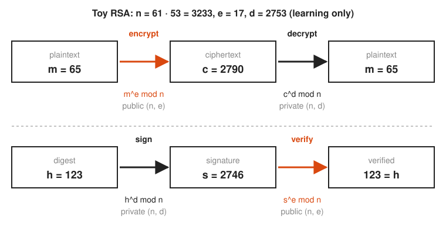

RSA uses one pair of exponents in two directions. Encrypt with the public exponent $e$, and only the private exponent $d$ undoes it. Sign with $d$, and anyone holding $e$ checks the signature. The orange arrows use the public key.

<!-- diagram: type=sequence actors=Alice,Wire,Bob p=23 g=5 a=6 b=15 caption="Toy Diffie-Hellman" -->
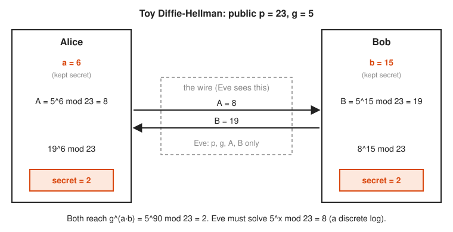

Diffie-Hellman lets two machines agree on a secret over a public wire. Each side keeps a private number, sends a public one, and combines what it receives with what it kept. Both land on the same secret. The eavesdropper sees only the public numbers.

<!-- diagram: type=table+ring hashes=0..19 n_before=4 n_after=5 ring_nodes=4 new_node=1 caption="hash % N reshuffle versus consistent hashing" -->
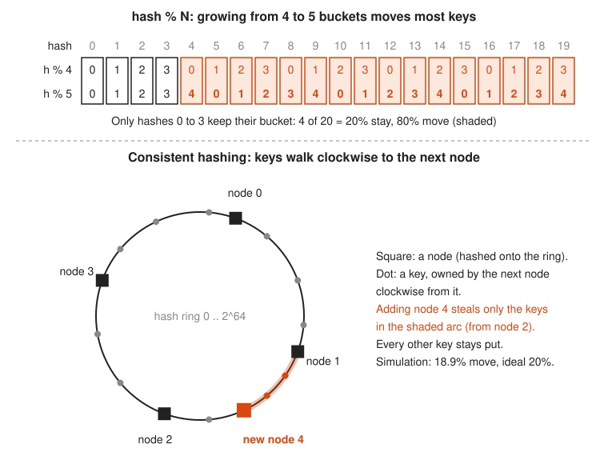

Top: going from four to five buckets, only hashes 0 to 3 keep their bucket in every block of twenty, so 80% of keys move. Bottom: on a ring, a new node takes over one arc. Everyone else stays home.

## Guided Build

### Step 1: Remainders and the % Operator

**The idea:** $a \bmod m$ is the remainder after dividing $a$ by $m$. Two numbers are **congruent** mod $m$ when they leave the same remainder. Written $a \equiv b \pmod m$, it means $m$ divides $a - b$ evenly. A clock is arithmetic mod 12: count past 11 and you wrap to 0.

<!-- diagram: type=clock modulus=12 start=9 step=5 end=2 caption="Clock arithmetic: (9 + 5) % 12 = 2" -->
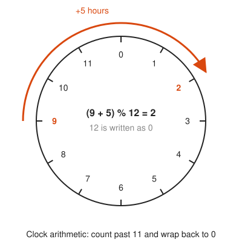

The same idea, drawn a second way: cut the number line into pieces of length 12 and stack them. Every column holds numbers with the same remainder.

<!-- diagram: type=wrapped-number-line modulus=12 rows=-12..35 highlight=14,-4 caption="Numbers in the same column are congruent mod 12" -->
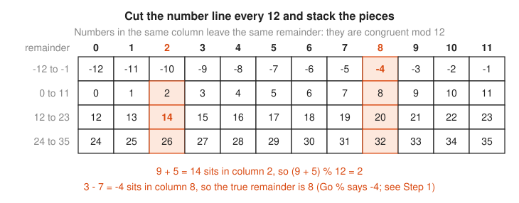

One trap for Go programmers. Go `%` keeps the sign of the left side: `-3 % 7` is `-3`, not `4`. Python returns 4. Math says 4. Write a small helper and use it everywhere a remainder must land in $0, 1, \dots, m-1$.

The other rule: reduce early and often. It keeps numbers small and the answer does not change.

$$(a \cdot b) \bmod m = \big((a \bmod m)(b \bmod m)\big) \bmod m$$

```go
// mod returns a mod m in the range 0..m-1, even for negative a.
func mod(a, m int64) int64 {
	return ((a % m) + m) % m
}
```

```txt
================================================================
1. Modular arithmetic: clock arithmetic and %
================================================================
Clock: 9 plus 5 hours lands on (9 + 5) % 12 = 2
Clock: 3 minus 7 hours, Go (3 - 7) % 12 = -4 (negative!)
Clock: 3 minus 7 hours, mod(3 - 7, 12)  = 8
Go % keeps the sign of the left side; mod() fixes it:
    17 % 7 =  3    mod(  17, 7) = 3
    -3 % 7 = -3    mod(  -3, 7) = 4
    24 % 7 =  3    mod(  24, 7) = 3
   100 % 7 =  2    mod( 100, 7) = 2
Reduce early, reduce often: (a * b) % m == ((a % m) * (b % m)) % m
  (123456 * 789012) % 3233 = 2563
  ((123456 % 3233) * (789012 % 3233)) % 3233 = 2563
```

### Step 2: gcd and the Euclidean Algorithm

**The idea:** the **greatest common divisor** (gcd) of two numbers is the largest number that divides both. Euclid noticed that $\gcd(a, b) = \gcd(b, a \bmod b)$. Repeat until the remainder is 0. The last nonzero remainder is the gcd.

The picture: tile an $a \times b$ rectangle with the largest squares that fit, then tile the leftover strip the same way. The last square size that tiles the strip exactly is the gcd.

<!-- diagram: type=euclid-tiles a=30 b=12 caption="gcd(30, 12) = 6 by tiling" -->
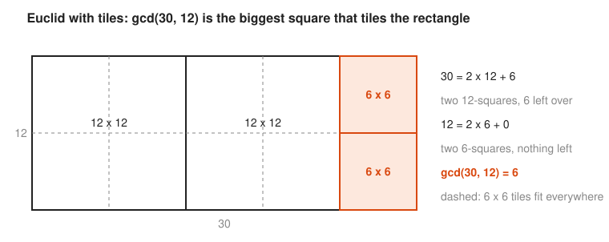

```go
func gcd(a, b int64) int64 {
	for b != 0 {
		a, b = b, a%b
	}
	return a
}
```

### Step 3: The Extended Euclidean Algorithm

**The idea:** Euclid also tells you *how* to build the gcd out of $a$ and $b$. Run Euclid down, then substitute back up. You get whole numbers $x$ and $y$ with

$$a x + b y = \gcd(a, b) \qquad \text{(the Bezout identity)}$$

<!-- diagram: type=back-substitution a=40 b=7 caption="Extended Euclid by hand for 7 mod 40" -->
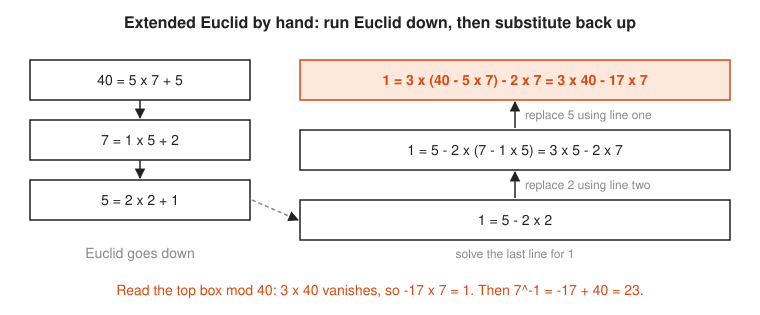

Back-substitution by hand gets messy. The program keeps a running table instead. Every row keeps the promise $r = 3120x + 17y$, so when $r$ reaches 1 the row holds the answer.

```go
// extendedGCD returns (g, x, y) with a*x + b*y = g = gcd(a, b).
// (The program version also takes a verbose flag to print the table.)
func extendedGCD(a, b int64) (int64, int64, int64) {
	oldR, r := a, b
	oldX, x := int64(1), int64(0)
	oldY, y := int64(0), int64(1)
	for r != 0 {
		q := oldR / r
		oldR, r = r, oldR-q*r
		oldX, x = x, oldX-q*x
		oldY, y = y, oldY-q*y
	}
	return oldR, oldX, oldY
}
```

```txt
================================================================
2. gcd and the extended Euclidean algorithm
================================================================
Euclid steps for gcd(3120, 17):
  3120 = 183 * 17 + 9
  17 = 1 * 9 + 8
  9 = 1 * 8 + 1
  8 = 8 * 1 + 0
  gcd = 1

Extended table for (3120, 17); each row keeps r = 3120*x + 17*y:
     q      r      x      y
         3120      1      0
           17      0      1
   183      9      1   -183
     1      8     -1    184
     1      1      2   -367
     8      0    -17   3120
  result: gcd = 1, x = 2, y = -367
  check: 3120 * (2) + 17 * (-367) = 1
```

### Step 4: Modular Inverse

**The idea:** the **inverse** of $e$ mod $m$ is the number $d$ with $e d \equiv 1 \pmod m$. It plays the role of division. It exists exactly when $\gcd(e, m) = 1$, that is, when $e$ and $m$ share no factor.

Picture a multiplication table mod $m$. The inverse of $a$ is the column where row $a$ hits 1. Mod 7 (a prime) every row has exactly one 1. Mod 8, the even rows never hit 1: they share the factor 2 with 8.

<!-- diagram: type=mult-table moduli=7,8 highlight=1 caption="Inverses in multiplication tables mod 7 and mod 8" -->
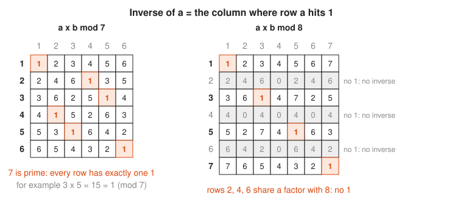

Extended Euclid finds the inverse fast. It gives $e y + m x = 1$. Take both sides mod $m$: the $m x$ term vanishes, and $e y \equiv 1$. The inverse is $y \bmod m$.

$$17 \cdot (-367) \equiv 1 \pmod{3120} \quad\Rightarrow\quad 17^{-1} \equiv -367 + 3120 = 2753 \pmod{3120}$$

```go
func modInverse(e, m int64) (int64, error) {
	g, x, _ := extendedGCD(e, m)
	if g != 1 {
		return 0, fmt.Errorf("%d has no inverse mod %d (gcd = %d)", e, m, g)
	}
	return mod(x, m), nil
}
```

The standard library does the same: `new(big.Int).ModInverse(e, m)`.

```txt
================================================================
3. Modular inverse
================================================================
inverse of 17 mod 3120 = 2753
check: 17 * 2753 = 46801 = 15 * 3120 + 1
math/big: new(big.Int).ModInverse(17, 3120) = 2753
no inverse case: 6 has no inverse mod 3120 (gcd = 6)
```

### Step 5: Fast Modular Exponentiation

**The idea:** RSA raises numbers to powers like 2,753. Multiplying 2,752 times works for toys. For a 2,048-bit exponent it outlasts the sun. Instead, read the exponent in binary. Each bit doubles the exponent built so far (square). A 1 bit adds one more (multiply by the base).

$$b^{2t} = (b^t)^2, \qquad b^{2t+1} = (b^t)^2 \cdot b$$

<!-- diagram: type=ladder exponent=17 caption="Naive versus square-and-multiply for exponent 17" -->
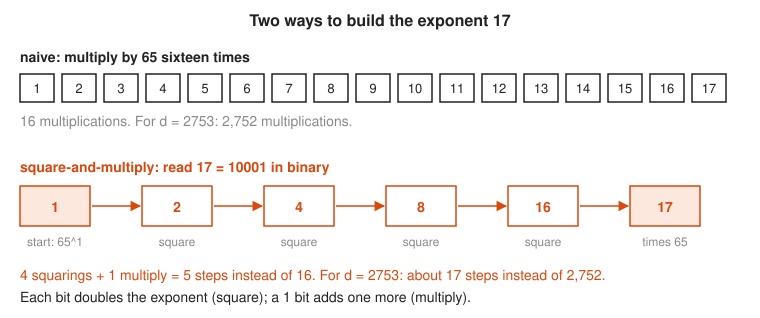

The same idea as a trace, with the actual values mod 3233:

<!-- diagram: type=pipeline steps=5 bits=1,0,0,0,1 values=65,992,1232,1547,2790 caption="65^17 mod 3233 by square-and-multiply" -->
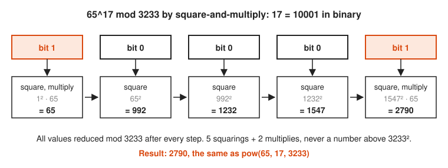

Reduce mod $n$ after every step and no number grows past $n^2$. In Go that matters twice over: $65^{17}$ has 31 digits and overflows `int64` (19 digits). `math/big` holds it, but the reduced loop never needs it.

```go
func modPow(base, exp, m int64) int64 {
	result := int64(1)
	for _, bit := range strconv.FormatInt(exp, 2) {
		result = (result * result) % m
		if bit == '1' {
			result = (result * base) % m
		}
	}
	return result
}
```

The library version is `new(big.Int).Exp(b, e, m)`.

```txt
================================================================
4. Fast modular exponentiation (square-and-multiply)
================================================================
Compute 65^17 mod 3233:
  exponent 17 in binary = 10001
  bit  action             result
    1  square, multiply       65
    0  square                992
    0  square               1232
    0  square               1547
    1  square, multiply     2790
  modPow result             = 2790
  big.Int Exp(65, 17, 3233) = 2790
  65^17 in full             = 6599743590836592050933837890625
  (31 digits; it overflows int64, which holds 19)
  65^17 in full, mod 3233   = 2790

Multiplications needed for exponent 2753:
  binary 101011000001: 12 squarings + 5 multiplies = 17 steps, versus 2752 for naive repeated multiply
```

For a real 2,048-bit exponent, square-and-multiply needs about 3,000 multiplications. The naive loop needs about $2^{2048}$.

### Step 6: Euler Totient

**The idea:** $\varphi(n)$, read "phi of n", counts the numbers from 1 to $n$ that share no factor with $n$. For a prime $p$, every smaller number qualifies: $\varphi(p) = p - 1$. For two different primes, $\varphi(pq) = (p-1)(q-1)$.

<!-- diagram: type=totient n=12,15 caption="Counting phi(12) and phi(15)" -->
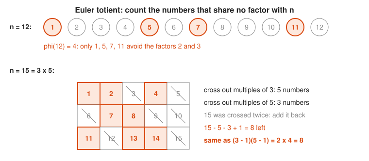

**Euler theorem** says that when $\gcd(a, n) = 1$,

$$a^{\varphi(n)} \equiv 1 \pmod n$$

In plain words: powers of $a$ go round in a loop, and $\varphi(n)$ steps always bring you back to 1. Exponents therefore only matter mod $\varphi(n)$. This one fact makes RSA work.

<!-- diagram: type=power-cycle n=15 bases=2,7 caption="Powers mod 15 loop back to 1" -->
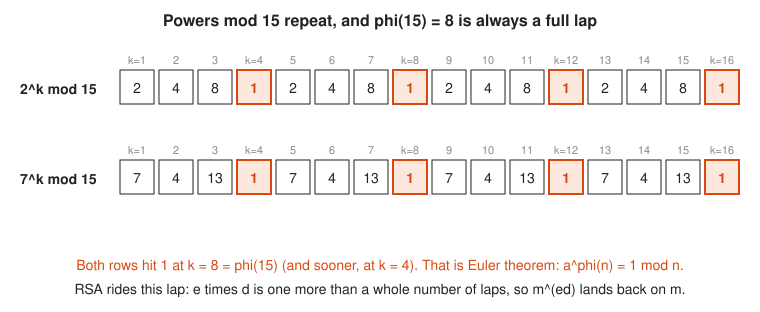

```go
func phiBruteForce(n int64) int64 {
	var count int64
	for k := int64(1); k <= n; k++ {
		if gcd(k, n) == 1 {
			count++
		}
	}
	return count
}
```

```txt
================================================================
5. Euler totient
================================================================
  phi(10) = 4: [1 3 7 9]
  phi(12) = 4: [1 5 7 11]
  phi(13) = 12: [1 2 3 4 5 6 7 8 9 10 11 12]
For n = p*q with p, q prime: phi(n) = (p - 1)(q - 1)
  phi(3233) by counting = 3120
  (61 - 1) * (53 - 1)   = 3120
Euler theorem check: 65^3120 mod 3233 = 1
```

### Step 7: Toy RSA, End to End

**The idea:** pick two secret primes $p, q$. Publish $n = pq$ and an exponent $e$ that shares no factor with $\varphi(n)$. Keep $d = e^{-1} \bmod \varphi(n)$ secret.

<!-- diagram: type=keygen p=61 q=53 e=17 caption="Toy RSA key generation" -->
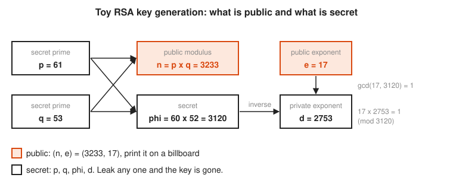

Why decryption works: $ed = 1 + k\varphi(n)$ for some whole number $k$. Encrypting and then decrypting raises $m$ to the power $ed$: one step plus $k$ full laps of the Euler loop.

$$c = m^e \bmod n, \qquad c^d = m^{ed} = m^{1 + k\varphi(n)} = m \cdot \big(m^{\varphi(n)}\big)^k \equiv m \cdot 1^k = m \pmod n$$

The security rests on one gap. Computing $d$ needs $\varphi(n)$. Computing $\varphi(n)$ from $n$ alone needs the factors $p$ and $q$. Factoring a 2,048-bit $n$ is out of reach for everyone. Factoring 3,233 takes 52 trial divisions and a coffee.

```go
var p, q int64 = 61, 53
n := p * q
phi := (p - 1) * (q - 1)
var e int64 = 17
d, _ := modInverse(e, phi)
c := modPow(65, e, n)
back := modPow(c, d, n)
```

```txt
================================================================
6. Toy RSA: key generation, encryption, decryption
================================================================
WARNING: toy RSA. Tiny primes, no padding. For learning only.
  p = 61, q = 53                 two secret primes
  n = p * q = 3233               public modulus
  phi = (p-1)(q-1) = 3120        secret
  e = 17, gcd(e, phi) = 1        public exponent
  d = e^-1 mod phi = 2753        private exponent
  check: e * d mod phi = 1       d really undoes e
  public key  (n, e) = (3233, 17)
  private key (n, d) = (3233, 2753)

  message m = 65
  encrypt c = m^e mod n = 65^17 mod 3233 = 2790
  decrypt   c^d mod n = 2790^2753 mod 3233 = 65

  text "HI" as numbers   [72 73]
  ciphertext             [3000 1486]
  decrypted numbers      [72 73] -> "HI"
```

Encrypting text one letter at a time, as above, is a classic textbook mistake. Every `H` becomes `3000`, so letter frequencies leak and a newspaper puzzle solver reads the message. Real RSA encrypts one random session key, with randomized OAEP padding.

### Step 8: Sign and Verify

**The idea:** run RSA backwards. The holder of $d$ computes $s = h^d \bmod n$ for a message digest $h$ (a **digest** is the fixed-size output of a hash function such as SHA-256). Anyone with the public key checks that $s^e \bmod n = h$. Only the holder of $d$ makes an $s$ that passes.

$$s^e = h^{de} \equiv h \pmod n$$

The bottom row of the RSA flow diagram in Picture It shows this direction.

```go
var h int64 = 123
s := modPow(h, d, n) // sign with the private key
v := modPow(s, e, n) // verify with the public key
```

```txt
================================================================
7. Toy RSA: sign and verify
================================================================
  message digest h = 123  (toy stand-in for a real hash)
  sign   s = h^d mod n = 123^2753 mod 3233 = 2746
  verify s^e mod n = 2746^17 mod 3233 = 123 -> VALID
  tampered s = 2747: s^e mod n = 837 -> INVALID

Why it is toy: factor n by trial division:
  3233 = 53 * 61  (found after 52 tries)
```

### Step 9: Diffie-Hellman

**The idea:** both sides agree in public on a prime $p$ and a **generator** $g$, a number whose powers hit every nonzero remainder mod $p$. Alice picks secret $a$ and sends $A = g^a \bmod p$. Bob picks secret $b$ and sends $B = g^b \bmod p$. Then

$$B^a = (g^b)^a = g^{ab} = (g^a)^b = A^b \pmod p$$

The attacker sees $g$, $p$, $A$, and $B$, and has to recover $a$ from $g^a \bmod p$. That is the **discrete logarithm problem**: undo a modular power. With 23 numbers a loop finds it at once. With a 2,048-bit prime, no known method finishes.

Why is it hard? Powers mod $p$ jump around with no slope to climb:

<!-- diagram: type=scatter x=k(1..22) y=5^k mod 23 highlight=6,15 caption="Powers of 5 mod 23" -->
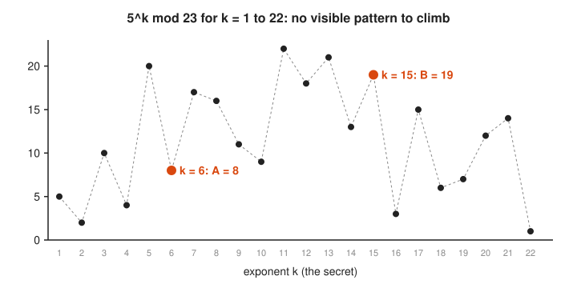

Run it: `go run ./code/diffiehellman`

```go
A := modPow(G, a, P) // Alice sends this
B := modPow(G, b, P) // Bob sends this
sAlice := modPow(B, a, P)
sBob := modPow(A, b, P)
```

```txt
============================================================
1. Powers of g = 5 mod p = 23
============================================================
  5^1  mod 23 =  5  #####
  5^2  mod 23 =  2  ##
  5^3  mod 23 = 10  ##########
  5^4  mod 23 =  4  ####
  5^5  mod 23 = 20  ####################
  5^6  mod 23 =  8  ########
  5^7  mod 23 = 17  #################
  5^8  mod 23 = 16  ################
  5^9  mod 23 = 11  ###########
  5^10 mod 23 =  9  #########
  5^11 mod 23 = 22  ######################
  5^12 mod 23 = 18  ##################
  5^13 mod 23 = 21  #####################
  5^14 mod 23 = 13  #############
  5^15 mod 23 = 19  ###################
  5^16 mod 23 =  3  ###
  5^17 mod 23 = 15  ###############
  5^18 mod 23 =  6  ######
  5^19 mod 23 =  7  #######
  5^20 mod 23 = 12  ############
  5^21 mod 23 = 14  ##############
  5^22 mod 23 =  1  #
  distinct values: 22 of 22 -> g is a generator

============================================================
2. Each side picks a secret and publishes g^secret mod p
============================================================
  Alice secret a = 6    sends A = 5^6 mod 23 = 8
  Bob   secret b = 15   sends B = 5^15 mod 23 = 19

============================================================
3. Both sides compute the shared secret
============================================================
  Alice: B^a mod p = 19^6 mod 23 = 2
  Bob:   A^b mod p = 8^15 mod 23 = 2
  direct: g^(a*b) mod p = 5^90 mod 23 = 2
  match: true

============================================================
4. What Eve sees on the wire
============================================================
  p = 23, g = 5, A = 8, B = 19
  Eve does NOT see a, b, or the shared secret.
  Naive guess g^(A*B) mod p = 12 (wrong)
  Naive guess A*B mod p     = 14 (wrong)
  Brute force: try every x until g^x mod p == A
    found x = 6 after 6 tries; secret = B^x mod p = 2
  With a 2048-bit p the same loop needs about 2^2048 tries.
  This hard problem is the discrete logarithm problem.
```

Plain Diffie-Hellman has no identity check. An attacker in the middle runs one exchange with Alice and another with Bob, and both feel fine about it. TLS stops that by signing the exchange with the certificate key from Step 8.

### Step 10: Hashing Into Buckets and the Reshuffle Problem

**The idea:** a good hash spreads keys evenly over a huge range. `% N` folds that range onto $N$ buckets, so each bucket gets about $1/N$ of the keys. The trap appears when $N$ changes. A key stays put only when $h \bmod N = h \bmod (N+1)$. In every block of $N(N+1)$ consecutive hashes, that happens for exactly $N$ of them. So

$$\text{fraction that stays} = \frac{N}{N(N+1)} = \frac{1}{N+1}, \qquad \text{fraction that moves} = \frac{N}{N+1}$$

Growing from four to five cache nodes moves about 80% of keys. The cache forgets almost everything in one deploy, and the database learns what load means.

**Consistent hashing** puts keys and nodes on the same ring of hash values. Each key belongs to the next node clockwise. A new node takes over one arc, so only about $1/(N+1)$ of keys move, all of them to the new node. Each node gets many **virtual nodes** (100 points on the ring here) to even out the arc lengths.

<!-- diagram: type=grouped-bars groups=2->3,4->5,8->9,16->17 series=hash%N,ring,ideal caption="Keys moved by hash % N versus consistent hashing" -->
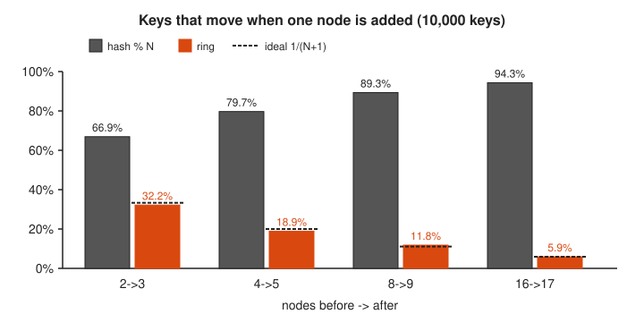

The program hashes with SHA-256 from `crypto/sha256` and keeps the first 8 bytes. Never pick a shard with Go map order or `hash/maphash`: both are randomized per process by design.

Run it: `go run ./code/hashbuckets`

```go
// lookup walks clockwise to the first node point after the key.
func (r Ring) lookup(keyHash uint64) int {
	i := sort.Search(len(r.points), func(i int) bool { return r.points[i].pos > keyHash })
	if i == len(r.points) {
		i = 0 // wrap around the ring
	}
	return r.points[i].owner
}
```

```txt
============================================================
1. hash(key) % 4 spreads 10,000 keys evenly
============================================================
  user:0   hash =  3006746966777050670  % 4 = 2
  user:1   hash = 12376917051461176197  % 4 = 1
  user:2   hash =   114104486020581965  % 4 = 1
  ...
  bucket 0:  2,534  #########################
  bucket 1:  2,493  ########################
  bucket 2:  2,450  ########################
  bucket 3:  2,523  #########################

============================================================
2. Grow from 4 to 5 buckets with hash % N
============================================================
  keys that change bucket: 7,973 of 10,000 (79.7%)
  ideal (only the fair share of the new bucket moves): 2,000 (20.0%)

============================================================
3. Same change with a consistent-hash ring (100 vnodes/node)
============================================================
  keys that change node: 1,892 of 10,000 (18.9%)
  keys that moved somewhere other than the new node 4: 0
  load after the change:
  node 0:  1,835  ##################
  node 1:  2,159  #####################
  node 2:  2,196  #####################
  node 3:  1,918  ###################
  node 4:  1,892  ##################

============================================================
4. Summary: fraction of keys that move when N -> N+1
============================================================
  N->N+1     hash % N     ring  ideal 1/(N+1)
  2->3          66.9%    32.2%          33.3%
  4->5          79.7%    18.9%          20.0%
  8->9          89.3%    11.8%          11.1%
  16->17        94.3%     5.9%           5.9%
```

The `hash % N` column tracks $N/(N+1)$: 66.7%, 80.0%, 88.9%, 94.1%. The ring column tracks the ideal $1/(N+1)$.

## Worked Numbers

### Example 1: Inverse of 7 mod 40 by Hand

```txt
  40 = 5*7 + 5                    divide 40 by 7
   7 = 1*5 + 2                    divide 7 by remainder 5
   5 = 2*2 + 1                    divide 5 by remainder 2; gcd = 1, inverse exists
   1 = 5 - 2*2                    solve the last line for 1
   1 = 5 - 2*(7 - 1*5)            replace 2 using line two
     = 3*5 - 2*7                  collect the 5s and 7s
   1 = 3*(40 - 5*7) - 2*7         replace 5 using line one
     = 3*40 - 17*7                collect again: Bezout identity
  -17*7 = 1 (mod 40)              the 3*40 term is 0 mod 40
  -17 + 40 = 23                   add 40 to land in 0..39
  check: 7*23 = 161 = 4*40 + 1    remainder 1, correct
```

### Example 2: 5^15 mod 23 by Square-and-Multiply

```txt
  15 = 1111 in binary             four bits, all ones
  start r = 1
  bit 1: r = 1^2 * 5   = 5        square, then multiply (1 bit)
  bit 1: r = 5^2 * 5   = 125      square, multiply
         125 mod 23    = 10       125 - 5*23 = 10
  bit 1: r = 10^2 * 5  = 500      square, multiply
         500 mod 23    = 17       500 - 21*23 = 17
  bit 1: r = 17^2 * 5  = 1445     square, multiply
         1445 mod 23   = 19       1445 - 62*23 = 19
  5^15 mod 23 = 19                matches B, the public value of Bob
```

### Example 3: A Pocket RSA With p = 5, q = 11

```txt
  n = 5 * 11 = 55                 public modulus
  phi = 4 * 10 = 40               (p - 1)(q - 1)
  e = 7                           gcd(7, 40) = 1, valid public exponent
  d = 23                          inverse of 7 mod 40, from Example 1
  m = 2                           message, must be less than n
  c = 2^7 mod 55 = 128 mod 55     encrypt with the public key
    = 18                          128 - 2*55 = 18
  18^23 mod 55 = 2                decrypt with the private key
```

### Example 4: Why 80% of Keys Move From 4 to 5 Buckets

```txt
  period of (h mod 4, h mod 5) = 20     4 and 5 share no factor, so the pattern repeats every 20
  h = 0, 1, 2, 3: h mod 4 = h mod 5     both equal h itself
  h = 4: 0 vs 4                         differ
  h = 5..19: differ every time          the two clocks only line up again at 20
  stay = 4 / 20 = 1/5 = 20%             same as 1/(N+1) with N = 4
  move = 16 / 20 = 4/5 = 80%            simulation shows 79.7%
```

## Common Mistakes

* Trusting Go `%` with negative numbers: `-3 % 7` is `-3` in Go, C, and Java. Normalize with `((a % m) + m) % m`.
* Computing the full power, then reducing: $65^{17}$ already overflows `int64`. Reduce after every multiplication, or use `big.Int.Exp`.
* Overflow inside `modPow` with larger moduli: `result * result` overflows `int64` once $m$ passes about $3 \times 10^9$. Switch to `math/big` (or `math/bits.Mul64`) before that.
* Reducing the exponent mod $n$ instead of mod $\varphi(n)$: exponents live mod $\varphi(n)$ (Euler theorem). Bases live mod $n$.
* Picking $e$ with $\gcd(e, \varphi(n)) \ne 1$: no inverse $d$ exists. For example $e = 6$ fails for $\varphi = 3120$.
* Encrypting a message $m \ge n$: the result decrypts to $m \bmod n$, not $m$.
* Using textbook RSA for anything real: no padding means equal messages give equal ciphertexts, small messages leak, and signatures can be forged by multiplying them. Use a vetted library.
* Picking a shard with a randomized hash: Go map order and `hash/maphash` seeds change per process, and so does Python `hash()`. Two workers disagree. Use a stable hash such as SHA-256, xxHash, or FNV (`hash/fnv`).
* Treating `hash % N` as safe to resize: changing $N$ moves about $N/(N+1)$ of all keys. Use consistent hashing or rendezvous hashing when the node count changes.

## Try It

1. In Go, what do `17 % 5`, `-17 % 5`, and `mod(-17, 5)` return?
2. Find $\gcd(252, 198)$ with the Euclidean algorithm.
3. Use the mod 7 table to find the inverse of 3 mod 7.
4. Find the inverse of 7 mod 40 and check it.
5. Compute $3^{13} \bmod 7$ by square-and-multiply.
6. Find $\varphi(15)$ and $\varphi(17)$.
7. With the pocket RSA key from Example 3 ($n = 55$, $e = 7$, $d = 23$), encrypt $m = 42$, then decrypt the result.
8. Toy Diffie-Hellman with $p = 23$, $g = 5$, Alice secret $a = 4$, Bob secret $b = 3$: find $A$, $B$, and the shared secret.
9. Explain why $e = 6$ fails as a public exponent when $\varphi(n) = 3120$.
10. A cache tier grows from ten to eleven nodes. Estimate the fraction of keys that move with `hash % N` and with consistent hashing.

<details>
<summary>Answers</summary>

1. `2`, `-2`, and `3`: Go keeps the sign of the left side, and the helper adds 5 to land in 0 to 4.
2. 18: $252 = 1 \cdot 198 + 54$, $198 = 3 \cdot 54 + 36$, $54 = 1 \cdot 36 + 18$, $36 = 2 \cdot 18 + 0$.
3. 5: row 3 hits 1 in column 5, because $3 \cdot 5 = 15 = 2 \cdot 7 + 1$.
4. 23: $7 \cdot 23 = 161 = 4 \cdot 40 + 1$.
5. 3: $13 = 1101_2$, running values 3, 6 (square 9 to 2, times 3), 1 (square of 6 is 36, which is 1), 3 (square 1, times 3).
6. $\varphi(15) = 8$ (1, 2, 4, 7, 8, 11, 13, 14) and $\varphi(17) = 16$ because 17 is prime.
7. $c = 42^7 \bmod 55 = 48$, and $48^{23} \bmod 55 = 42$: decryption recovers the message.
8. $A = 5^4 \bmod 23 = 4$, $B = 5^3 \bmod 23 = 10$, secret $= 10^4 \bmod 23 = 4^3 \bmod 23 = 18$.
9. $\gcd(6, 3120) = 6 \ne 1$, so 6 has no inverse mod 3120 and no private exponent $d$ exists.
10. About $10/11 \approx 90.9\%$ with `hash % N`, about $1/11 \approx 9.1\%$ with consistent hashing.

</details>

## Where This Shows Up at Work

* TLS certificates and handshakes: RSA or ECDSA signatures prove server identity. ECDHE (Diffie-Hellman on an elliptic curve) agrees on session keys with forward secrecy.
* SSH: host keys and user keys are RSA, ECDSA, or Ed25519. The key exchange is Diffie-Hellman (often X25519).
* Secrets management: Vault, KMS, and sealed-secret tools wrap data keys with RSA-OAEP or elliptic-curve keys.
* Code signing and package verification: signed container images, Git commit signatures, and apt or rpm repositories all verify with the public half of a key pair.
* Sharding and caching: `hash % N` for Kafka partitions, Redis Cluster hash slots (CRC16 mod 16,384, a fixed $N$ that dodges the reshuffle), and consistent hashing in Memcached clients, Envoy ring-hash load balancing, Cassandra, and DynamoDB.
* Scheduling: round-robin rotations (`requestID % N`) and on-call rotas are clock arithmetic.

## Go Deeper

* [601 Proof and Higher Math](../../course/601/README.md): proofs of Bezout, Fermat little theorem, and Euler theorem.
* [Number Theory track](../../tracks/number-theory/README.md): congruences, primes, and totients step by step.
* [Abstract Algebra track](../../tracks/abstract-algebra/README.md): groups, generators, and why the nonzero remainders mod a prime form a cycle.
* [301 Algebra II, Trig and Precalculus](../../course/301/README.md): exponent rules behind square-and-multiply.
* [Games and Probability](../games-and-probability/README.md): the birthday problem, which sets how many bits a hash needs before collisions appear.
* [Cryptography on Khan Academy](https://www.khanacademy.org/computing/computer-science/cryptography): a plain, visual unit on modular arithmetic, Diffie-Hellman, and RSA.
* [Euclidean algorithm on Wolfram MathWorld](https://mathworld.wolfram.com/EuclideanAlgorithm.html): a compact reference with the extended form.
* [Totient function on Wolfram MathWorld](https://mathworld.wolfram.com/TotientFunction.html): formulas and a table of values.
