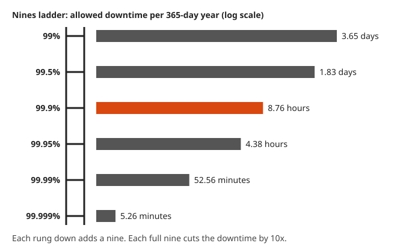
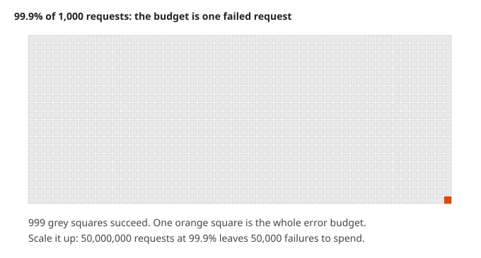
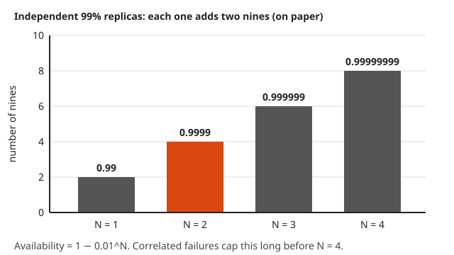

# Probability for On-Call: Error Budgets and SLOs

**Math used:** percentages, multiplying probabilities, the complement rule, exponents · **Level needed:** 201 (with the probability unit of 501) · **Time:** 90 minutes
**Run it:** `go run ./code/burnrate` (also `./code/nines` and `./code/availability`), from this folder

## The Real Problem

A team promises 99.9% availability over a rolling 30-day window. That promise is an **SLO** (service level objective): a target for the fraction of time, or of requests, that goes well. Three questions follow. How much downtime does the promise allow? Is a 1.44% error rate over the last hour worth waking someone at 3 AM? Do two replicas behind a load balancer buy another nine, or only look like they do?

All three are probability with small numbers. The SLO is a chance of success. The **error budget** is the chance of failure that the SLO leaves over. The **burn rate** compares two speeds of spending. Redundancy is the multiplication rule for independent events. The arithmetic is short. The traps hide in the assumptions: which window, a ratio or a difference, and independence that real outages ignore.

Each piece below gets a Go program, its real output, and at least one picture. The alert thresholds match the multiwindow, multi-burn-rate alerts in the Google SRE Workbook. The universe does not care about your SLO. The math at least tells you how much it is allowed not to care.

## The Math You Need

* [Percent and decimals (101)](../../course/101/README.md): convert `99.95%` to `0.9995` and back without losing a zero.
* [Exponents (301)](../../course/301/README.md): repeated multiplication, such as $0.99^{168}$ and $0.01^3$, and how a power of ten moves the decimal point.
* [Probability (501)](../../course/501/README.md): the complement rule $P(\text{not } A) = 1 - P(A)$, and the product rule for independent events $P(A \text{ and } B) = P(A)\,P(B)$.
* [Probability track](../../tracks/probability/README.md): independence in plain words (one event tells you nothing about the other), and why shared causes break it.

## Picture It

<!-- diagram: type=bar-ladder scale=log values=99,99.5,99.9,99.95,99.99,99.999 measure=downtime-per-year highlight=99.9 caption="Nines ladder" -->


The nines ladder shows allowed downtime per 365-day year. A full nine divides the downtime by ten: 8.76 hours at 99.9%, 52.56 minutes at 99.99%. The bars use a log scale (each step is a multiplication, not an addition), therefore equal steps on the ladder look equal even though each one is ten times smaller in real minutes.

<!-- diagram: type=line-chart x=day:0..30 y=budget-remaining:0..1 series=0.5x,1x,2x,6x,14.4x highlight=14.4x caption="Budget burn-down by burn rate" -->


The burn-down chart plots the fraction of the error budget left. A burn rate of 1x is steady spend: the budget reaches zero exactly at the end of the window. Faster rates are steeper lines. A 14.4x burn empties the budget in 50 hours, which is why the fast page fires after one hour of it.

<!-- diagram: type=block-diagram layouts=series,parallel blocks=A:0.99,B:0.99 caption="Series versus parallel availability" -->


The block diagram shows the two ways to combine parts. In **series**, a request needs every block, therefore the up-chances multiply and the total is worse than any single block. In **parallel**, a request needs any one block, therefore the down-chances multiply and the total is better than any single block. Both rules assume the blocks fail independently.

## Guided Build

### Step 1: Nines to Downtime

The error budget is the part of the window the SLO allows to go wrong:

$$\text{budget} = 1 - \text{SLO}$$

Multiply the budget by the window length to get allowed downtime. A day is 86,400 seconds, a 30-day window is 2,592,000 seconds, and a 365-day year is 31,536,000 seconds.

```go
func budget(sloPercent float64) float64 { return 1 - sloPercent/100 }

fmt.Printf("%7g%%  %8.5f  %10s  %10s  %10s\n", slo, b,
	human(b*daySec), human(b*monthSec), human(b*yearSec))
```

```txt
1. Allowed downtime per window (budget = 1 - SLO)

     SLO    budget     per day    per 30 d    per year
------------------------------------------------------
     99%   0.01000   14.40 min      7.20 h      3.65 d
   99.5%   0.00500    7.20 min      3.60 h      1.83 d
   99.9%   0.00100    1.44 min   43.20 min      8.76 h
  99.95%   0.00050     43.20 s   21.60 min      4.38 h
  99.99%   0.00010      8.64 s    4.32 min   52.56 min
 99.999%   0.00001      0.86 s     25.92 s    5.26 min

2. Nines ladder: downtime per year, log scale (each '#' = x1.25)

     99%    5,256.0 min  ######################################
   99.5%    2,628.0 min  ###################################
   99.9%      525.6 min  ############################
  99.95%      262.8 min  #########################
  99.99%       52.6 min  ##################
 99.999%        5.3 min  #######

Each extra nine divides the downtime by 10.
```

Remember one row: 99.9% over 30 days is 43.2 minutes. Every other row is that number moved by a power of ten or halved. Five nines is 26 seconds a month, roughly one slow restart.

### Step 2: The Budget in Requests

For a request-based SLO, the budget counts failed requests instead of minutes:

$$\text{allowed failures} = (1 - \text{SLO}) \times \text{total requests}$$

<!-- diagram: type=unit-grid cells=1000 highlight=1 caption="One failed request in a thousand" -->


The grid is 99.9% made visible: out of every thousand requests, one is allowed to fail. That single orange square is the whole budget.

```go
allowed := int64(math.Round(budget(slo) * float64(monthly)))
```

```txt
3. Error budget in requests for 50,000,000 requests per 30 days

     99%       500,000 failed requests allowed
   99.5%       250,000 failed requests allowed
   99.9%        50,000 failed requests allowed
  99.95%        25,000 failed requests allowed
  99.99%         5,000 failed requests allowed
 99.999%           500 failed requests allowed
```

A request budget grows and shrinks with traffic. A quiet week spends fewer failures at the same error rate. That is why the next step uses the error rate, not the raw count.

### Step 3: Burn Rate

The **burn rate** compares the current error rate with the error rate that spends the budget exactly over the window:

$$\text{burn rate} = \frac{\text{observed error rate}}{1 - \text{SLO}}$$

A burn rate of 1 is steady spend. A burn rate of 2 empties the budget in half the window. Think of it as the speedometer, with the budget as the fuel tank.

```go
func burnRate(errorRate float64) float64 { return errorRate / budgetFr }
```

```txt
2. Burn rate = observed error rate / (1 - SLO)
   error rate  0.05%  ->  burn rate   0.5x
   error rate  0.10%  ->  burn rate   1.0x
   error rate  0.20%  ->  burn rate   2.0x
   error rate  0.60%  ->  burn rate   6.0x
   error rate  1.44%  ->  burn rate  14.4x
   error rate  5.00%  ->  burn rate  50.0x
```

### Step 4: Budget Consumed in a Window

At a constant burn rate $r$, a window of $w$ hours inside a period of $T$ hours spends this fraction of the whole budget:

$$\text{consumed} = \frac{r \times w}{T}$$

The SRE Workbook picks its thresholds backwards: first decide how much budget is worth waking someone for, then solve for the burn rate. With $T = 720$ hours:

$$14.4 \times \frac{1}{720} = 0.02 \qquad 6 \times \frac{6}{720} = 0.05 \qquad 1 \times \frac{72}{720} = 0.10$$

Each alert has two windows. The **long window** (1 hour for the fast page) proves the burn is real and not one bad minute. The **short window** (one twelfth as long, 5 minutes) proves the burn is still happening. The alert fires only when both are above the threshold.

```go
func consumed(rate, windowH float64) float64 { return rate * windowH / periodH }
```

```txt
3. Multiwindow, multi-burn-rate alerts (SRE Workbook, SLO 99.9%, 30 d)
   action   burn   long   short  err rate  consumed
   page    14.4x     1h      5m     1.44%      2.0%
   page     6.0x     6h     30m     0.60%      5.0%
   ticket   1.0x    72h      6h     0.10%     10.0%

   consumed = burn x long window / 720 h
   14.4 x 1 / 720 = 0.02   6 x 6 / 720 = 0.05   1 x 72 / 720 = 0.10
```

<!-- diagram: type=line-chart x=minute:0..240 series=raw,avg5m,avg1h threshold=0.0144 incident=60..120@3% shade=page:87..121 caption="Multiwindow burn-rate alert timeline" -->


The timeline shows why both windows matter. The incident runs from minute 60 to 120 at a 3% error rate. The 1-hour average needs 27 minutes to climb past 1.44%, therefore the page starts at minute 87. The 5-minute average drops right after the fix, therefore the page clears at minute 121. On its own, the 1-hour average keeps shouting until minute 151, half an hour after the problem is gone. Nobody enjoys being paged for history.

In PromQL terms, the fast page reads: `error ratio over 1h > 14.4 * 0.001 and error ratio over 5m > 14.4 * 0.001`.

### Step 5: Time to Exhaustion

Solve the consumed formula for the window that spends everything left. With a remaining fraction $f$:

$$t_{\text{exhaust}} = \frac{f \times T}{r}$$

```go
func hoursLeft(rate, remaining float64) float64 { return remaining * periodH / rate }
```

```txt
4. Time to exhaustion = remaining x 720 h / burn rate
     burn         full budget    40% left
     0.5x   1440.00 h (60.0 d)    576.00 h
       1x    720.00 h (30.0 d)    288.00 h
       2x    360.00 h (15.0 d)    144.00 h
       6x    120.00 h ( 5.0 d)     48.00 h
    14.4x     50.00 h ( 2.1 d)     20.00 h
      36x     20.00 h ( 0.8 d)      8.00 h
```

A burn rate below 1 never empties the budget inside the window. The 0.5x row shows 60 days only to make the slope visible. The burn-down chart in Picture It draws this table as lines.

The program also plays a month with a quiet 0.5x background and one six-hour incident at 14.4x on day 10:

```txt
5. Burn-down: 0.5x steady, 14.4x incident for 6 h starting day 10
   day  0  100.0%  ##################################################
   day  2   96.7%  ################################################
   day  4   93.3%  ###############################################
   day  6   90.0%  #############################################
   day  8   86.7%  ###########################################
   day 10   83.3%  ##########################################
   day 12   68.4%  ##################################
   day 14   65.1%  #################################
   day 16   61.8%  ###############################
   day 18   58.4%  #############################
   day 20   55.1%  ############################
   day 22   51.8%  ##########################
   day 24   48.4%  ########################
   day 26   45.1%  #######################
   day 28   41.8%  #####################
   day 30   38.4%  ###################
   incident cost: 14.4 x 6 / 720 = 12.0% of the budget
```

Six bad hours cost as much as about seven quiet days at 0.5x (12% against 1.67% per day).

### Step 6: Series Availability

When a request needs every component, the system is up only if all of them are up. For independent components, multiply:

$$A_{\text{series}} = A_1 \times A_2 \times \cdots \times A_n$$

```go
func series(avail ...float64) float64 {
	out := 1.0
	for _, a := range avail {
		out *= a
	}
	return out
}
```

```txt
1. Series: load balancer -> app -> database
   0.9999 x 0.999 x 0.9995 = 0.998401  (99.8401%)
   The chain is worse than its weakest link (99.9%).
```

A quick estimate: for small budgets, the series budget is close to the sum of the component budgets: $0.0001 + 0.001 + 0.0005 = 0.0016$, against the exact $0.001599$.

### Step 7: Parallel Availability and N Replicas

A **replica** is a copy of a service that can take the same traffic. When any one replica is enough, the system is down only if all replicas are down. For independent replicas, multiply the failure chances and take the complement:

$$A_{\text{parallel}} = 1 - (1 - A)(1 - B) \qquad A_N = 1 - (1 - A)^N$$

```go
func parallel(avail ...float64) float64 {
	down := 1.0
	for _, a := range avail {
		down *= 1 - a
	}
	return 1 - down
}
```

```txt
2. Parallel: N replicas, each up 99% of the time
   N=1  1 - 0.01^1 = 0.9900000000   down  5256.0000 min/yr
   N=2  1 - 0.01^2 = 0.9999000000   down    52.5600 min/yr
   N=3  1 - 0.01^3 = 0.9999990000   down     0.5256 min/yr
   N=4  1 - 0.01^4 = 0.9999999900   down     0.0053 min/yr
   N=5  1 - 0.01^5 = 0.9999999999   down     0.0001 min/yr
```

<!-- diagram: type=bar-chart x=N:1..4 y=nines values=2,4,6,8 highlight=2 caption="Nines gained per independent replica" -->


Each extra 99% replica adds two nines, on paper. Paper is very reliable. The next two steps test the claim.

### Step 8: Check the Formula by Simulation

The program flips a seeded coin for each replica in each of 1,000,000 minutes. Each replica is down in 5% of minutes. A minute counts as an outage for N replicas when the first N are all down. The seed is fixed (`rand.NewPCG(42, 42)`), therefore every run prints the same numbers.

```go
d1 := rng.Float64() < q
d2 := rng.Float64() < q
d3 := rng.Float64() < q
```

```txt
3. Simulation: replicas each down 5% of minutes, 1,000,000 minutes, seed 42
    N     formula   simulated  outage minutes
    1    0.950000    0.950464          49,536
    2    0.997500    0.997551           2,449
    3    0.999875    0.999883             117
```

The simulation agrees with $1 - 0.05^N$ within the noise of the sample. It agrees only because the code draws each replica on its own, with nothing shared.

### Step 9: Correlated Failure

Put both replicas in one **availability zone** (one data center, or one group of them, that can fail as a unit). The zone is down in 1% of minutes and takes both replicas with it. Each replica also fails on its own in 5% of minutes. One replica alone is up $0.99 \times 0.95 = 0.9405$ of the time.

<!-- diagram: type=block-diagram outer=zone:0.99 inner=parallel(replica:0.95,replica:0.95) caption="Correlated failure through a shared availability zone" -->


The naive calculation treats the two replicas as independent:

$$1 - (1 - 0.9405)^2 = 0.996460$$

The correct calculation puts the shared zone in series with the redundant pair:

$$0.99 \times \left(1 - 0.05^2\right) = 0.987525$$

```go
if zone || (n1 && n2) {
	down++
}
```

```txt
4. Correlated failure: two replicas in one availability zone
   zone down 1% of minutes (takes both out), each replica also down 5% on its own
   one replica alone        = 0.99 x 0.95          = 0.940500
   naive independent pair   = 1 - (1 - 0.9405)^2   = 0.996460
   true pair (zone x pair)  = 0.99 x (1 - 0.05^2)  = 0.987525
   simulated pair           = 1,000,000 minutes    = 0.987628
   naive downtime 0.3540%  vs true 1.2475%  (3.5x worse)
```

The pair can never beat the zone it sits in: its availability is capped at 0.99. Shared dependencies (one zone, one DNS provider, one config push, one bad deploy rolled to every replica) turn a parallel block back into a series block.

### Step 10: At Least One Page in a Week

A **page** is an alert that wakes a person. If an alert fires in any given hour with chance $p$, independently, the chance of a quiet week is $(1-p)^{168}$. The complement gives the chance of at least one page:

$$P(\text{at least one page}) = 1 - (1 - p)^{168}$$

```go
fmt.Printf("   p per hour %-6g -> 1 - (1 - p)^168 = %.4f\n", p, 1-math.Pow(1-p, hours))
```

```txt
5. Chance of at least one page in a week (168 hours)
   p per hour 0.001  -> 1 - (1 - p)^168 = 0.1547
   p per hour 0.005  -> 1 - (1 - p)^168 = 0.5692
   p per hour 0.01   -> 1 - (1 - p)^168 = 0.8152
   p per hour 0.02   -> 1 - (1 - p)^168 = 0.9664
   simulation, p = 0.01, 20,000 weeks: 0.8143
```

<!-- diagram: type=line-chart x=hours:0..168 y=P(at-least-one):0..1 series=p:0.02,0.01,0.005,0.001 highlight=0.01 caption="Probability of at least one page over a week" -->


A 1% chance per hour sounds rare. Over a week it means a page in about four weeks out of five. Small chances, given enough hours, stop being small.

## Worked Numbers

### Example 1: A 99.95% SLO Over 30 Days

```txt
  window   = 30 x 24 x 60 = 43,200 min       minutes in a 30-day window
  budget   = 1 - 0.9995   = 0.0005           error budget is the complement of the SLO
  downtime = 43,200 x 0.0005 = 21.6 min      budget fraction times window length
```

### Example 2: A 6x Burn With 70% of the Budget Left

SLO 99.9%. The error rate is 0.6% for two hours. The month started this incident with 70% of the budget left.

```txt
  burn rate = 0.006 / 0.001 = 6                 error rate over budget fraction
  consumed  = 6 x 2 / 720   = 0.01667           burn x window / period
  remaining = 0.70 - 0.01667 = 0.68333          subtract the spend
  exhaust   = 0.68333 x 720 / 6 = 82 h          remaining x period / burn
```

The 6x page (6-hour long window) has not fired yet: only two hours have passed. At this rate the budget lasts about 3.4 more days.

### Example 3: Redundant App Tier in a Chain

A load balancer (99.99%) sends traffic to two app replicas (99.5% each, independent), backed by one database (99.95%).

```txt
  app tier = 1 - (1 - 0.995)^2 = 1 - 0.000025 = 0.999975     parallel rule
  system   = 0.9999 x 0.999975 x 0.9995       = 0.999375     series rule
  budget   = 1 - 0.999375 = 0.000625                         complement
```

The database and the load balancer now own most of the budget. A third app replica buys almost nothing.

### Example 4: Pages per Week at 0.5% per Hour

```txt
  quiet hour      = 1 - 0.005 = 0.995              complement rule
  quiet week      = 0.995^168 = 0.4308             independent hours multiply
  at least one    = 1 - 0.4308 = 0.5692            complement again
  expected pages  = 0.005 x 168 = 0.84             average count, a different question
```

## Common Mistakes

* Mixing windows: 43.2 minutes is the 30-day budget for 99.9%, not the yearly one (8.76 hours). State the window with every budget.
* Treating burn rate as a difference: a 1.44% error rate against a 0.1% budget is 14.4x, not 1.34 points over. The ratio predicts time to exhaustion.
* Paging on the long window alone: a 1-hour window keeps firing for up to an hour after the fix. Add the short window (5 minutes for the 1-hour page).
* Applying the parallel formula to replicas that share a zone, a database, a DNS provider, or a deploy pipeline. Shared parts go in series with the redundant group.
* Adding chances for at least one event: $168 \times 0.01 = 1.68$ is not a probability. Nothing is 168% likely, not even a Friday deploy going wrong. Use $1 - (1-p)^{168}$.
* Losing a zero in conversion: 99.95% is `0.9995`, and its budget is `0.0005`, not `0.005`.

## Try It

1. How many minutes of downtime per 365-day year does a 99.95% SLO allow?
2. A service handles 2,000,000,000 requests in 30 days with a 99.99% request SLO. How many failed requests fit in the budget?
3. The SLO is 99.9% and the error rate holds at 0.3%. What is the burn rate, and how long does a full 30-day budget last?
4. The SLO is 99.99% instead of 99.9%. What error rate trips the 14.4x page, and what fraction of the 30-day budget has it spent after one hour?
5. Three services in series are each 99.9% available. What is the combined availability?
6. Three independent replicas are each 98% available. What is the availability of the group if any one is enough?
7. An alert fires in any hour with chance 0.002, independently. What is the chance of at least one page in a 168-hour week?
8. A quarter of the budget is left and the burn rate is 6x. How many hours until the budget is gone?
9. Two replicas, each down 1% of the time on their own, both depend on one DNS service that is 99.9% available. What is the availability of the pair?
10. Change `part3` in `code/availability/main.go` to use `q := 0.10`. Before you run it, predict the formula column for N = 1, 2, 3.

<details>
<summary>Answers</summary>

1. 262.8 minutes (4.38 hours): $0.0005 \times 525{,}600$.
2. 200,000 failed requests: $0.0001 \times 2{,}000{,}000{,}000$.
3. 3x, and 240 hours (10 days): $0.003 / 0.001 = 3$, then $720 / 3$.
4. 0.144% error rate, and 2% of the budget: the threshold is $14.4 \times 0.0001$, and $14.4 \times 1 / 720$ does not depend on the SLO.
5. 0.997003 (99.7003%): $0.999^3$.
6. 0.999992: $1 - 0.02^3 = 1 - 0.000008$.
7. About 0.2856: $1 - 0.998^{168}$.
8. 30 hours: $0.25 \times 720 / 6$.
9. 0.9989001: the DNS is in series with the pair, $0.999 \times (1 - 0.01^2)$.
10. 0.9, 0.99, 0.999: $1 - 0.1^N$. The simulated column lands close to these.

</details>

## Where This Shows Up at Work

* SLO dashboards: budget remaining is the burn-down line from Step 5, computed from the error ratio over the rolling window.
* Prometheus and Grafana alert rules: the multiwindow, multi-burn-rate rules from the SRE Workbook, often generated by tools such as Sloth or Pyrra.
* Release policy: a team freezes risky deploys when the budget runs low, and spends a healthy budget on experiments and migrations.
* Architecture review: the series and parallel rules give a first estimate of the availability a design can promise before anyone writes an SLO.
* Multi-zone and multi-region design: correlated failure is the argument for spreading replicas across zones and for removing shared control planes.
* On-call health: the at-least-one rule predicts how often a rotation gets woken up, and shows why many quiet alerts add up to a loud week.

## Go Deeper

* [Site Reliability Engineering, Embracing Risk](https://sre.google/sre-book/embracing-risk/): the origin of the error budget idea and how to pick a target.
* [The Site Reliability Workbook, Alerting on SLOs](https://sre.google/workbook/alerting-on-slos/): the full derivation of the burn-rate alerts used in Steps 4 and 5.
* [Probability course unit (501)](../../course/501/README.md) and the [probability track](../../tracks/probability/README.md): the rules behind every formula here.
* [Statistics for Monitoring and Anomaly Detection](../statistics-for-monitoring-and-anomaly-detection/README.md): the companion workshop on latency percentiles and alert baselines.
