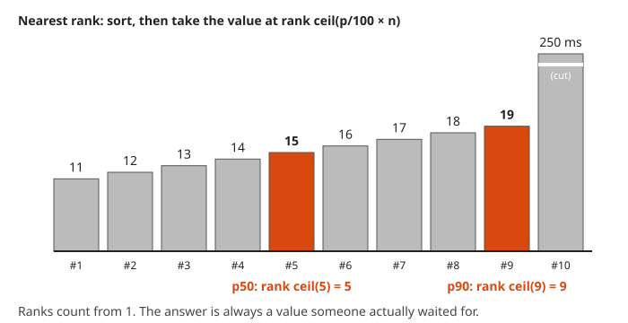

# Statistics for Monitoring and Anomaly Detection

**Math used:** mean, median, percentiles, linear interpolation, variance and standard deviation, z-scores, exponentially weighted averages, median absolute deviation · **Level needed:** 501 (statistics basics; 101 arithmetic to start) · **Time:** 2 hours
**Run it:** `go run ./code/percentiles` (also `./code/p99avg` and `./code/anomaly`), from this folder

## The Real Problem

A latency dashboard shows a mean of 110 ms while users complain about requests that take seconds. A fleet dashboard averages the p99 of every host and reports a number that no request ever saw. An anomaly alert built on "mean plus three standard deviations" fires on healthy traffic and goes quiet halfway through a real regression.

None of these is a tooling bug. Each one is a statistics mistake. Latency is **skewed**: most requests are fast and a few are very slow, therefore the data leans to one side. Percentiles do not add. The standard deviation assumes a tidy, symmetric shape that latency does not have, and one big outlier stretches it enough to hide other outliers.

This workshop builds each summary and each detector by hand on seeded data, prints every number, and draws every idea. The goal is a calm instinct for which number belongs on a dashboard and which one belongs behind a page. The data does not lie. It just answers the question you asked, not the one you meant.

## The Math You Need

* [Arithmetic, fractions, and decimals (101)](../../course/101/README.md): sums, averages, and percentages of a count.
* [Probability (501)](../../course/501/README.md): distributions (the shape data takes when you count how often each value appears) and the normal bell curve.
* [Statistics track](../../tracks/statistics/README.md): mean, median, quantiles, variance, and standard deviation.
* [Probability track](../../tracks/probability/README.md): skewed shapes such as the lognormal, the usual model for latency.

## Picture It

<!-- diagram: type=histogram data=lognormal(median=80,sigma=0.6,n=1000)+5-outliers bins=25ms markers=median:81.5,mean:109.5,p99:353.1 caption="Skewed latency histogram" -->


The histogram shows the usual latency shape: a hump near 50 to 100 ms and a long tail to the right. The median sits in the hump. The mean sits to the right of it, pulled by the tail and by five outliers too far out to draw. The p99 sits deep in the tail. One number cannot describe this shape, which is why latency dashboards show p50, p90, and p99 side by side.

<!-- diagram: type=bar-chart orientation=horizontal values=hostA_p99:99.8,hostB_p99:588.8,avg:344.3,weighted:148.7,true:324.1 highlight=true caption="Two-host p99 averaging trap" -->


The bar chart shows the averaging trap. The plain average of two p99s lands too high. The traffic-weighted average lands far too low. Neither is the true p99, because a percentile depends on where every request sits in the merged line-up, not on two summary numbers.

<!-- diagram: type=time-series t=30..199 series=metric,ewma band=ewma+-3sd alpha=0.1 events=spike:100,shift:150 alerts=100,144,150 caption="EWMA band over a time series" -->
![Time series from t equals 30 to 199. A thin grey line wanders around 100 inside a grey band about 10 units either side. At t equals 100 a single spike reaches 143 and is circled in orange. After it the band balloons to about 66 to 144 and shrinks slowly. At t equals 144 a smaller point at 111.5 is circled in orange. At t equals 150 the series steps up to about 125 and stays there. The first point after the step is circled in orange. The thick black EWMA line climbs toward 125 over about 30 steps and the band swallows the new level.](img/ewma-band.svg)

The EWMA chart shows the detector from Step 9. The thick line is the smoothed baseline. The grey band is the baseline plus or minus three standard deviations. A point alerts when it lands outside the band computed just before it arrives. The spike and the first point of the level shift alert. The band then widens and adapts, which ends the alerts for the shift. One noise point at $t = 144$ also alerts: a false alarm.

## Guided Build

### Step 1: Mean Versus Median on Skewed Data

The **mean** adds every value and divides by the count. The **median** is the middle value after sorting. On a symmetric shape they agree. On a right-skewed shape the mean drifts toward the tail.

$$\bar{x} = \frac{1}{n}\sum_{i=1}^{n} x_i$$

The program draws 1,000 latencies from a **lognormal** distribution (a shape whose logarithm is a bell curve; it never goes below zero and has a long right tail) with a median near 80 ms, then appends five outliers between 1,200 and 6,000 ms. The seed is fixed: `rand.New(rand.NewPCG(42, 42))`.

```go
rng := rand.New(rand.NewPCG(seed, seed))
for i := 0; i < 1000; i++ {
	data = append(data, math.Exp(math.Log(80)+0.6*rng.NormFloat64()))
}
return append(data, outliers...)
```

```txt
1. Summary of 1,005 latencies (ms), seed 42
   mean      109.5
   p50        81.5
   p90       167.0
   p95       204.3
   p99       353.1
   p99.9    4000.0
   max      6000.0
   mean without the 5 outliers: 94.5

2. Histogram, 25 ms bins (each # = 5 requests)
      0-25     23 #####
     25-50    189 ######################################
     50-75    237 ###############################################
     75-100   190 ######################################
    100-125   121 ########################
    125-150    98 ####################
    150-175    62 ############
    175-200    30 ######
    200-225    18 ####
    225-250     9 ##
    250-275     9 ##
    275-300     5 #
    300-325     2 
    325-350     1 
    350-375     2 
    375-400     2 
   400+         7 #
```

Five requests out of 1,005 (half a percent) move the mean from 94.5 ms to 109.5 ms. The median does not notice.

### Step 2: One Slow Request

Adding one value $x_{\text{new}}$ to $n$ values moves the mean by

$$\Delta\bar{x} = \frac{x_{\text{new}} - \bar{x}}{n + 1}$$

```go
slow := append(slices.Clone(first), 30000)
fmt.Println(mean(slow), nearestRank(slow, 50))
```

```txt
3. One slow request
   100 requests:               mean   100.8  median   86.9
   plus one 30,000 ms timeout: mean   396.9  median   88.6
   mean moves by 296.0 ms = (30,000 - 100.8) / 101
   median moves by 1.7 ms
```

<!-- diagram: type=number-line rows=before,after range=0..450 markers=median,mean caption="One slow request moves the mean but not the median" -->


One 30-second timeout nearly quadruples the mean of 100 requests. The mean answers "how much total time did the service spend", which is useful for capacity. It does not answer "how slow does a typical user feel".

### Step 3: The Nearest-Rank Percentile

The **p-th percentile** is the value that p percent of requests are at or below. By the **nearest-rank** method it is the value at rank $\lceil p/100 \times n \rceil$ in the sorted list, counting from one. The symbol $\lceil \cdot \rceil$ means "round up to the next whole number".

$$P_p = x_{(k)}, \qquad k = \left\lceil \frac{p}{100} \cdot n \right\rceil$$

<!-- diagram: type=sorted-bars values=11,12,13,14,15,16,17,18,19,250 highlight=rank5,rank9 caption="Nearest-rank percentile on ten sorted latencies" -->


For the 1,005-point sample, the p99 rank is $\lceil 0.99 \times 1{,}005 \rceil = \lceil 994.95 \rceil = 995$. The p99.9 rank is $\lceil 1{,}003.995 \rceil = 1{,}004$, which lands on the fourth outlier, 4,000 ms.

```go
func nearestRank(data []float64, p float64) float64 {
	s := slices.Clone(data)
	slices.Sort(s)
	rank := int(math.Max(1, math.Ceil(p/100*float64(len(s)))))
	return s[rank-1]
}
```

The nearest-rank percentile is always a real observed value. Other definitions interpolate between neighbours. They differ a little on small samples and agree on large ones.

### Step 4: Prometheus histogram_quantile

Prometheus does not keep raw latencies. A histogram metric keeps **cumulative bucket counts**: how many requests took at most `le` ("less than or equal") milliseconds. `histogram_quantile(q, ...)` estimates a quantile (a percentile written as a fraction: p99 is $q = 0.99$) in three moves:

1. Compute the target rank $r = q \times \text{total}$.
2. Find the first bucket whose cumulative count reaches $r$. Call its bounds $(\ell, u]$, the count below it $c_{\text{below}}$, and the count inside it $c_{\text{in}}$.
3. Assume the requests spread evenly inside the bucket and draw a straight line:

$$\hat{Q}_q = \ell + (u - \ell)\cdot\frac{r - c_{\text{below}}}{c_{\text{in}}}$$

The lowest bucket starts at 0. If the rank lands in the `+Inf` bucket, Prometheus returns the highest finite bound.

<!-- diagram: type=cumulative-line points=0:0,100:60,200:90,400:98 rank=95 answer=325 caption="Linear interpolation inside a histogram bucket" -->


The picture uses Worked Example 2: rank 95 falls in the 200 to 400 bucket, five of its eight requests along, therefore the estimate is five eighths of the way from 200 to 400.

```go
rank := q * float64(total)
for float64(cum[i]) < rank {
	i++
}
est := lower + (bounds[i]-lower)*(rank-float64(below))/float64(cum[i]-below)
```

```txt
4. Prometheus histogram and histogram_quantile
   le=25    cumulative    23
   le=50    cumulative   212
   le=100   cumulative   639
   le=200   cumulative   950
   le=400   cumulative   998
   le=800   cumulative  1000
   le=1600  cumulative  1001
   le=3200  cumulative  1003
   le=+Inf  cumulative  1005

   p99 by linear interpolation:
   rank      = 0.99 x 1005 = 994.95
   bucket    = (200, 400] holds ranks 951..998
   position  = (994.95 - 950) / 48 = 0.9365
   estimate  = 200 + (400 - 200) x 0.9365 = 387.3 ms

       q  histogram_quantile  exact nearest-rank
     0.5             84.0 ms             81.5 ms
     0.9            185.4 ms            167.0 ms
    0.99            387.3 ms            353.1 ms
```

The estimate overshoots the p99 by about 34 ms. Inside the `(200, 400]` bucket the real requests crowd toward 200 ms (the tail thins out), while the formula assumes an even spread.

### Step 5: Bucket Choice

The interpolation error can be as large as the width of the bucket that holds the rank. Narrow buckets near the quantile that matters give a better answer. **Exponential buckets** (each bound a fixed multiple of the last, for example 1.25 times) keep the relative error steady across the range, which suits latency.

```go
for k := 0; k < 30; k++ {
	expo = append(expo, math.Round(10*math.Pow(1.25, float64(k))*10)/10)
}
```

```txt
5. Bucket choice and the p99 estimate (exact p99 = 353.1 ms)
   coarse 100/500/1000      4 buckets  p99 ~  494.4 ms
   doubling 25..3200        9 buckets  p99 ~  387.3 ms
   x1.25 from 10 ms        31 buckets  p99 ~  354.8 ms
   linear 50 ms steps      21 buckets  p99 ~  361.9 ms
```

<!-- diagram: type=bar-chart orientation=horizontal values=coarse:494.4,doubling:387.3,x1.25:354.8,linear50:361.9 reference=353.1 caption="p99 estimates under four bucket layouts" -->


Each bucket is one more time series per label set, therefore more buckets cost storage and query time. Put the resolution where the SLO threshold lives. A bound exactly at the threshold (for example `le="300"` for a 300 ms target) makes "fraction of requests under 300 ms" exact, with no interpolation at all.

### Step 6: Why Averaging p99s Is Wrong

Two hosts serve one service. Host A handles 9,000 requests with a median near 40 ms. Host B handles 1,000 requests with a median near 150 ms and a wider spread.

```go
return lognormal(rng, 40, 0.4, 9000), lognormal(rng, 150, 0.6, 1000)
```

```txt
1. p99 per host versus the true p99
   host A p99 (9,000 req)      99.8 ms  ############
   host B p99 (1,000 req)     588.8 ms  ##########################################################################
   average of p99s            344.3 ms  ###########################################
   traffic-weighted avg       148.7 ms  ###################
   TRUE merged p99            324.1 ms  #########################################
   average of p99s is off by +20.2 ms (+6%)
   weighted average is off by -175.5 ms (-54%)
   requests above the true p99: 1.00%, of which 100 come from host B
   host B p90 = 324.1 ms
```

The slowest 1% of all requests (100 requests) all come from host B. The true p99 is therefore exactly the p90 of host B (rank 900 of its 1,000 requests), a value neither host reports as a p99. No weighting of the two p99s recovers it. Each p99 throws away where its requests sit relative to the other host. The plain average landing within 6% here is luck, not method: change the traffic split and it drifts anywhere.

### Step 7: Sum the Buckets, Then Take the Quantile

Bucket counts are plain counts, and counts add:

$$\text{cumulative}_{\text{fleet}}(\texttt{le}) = \sum_{\text{hosts}} \text{cumulative}_h(\texttt{le})$$

<!-- diagram: type=table-sum rows=hostA,hostB,sum columns=le:25..+Inf caption="Summing histogram buckets across two hosts" -->


```txt
2. Sum the buckets, then take the quantile
   le      host A  host B     sum
   25        1066       2    1068
   50        6386      38    6424
   100       8911     252    9163
   200       8999     689    9688
   400       9000     945    9945
   800       9000     998    9998
   1600      9000    1000   10000
   3200      9000    1000   10000
   +Inf      9000    1000   10000

   rank      = 0.99 x 10000 = 9900.00
   bucket    = (200, 400] holds ranks 9689..9945
   position  = (9900.00 - 9688) / 257 = 0.8249
   estimate  = 200 + (400 - 200) x 0.8249 = 365.0 ms
   histogram_quantile on summed buckets: 365.0 ms
   average of per-host estimates:        419.8 ms
   exact merged p99:                     324.1 ms
```

In PromQL this is `histogram_quantile(0.99, sum by (le) (rate(http_request_duration_seconds_bucket[5m])))`. The `sum by (le)` happens before the quantile. The remaining error (365.0 against 324.1) is bucket width from Step 5, not an aggregation mistake.

### Step 8: Variance, Standard Deviation, and the 3-Sigma Rule

The **variance** is the average squared distance from the mean. The **standard deviation** $\sigma$ (sigma) is its square root, back in the original unit. Divide by $n$ for the population version, by $n - 1$ for the sample estimate:

$$\sigma^2 = \frac{1}{n}\sum (x_i - \bar{x})^2 \qquad s^2 = \frac{1}{n-1}\sum (x_i - \bar{x})^2$$

<!-- diagram: type=number-line+squares data=12,15,11,14,18 mean=14 caption="Variance as the average squared distance from the mean" -->


Squaring does two jobs: it makes every distance positive, and it makes big distances count much more than small ones. Remember that second job. It comes back to bite.

```txt
1. Variance and standard deviation by hand
   data  [12 15 11 14 18]   mean = 70 / 5 = 14
      x  x - mean  squared
     12        -2        4
     15         1        1
     11        -3        9
     14         0        0
     18         4       16
   sum of squares = 30
   population variance = 30 / 5 = 6   sd = 2.449
   sample variance     = 30 / 4 = 7.5   sd = 2.739
```

A **z-score** says how many standard deviations a point sits from the mean: $z = (x - \bar{x}) / \sigma$. The **3-sigma rule** flags $|z| > 3$. For normal (bell-shaped) data that is about 0.27% of points, split evenly between the two sides.

```txt
2. The 3-sigma rule on 100,000 points
   normal     mean  100.1  sd  20.0  band [  40.0,  160.1]  above 0.146%  below 0.158%
   lognormal  mean   96.1  sd  63.5  band [ -94.5,  286.7]  above 1.672%  below 0.000%
   normal theory: 0.135% above and 0.135% below
```

<!-- diagram: type=density-pair shapes=normal(100,20),lognormal(80,0.6) band=mean+-3sd caption="3-sigma band on normal and lognormal shapes" -->


On normal data the rule works as advertised. On lognormal data the upper side fires 1.67% of the time, more than twelve times the textbook rate, and the lower side never fires, because its edge is a negative latency.

A worse failure is **masking**: two large outliers inflate the standard deviation so much that their own z-scores stay under 3.

```txt
3. Masking: outliers inflate the sd and hide from the z-score
   data   [100 102 98 101 99 103 97 100 500 520]
   mean 182.0  sd 164.1   median 100.5  MAD 2
       x       z  robust z
     100   -0.50      -0.2  
     102   -0.49       0.5  
      98   -0.51      -0.8  
     101   -0.49       0.2  
      99   -0.51      -0.5  
     103   -0.48       0.8  
      97   -0.52      -1.2  
     100   -0.50      -0.2  
     500    1.94     134.7  rz>3.5
     520    2.06     141.5  rz>3.5
```

The robust z column comes from Step 10.

### Step 9: EWMA Smoothing and an EWMA Band

An **exponentially weighted moving average** (EWMA) keeps one number and nudges it toward each new point by a fraction $\alpha$ (alpha):

$$m_t = m_{t-1} + \alpha\,(x_t - m_{t-1}) = \alpha x_t + (1 - \alpha)\,m_{t-1}$$

A point $k$ steps old carries weight $\alpha(1-\alpha)^k$. A small $\alpha$ is smooth and slow. A large $\alpha$ is quick and jumpy.

<!-- diagram: type=bar-chart x=steps-ago:0..24 series=alpha0.3,alpha0.1 values=alpha*(1-alpha)^k caption="EWMA weights by age for two alpha values" -->


The same trick tracks an **exponentially weighted variance** (the incremental form from Finch, 2009):

$$d = x_t - m_{t-1}, \qquad m_t = m_{t-1} + \alpha d, \qquad v_t = (1 - \alpha)\left(v_{t-1} + \alpha d^2\right)$$

The detector checks each point against the band from the previous step, then updates:

$$\text{alert if } |x_t - m_{t-1}| > 3\sqrt{v_{t-1}}$$

```go
sd := math.Sqrt(v)
rows = append(rows, row{t, x, m, sd, math.Abs(x-m) > k*sd})
diff := x - m // update after the check
incr := alpha * diff
m += incr
v = (1 - alpha) * (v + diff*incr)
```

The test series has 200 points around 100 with bell-shaped noise ($\sigma = 4$), a single +40 spike at $t = 100$, and a +25 level shift from $t = 150$ onward. The first 30 points seed the mean and the variance.

```txt
4. EWMA band: alpha 0.1, band = mean +/- 3 sd, warm-up 30 points
   alerts at t = [100 144 150]

      t       x    ewma     low    high
     98   100.5   100.4    89.9   111.0
     99   102.7   100.5    90.4   110.5
    100   143.1   100.7    91.0   110.4  ALERT
    101   108.6   104.9    65.6   144.2
    102    99.4   105.3    67.9   142.7
    103   100.9   104.7    68.8   140.6
    ...
    144   111.5    99.6    87.9   111.3  ALERT
    ...
    148   100.6   100.4    85.9   114.8
    149   104.2   100.4    86.7   114.1
    150   127.6   100.8    87.3   114.2  ALERT
    151   122.7   103.5    76.1   130.8
    152   122.1   105.4    74.2   136.6
    153   126.3   107.1    73.9   140.3
    154   120.1   109.0    73.0   144.9
    155   124.8   110.1    74.6   145.6
    156   119.1   111.6    75.4   147.8
    157   129.6   112.3    77.3   147.3

   text plot, one row per 5 points: # bar = highest value in the row,
   | = ewma at the end of the row, ! = an alert in the row, each char = 2 units from 80
   t  30   ###########|##                            105.3
   t  35   ##########|####                           107.6
   ...
   t  95   ##########|##                             103.4
   t 100 ! ############|####################         143.1
   t 105   ############|                             104.3
   ...
   t 135   ##########|###                            105.7
   t 140 ! ##########|######                         111.5
   t 145   ##########|##                             104.2
   t 150 ! ##############|##########                 127.6
   t 155   ##################|#######                129.6
   t 160   ###################|####                  126.2
   t 165   #####################|#####               132.3
   ...
   t 195   ######################|###                130.7
```

Read the results point by point:

* The spike at $t = 100$ alerts. Its squared deviation then multiplies the variance by about 16, and the band balloons from about 19 units wide to about 79. A second +40 spike slips through for the next three points. A +25 spike (to 125) slips through for the next 13 points.
* The level shift alerts once, at $t = 150$. The band widens and the EWMA climbs, therefore $t = 151$ onward stays inside. An EWMA band detects the edge of a shift, then accepts the new level as normal. That is right for a deploy that legitimately moves a baseline, and wrong for a regression that needs a human.
* The point at $t = 144$ is noise. The variance estimate itself is noisy (an effective memory of about 19 points), therefore a 3-sigma band built on it fires more often than the textbook 0.27%.

### Step 10: Median Absolute Deviation

The **median absolute deviation** (MAD) replaces both the mean and the standard deviation with medians:

$$\text{MAD} = \operatorname{median}\left(|x_i - \operatorname{median}(x)|\right)$$

For normal data, $\sigma \approx 1.4826 \times \text{MAD}$. The **modified z-score** of Iglewicz and Hoaglin (the "robust z" column) uses the reciprocal, 0.6745, and flags $|M| > 3.5$:

$$M_i = \frac{0.6745\,(x_i - \operatorname{median}(x))}{\text{MAD}}$$

<!-- diagram: type=number-line-pair data=100,102,98,101,99,103,97,100,500,520 bands=mean+-3sd,median+-3.5robust caption="Mean and standard deviation band versus median and MAD band" -->


Up to half of the data can be garbage before the median or the MAD moves much. That is why the robust column in Step 8 catches both outliers that the z-score missed. Medians are hard to impress.

The program also runs a rolling version over the last 30 points of the same time series:

```go
med, m := mad(xs[t-window : t])
if math.Abs(robustZ(xs[t], med, m)) > cut {
	hits = append(hits, t)
}
```

```txt
5. Rolling median and MAD: window 30, alert when |robust z| > 3.5
   alerts at t = [100 150 151 152 153 155 157]
```

The spike does not inflate anything, therefore the MAD detector stays sharp after $t = 100$. The noise point at $t = 144$ does not alert. The level shift keeps alerting on and off through $t = 157$, until enough shifted points enter the window to drag the median up. That gives a human a longer signal for a real step change. On other seeds the MAD detector also has false alarms: no threshold on noisy data is free.

## Worked Numbers

### Example 1: Nearest-Rank Percentiles by Hand

Latencies in ms: `12, 15, 11, 14, 18, 250, 13, 16, 17, 19`.

```txt
  sorted   = 11 12 13 14 15 16 17 18 19 250     sort ascending, n = 10
  p50 rank = ceil(0.50 x 10) = 5  ->  15 ms      nearest-rank definition
  p90 rank = ceil(0.90 x 10) = 9  ->  19 ms      ninth value
  mean     = 385 / 10 = 38.5 ms                  one 250 ms request doubles the typical value
```

### Example 2: Bucket Interpolation by Hand

Cumulative buckets: `le=100: 60`, `le=200: 90`, `le=400: 98`, `le=+Inf: 100`. Find the p95.

```txt
  rank      = 0.95 x 100 = 95                    target rank
  bucket    = (200, 400]                         first cumulative count >= 95 is 98
  c_below   = 90, c_in = 98 - 90 = 8             counts below and inside the bucket
  position  = (95 - 90) / 8 = 0.625              fraction of the way through the bucket
  estimate  = 200 + 200 x 0.625 = 325 ms         linear interpolation
```

### Example 3: The Averaging Trap With Round Numbers

Host A: 1,000 requests, all 40 ms. Host B: 100 requests, 50 at 60 ms and 50 at 1,000 ms.

```txt
  p99 A        = 40 ms                            every request is 40 ms
  p99 B        = rank ceil(99) = 99 -> 1,000 ms   the top 50 of B are 1,000 ms
  average      = (40 + 1,000) / 2 = 520 ms        the wrong answer
  merged       = 1,100 requests, rank 1,089       ceil(0.99 x 1,100)
  ranks 1,051 to 1,100 hold the 1,000 ms requests  1,000 + 50 = 1,050 faster ones first
  true p99     = 1,000 ms                          the average is off by almost half
```

### Example 4: One EWMA Step With a Band

State before the point: mean 100, variance 16 (sd 4), $\alpha = 0.1$. A point arrives at 130.

```txt
  band before   = 100 +/- 3 x 4 = [88, 112]        3-sigma band from the old state
  check         = |130 - 100| = 30 > 12  -> ALERT  outside the band
  d             = 130 - 100 = 30                   deviation from the old mean
  new mean      = 100 + 0.1 x 30 = 103             EWMA update
  new variance  = 0.9 x (16 + 0.1 x 30^2) = 95.4   EWM variance update
  new sd        = sqrt(95.4) = 9.77                one spike more than doubles the sd
  new band      = 103 +/- 29.3 = [73.7, 132.3]     the band now hides a second spike
```

## Common Mistakes

* Putting the mean latency on an SLO dashboard: it mixes the typical request with the tail and moves with a single timeout. Show p50 and p99, and keep the mean for capacity math.
* Averaging percentiles across hosts, pods, regions, or time windows: sum the bucket counts with `sum by (le)` first, then call `histogram_quantile`.
* Taking a percentile of a percentile, for example the max over a day of a 5-minute p99: it answers a different question. Compute the daily p99 from the daily bucket counts.
* Reading `histogram_quantile` as exact: the answer is only as fine as the bucket that holds the rank. Put a bucket bound at every SLO threshold.
* Applying a 3-sigma band to raw latency: the data is skewed, the lower edge goes negative, and outliers inflate the sigma. Use a log transform, a percentile threshold, or the MAD.
* Letting one spike widen an EWMA band for the next dozen points: cap the update, skip updates on alerted points, or switch to the MAD detector.
* Expecting an adaptive baseline to keep alerting on a level shift: it alerts on the edge, then adapts. Pair it with a fixed SLO threshold.

## Try It

1. Find the nearest-rank p50 and p90 and the mean of: `20, 22, 25, 30, 31, 35, 40, 45, 60, 900` ms.
2. 99 requests take 50 ms and one takes 10,000 ms. What are the mean and the median?
3. Cumulative buckets: `le=50: 400`, `le=100: 900`, `le=250: 990`, `le=+Inf: 1000`. Estimate the p95 with the `histogram_quantile` rules.
4. In the same histogram, what does `histogram_quantile` return for q = 0.995?
5. Two hosts report p99 values of 80 ms and 400 ms. What can you say about the fleet p99 without the bucket counts?
6. Compute the population variance and standard deviation of `4, 8, 6, 2, 10`, then the sample versions.
7. A metric has mean 200 and standard deviation 25. Does a value of 290 break the 3-sigma rule? What is its z-score?
8. An EWMA with $\alpha = 0.2$ sits at 50 and the next point is 60. What is the new EWMA?
9. Compute the median, the MAD, and the modified z-score of 100 for the data `10, 11, 12, 13, 100`.
10. With $\alpha = 0.1$, after how many steps does a point carry less than half the weight of the newest point?

<details>
<summary>Answers</summary>

1. p50 = 31 ms (rank 5), p90 = 60 ms (rank 9), mean = 120.8 ms: the single 900 ms value pulls the mean above every other point but one.
2. Mean 149.5 ms, median 50 ms: $(99 \times 50 + 10{,}000) / 100$.
3. 183.3 ms: rank 950 lands in $(100, 250]$, and $100 + 150 \times (950 - 900) / 90$.
4. 250 ms: rank 995 lands in the `+Inf` bucket, therefore Prometheus returns the highest finite bound.
5. Only that it lies between 80 and 400 ms: the merged p99 depends on the traffic split and on the full shape of each distribution.
6. Population variance 8 and sd 2.828; sample variance 10 and sd 3.162: the sum of squares is 40, divided by 5 or by 4.
7. Yes. The z-score is $(290 - 200) / 25 = 3.6$, which is above 3.
8. 52: $50 + 0.2 \times (60 - 50)$.
9. Median 12, MAD 1, modified z-score about 59.4: the absolute deviations are 2, 1, 0, 1, 88, and $0.6745 \times 88 / 1$.
10. Seven steps: $0.9^6 = 0.531$ and $0.9^7 = 0.478$.

</details>

## Where This Shows Up at Work

* Prometheus and Grafana: `histogram_quantile` over `sum by (le)` for fleet latency, and bucket bounds chosen around SLO thresholds.
* Latency SLOs: "99% of requests under 300 ms" is a ratio of bucket counts, exact when 300 ms is a bucket bound, and safe to sum across hosts.
* Load balancer and CDN dashboards: per-region percentiles merged from histograms, never averaged.
* Anomaly detection in Datadog, New Relic, and custom pipelines: EWMA and Holt-Winters style baselines with variance bands, plus median-based variants for spiky metrics.
* Capacity planning: the mean latency times the request rate gives the average number of requests in flight (Little's law), which is a correct use of the mean.
* Load test reports: p50, p90, p99, and max side by side, with the histogram, instead of a single average.
* ML feature monitoring: modified z-scores and the MAD for drift alerts on skewed features.

## Go Deeper

* [Statistics track](../../tracks/statistics/README.md) and [probability track](../../tracks/probability/README.md): the definitions behind every summary here.
* [Probability course unit (501)](../../course/501/README.md): distributions, expectation, and the normal curve.
* [Probability for On-Call: Error Budgets and SLOs](../probability-for-on-call-error-budgets-and-slos/README.md): the companion workshop on budgets, burn rates, and redundancy.
* [Prometheus documentation: histograms and summaries](https://prometheus.io/docs/practices/histograms/): bucket choice, aggregation, and the error of `histogram_quantile`.
* [NIST/SEMATECH e-Handbook of Statistical Methods](https://www.itl.nist.gov/div898/handbook/): measures of scale (including the MAD), outlier detection, and EWMA control charts.
* [Mean, median, and mode on Math Is Fun](https://www.mathsisfun.com/data/central-measures.html) and [standard deviation on Math Is Fun](https://www.mathsisfun.com/data/standard-deviation.html): plain refreshers with pictures.
